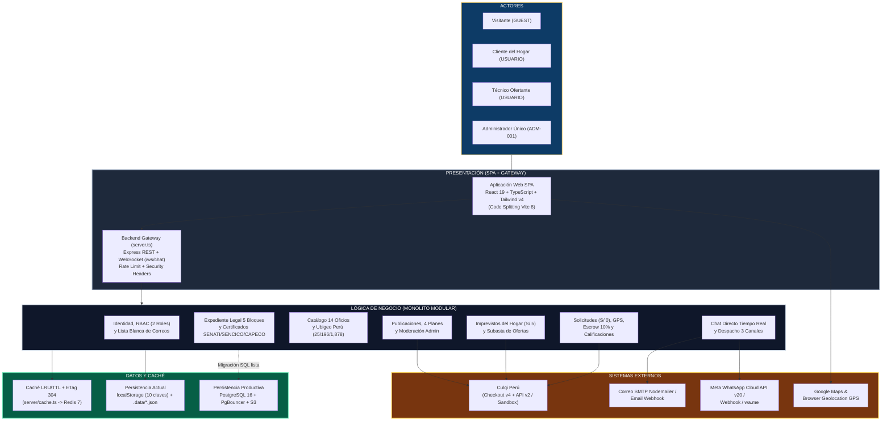

# Arquitectura Inicial del Sistema — TrabajaYa Perú (`conectaoficios`)

## 1. Diagrama General de Arquitectura

---

## 2. Descripción por Capa

- **Presentación (SPA React 19 + Gateway Express/WS):**
  - Interfaz responsive (`360px` a `1920px+`) con 24 componentes activos, navegación lateral adaptativa por rol (`Sidebar.tsx`, `Header.tsx`, `Footer.tsx`) y carga diferida (`React.lazy` + `manualChunks`) que difiere más de `382 kB` de vistas secundarias y administrativas.
  - El servidor `server.ts` expone API REST JSON (`/api/*`), WebSocket `/ws/chat`, cabeceras de seguridad, `X-Instance-Id`, Rate Limiting (`429`) y cierre ordenado (`SIGTERM`).
- **Lógica de Negocio (Monolito Modular):**
  - *Identidad y RBAC:* estrictamente 2 permisos (`USUARIO` y `ADMIN` único `ADM-001`), modalidades `CLIENTE_HOGAR` / `OFERTANTE_OFICIO` / `AMBOS` y lista blanca de correos.
  - *Expediente de Cumplimiento (5 Bloques):* identidad/domicilio/emergencia, RUC/SUNAT, antecedentes PNP/PJ/INPE, certificaciones/licencia MTC, contrato/normas/inventario firmado y galería pública de trabajos.
  - *Catálogo y Ubigeo:* 4 grupos, 14 oficios, 25 regiones, 196 provincias y 1,878 distritos, con prioridad comercial `PRO > DESTACADO > BASICO > PRUEBA`.
  - *Publicaciones y Moderación:* 4 planes (`PRUEBA_7`, `BASICO`, `DESTACADO`, `PRO`) con moderación previa del Administrador.
  - *Imprevistos del Hogar (`S/ 5.00`):* emergencias con fotos, cotizaciones competitivas y adjudicación automática a Orden Escrow.
  - *Solicitudes (`S/ 0.00`), Escrow y Calificaciones:* carrito aislado, GPS, máquina de estados Escrow de 6 estados, garantía del 10%, IGV 18%, resolución de garantías y reseñas 1–5★.
  - *Chat y Despacho 3 Canales:* mensajería WebSocket persistente e idempotente + entrega automática por Chat in-app, Correo y WhatsApp.
- **Datos y Caché:**
  - `server/cache.ts` implementa caché LRU/TTL con `ETag`/`304 Not Modified` e invalidación automática (`99.87%` hit ratio verificado), diseñado sobre el puerto `CacheStore` para conmutar a **Redis 7**.
  - En modo autónomo persiste en `localStorage` (`safeLocalStorageSet`) y `.data/*.json`; para producción cuenta con esquema completo **PostgreSQL 16** (`database/01_schema.sql`, `02_indexes_and_scalability.sql`, `03_seed_data.sql`) y **PgBouncer** (`infra/pgbouncer.ini`).
- **Sistemas Externos:**
  - **Culqi Perú** (`Checkout v4` + `Charges API v2` + `Sandbox` en `PEN`), **SMTP Nodemailer / Webhook**, **Meta WhatsApp Cloud API v20.0 / Webhook / `wa.me`** y **Google Maps / GPS**.
