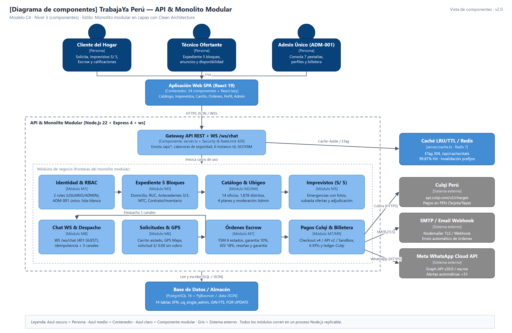
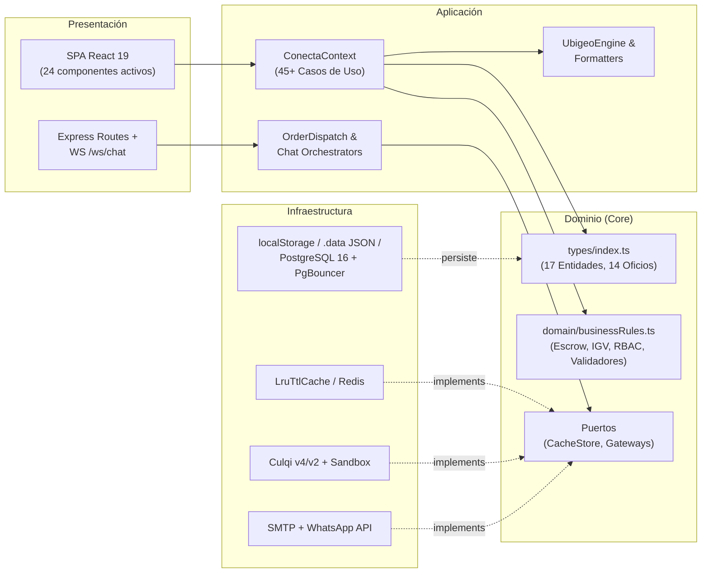

# Componentes Arquitectónicos — TrabajaYa Perú (`conectaoficios`)

La plataforma organiza sus componentes siguiendo **Clean Architecture**, estructurando el código en cuatro capas concéntricas con regla de dependencia estricta hacia el centro (**Dominio**):

## 1. Desglose por Capas y Archivos Reales

1. **Capa 1 — Dominio (Core Puro):**
   - **Entidades y Contratos de Tipos (`src/types/index.ts`):** `UsuarioRegistrado`, `Servicio`, `PlanPublicacion`, `PagoPublicacion`, `ResenaPublicacion`, `ImprevistoHogar`, `OfertaImprevisto`, `Orden`, `ItemCarrito`, `DatosVisita`, `CalificacionServicio`, `CertificadoTecnico`, `InventarioHerramientaItem`, `FotoTrabajoRealizado`, `ChatConversation`, `ChatMessage`, `CulqiPaymentReceipt`.
   - **Taxonomía y Constantes:** `GRUPOS_OFICIO` (4 grupos), `CATEGORIAS_OFICIO` (14 especialidades y `tareasComunes`).
   - **Reglas de Negocio Puras (`src/domain/businessRules.ts`):** `validarNumeroDocumento`, `esCorreoPermitidoEnLista`, `calcularTarifaServicio`, `calcularResumenCarrito`, `calcularDesgloseCulqiOrden`, `calcularBilletera`, `ordenarCatalogoAprobado`, `puedeVerMediosPrivados`, `esTransicionEscrowValida`.
   - **Puertos / Contratos:** `CacheStore` (`server/cache.ts`) y contratos de pasarela/despacho en `server.ts`.

2. **Capa 2 — Aplicación (Casos de Uso y Orquestación):**
   - **Orquestador de Casos de Uso (`src/context/ConectaContext.tsx`):** `registrarUsuario`, `iniciarSesion`, `actualizarMiPerfil`, `actualizarExpedienteCumplimiento`, `publicarAnuncioPagado`, `admitirPublicacion`, `rechazarPublicacion`, `publicarImprevisto`, `ofrecerServicioImprevisto`, `aceptarOfertaImprevisto`, `confirmarOrdenYEscrow`, `responderDisponibilidadOrden`, `darConformidadYLiberarFondos`, `pagarOrdenConCulqi`, `reportarObservacion`, `resolverGarantiaAdmin`, `calificarOrden`, `abrirChatDirecto`, `enviarMensajeChat`, `despacharOrdenAutomaticamente`.
   - **Servicios de Aplicación Backend (`server.ts`):** `upsertConversation`, `appendMessage` (idempotente), `normalizePhone` y orquestación del pipeline `dispatch-order`.
   - **Motor Geográfico y Formateadores (`src/data/peruUbigeo.ts`, `src/utils/whatsappSolicitud.ts`):** `inferUbicacionPeru` (6 niveles sobre 25/196/1,878), `getTrabajadoresUnicosOrden`, `buildOrdenMapsUrl`.

3. **Capa 3 — Infraestructura (Adaptadores y Persistencia):**
   - **Adaptador de Caché (`server/cache.ts`):** `LruTtlCache` O(1) con TTL, `ETag` SHA-1 e invalidación por prefijo (puerto listo para Redis 7).
   - **Adaptador Culqi Perú (`server.ts` + `CulqiCheckoutModal.tsx`):** integración con `https://api.culqi.com/v2/charges` y `https://checkout.culqi.com/js/v4` + modo Sandbox auditado.
   - **Adaptadores de Notificación (`server.ts`):** Nodemailer SMTP / `EMAIL_WEBHOOK_URL` y Meta WhatsApp Cloud API v20.0 / `WHATSAPP_WEBHOOK_URL`.
   - **Adaptadores de Persistencia:** `safeLocalStorageSet` + `mediaUpload.ts` en cliente, repositorios JSON en `.data/` (`chat-store.json`, `dispatch-log.json`, `culqi-transactions.json`) y scripts productivos **PostgreSQL 16** (`database/01_schema.sql`, `02_indexes_and_scalability.sql`, `03_seed_data.sql`) + `infra/pgbouncer.ini`.

4. **Capa 4 — Presentación (UI React 19 + Controladores HTTP/WS):**
   - **Shell y 10 Vistas (`src/App.tsx`, `src/components/`):** `Sidebar`, `Header`, `Footer`, `Toast`, `CatalogoView`, `ImprevistosView`, `PublicarAnuncioView`, `CarritoView`, `OrdenesView`, `PerfilView`, `AuthScreen`, `TecnicoAdminView` (7 pestañas), `PerfilesView`, `AdminInspectProfileView`.
   - **Componentes Reutilizables y Modales:** `ExpedienteCumplimientoSection` (5 bloques), `PeruUbigeoSelector`, `CulqiCheckoutModal`, `ServiceDetailModal`, `PublicProfileModal`, `OrdenConfirmadaModal`, `PedidoDetalleModal`, `WhatsAppChatModal`, `CallModal`, `ArchitectureModal`.
   - **Controladores Express y WebSocket (`server.ts`):** `/api/health`, `/api/cache/stats`, `/api/payments/culqi/*`, `/api/chat/*`, `/api/notifications/dispatch-order` y `/ws/chat`.

---

## 2. Diagrama de Componentes por Capa

