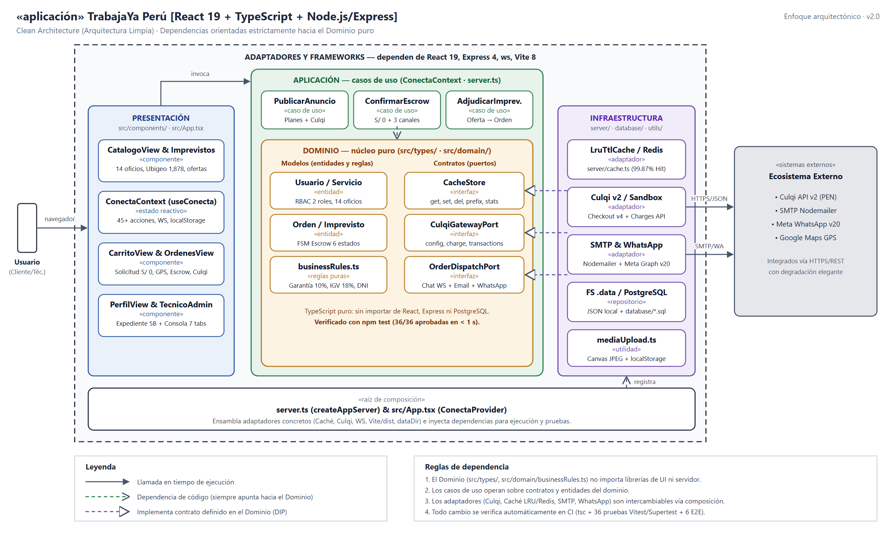
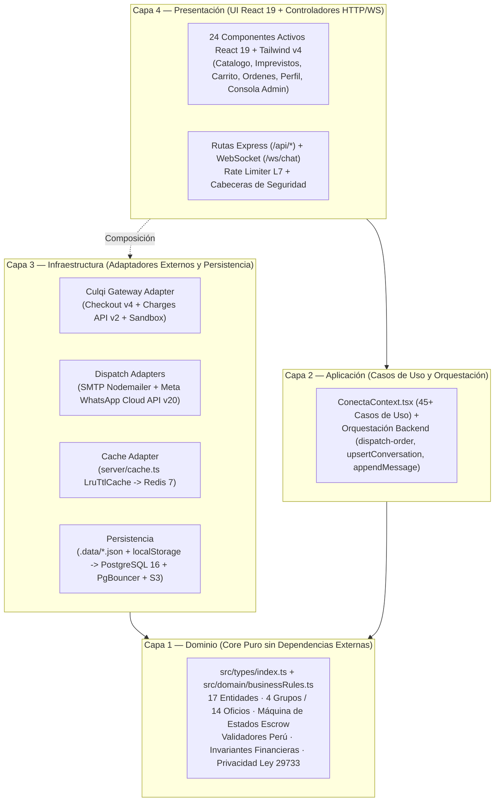

# Enfoque Arquitectónico — TrabajaYa Perú (`conectaoficios`)

Se utiliza el enfoque **Clean Architecture (Arquitectura Limpia)** complementado con **Spec-Driven Development (SDD)** para separar las reglas esenciales del negocio de servicios multioficios de los detalles de implementación tecnológica.

## 1. Resumen del Enfoque

| Elemento | Descripción aplicada a TrabajaYa Perú (`conectaoficios`) |
| :--- | :--- |
| **Patrón / Enfoque Arquitectónico** | **Clean Architecture** (Robert C. Martin) + **Domain Escrow Pattern** + **SDD** (`docs/sdd/`). |
| **Objetivo** | Aislar las invariantes de negocio (tarifa cliente = `precioBase + 10%` garantía, IGV 18%, máquina de estados Escrow de 6 estados, RBAC estricto de 2 permisos con Admin único, validación de DNI/CE/Pasaporte y privacidad Ley N.º 29733) dirigiendo todas las dependencias hacia el Dominio central. |
| **¿Qué problema resuelve?** | Evita el acoplamiento directo entre la interfaz **React 19 + Tailwind CSS v4**, los endpoints **Express/WebSocket (`server.ts`)**, la persistencia (`localStorage`/`.data/*.json` → **PostgreSQL 16 + Redis 7**) y las pasarelas externas (**Culqi Perú**, **SMTP Nodemailer**, **Meta WhatsApp Cloud API**). |
| **Capas Definidas** | **1. Dominio (Core)** · **2. Aplicación (Casos de Uso)** · **3. Infraestructura (Adaptadores)** · **4. Presentación (UI React 19 / HTTP-WS)**. |
| **Beneficios Comprobados** | • Las reglas de negocio y el motor de caché se prueban al 100% sin navegador (`npm test` → **36/36** aprobadas en `< 1 s`). • Permite conmutar entre **Culqi API v2** y **Sandbox**, o entre **`LruTtlCache`** y **Redis 7**, sin modificar reglas de negocio. • Facilita incorporar nuevos oficios, planes comerciales o integraciones IA (`@google/genai`) sin regresiones. |

---

## 2. Diagrama de Capas Concéntricas (Clean Architecture)

