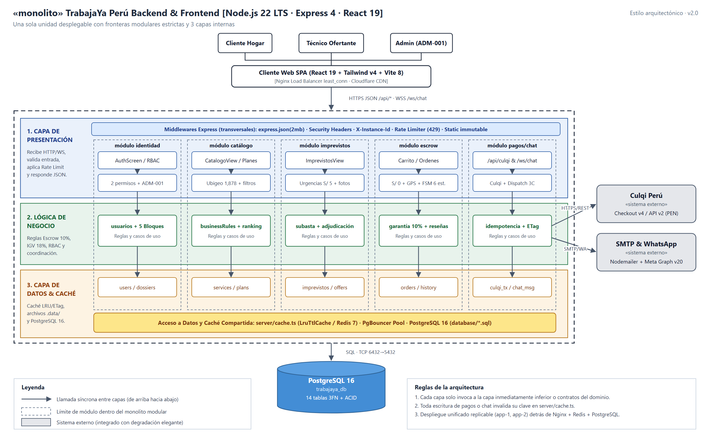
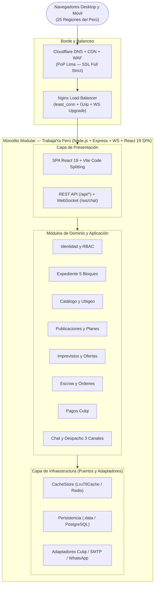

# Estilo Arquitectónico — TrabajaYa Perú (`conectaoficios`)

Se adopta el estilo arquitectónico: **Monolito Modular en Capas (Full-Stack Stateless-Ready)**.

## 1. Principios del Estilo Elegido

- **Monolito Modular:** Todos los módulos funcionales (`Identidad/RBAC`, `Cumplimiento/Acreditación`, `Catálogo/Ubigeo`, `Publicaciones/Planes`, `Imprevistos/Ofertas`, `Solicitudes/Escrow`, `Pagos Culqi`, `Chat WS/Notificaciones` y `Administración Nacional`) se empaquetan y despliegan en una única unidad (`server.ts` + SPA `dist/`), eliminando latencia entre servicios y transacciones distribuidas complejas, pero preservando fronteras claras de dominio.
- **Capas Concéntricas (Clean Architecture):** Internamente cada capacidad respeta la separación Presentación → Aplicación → Dominio ← Infraestructura, garantizando alta cohesión interna y bajo acoplamiento.
- **Preparado para Escalado Horizontal:** Aunque se despliega como monolito modular, el contenedor (`Dockerfile`) es replicable detrás de un balanceador de carga **Nginx (`least_conn`)** con estado externo compartido (**PostgreSQL 16 + PgBouncer + Redis 7**) como se configura en `docker-compose.yml` e `infra/nginx.conf`.

---

## 2. Diagrama del Estilo Monolito Modular en Capas

---

## 3. Comparativa frente a Microservicios

| Criterio | Monolito Modular (Elegido) | Microservicios Distribuidos |
| :--- | :--- | :--- |
| **Consistencia Escrow + Agenda** | Transacción ACID local directa (`FOR UPDATE`). | Requiere Sagas, compensaciones y consistencia eventual. |
| **Latencia entre módulos** | Llamadas en memoria (`< 1 ms`). | Serialización HTTP/gRPC en cada salto. |
| **Complejidad DevOps / CI-CD** | 1 repositorio, 1 `Dockerfile`, 1 pipeline (`ci.yml`/`cd.yml`). | Múltiples repos, service mesh, trazado distribuido. |
| **Ruta de evolución futura** | Cualquier módulo (ej. Pagos o Chat) puede extraerse gracias a las fronteras y puertos ya definidos. | Alto costo fijo desde el día 1. |
