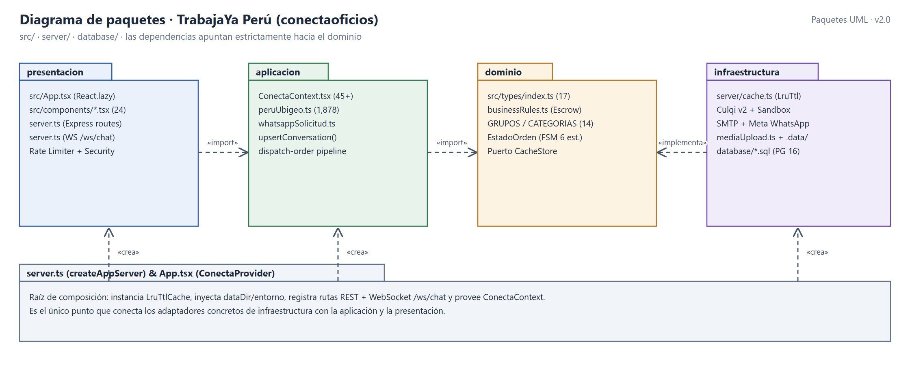
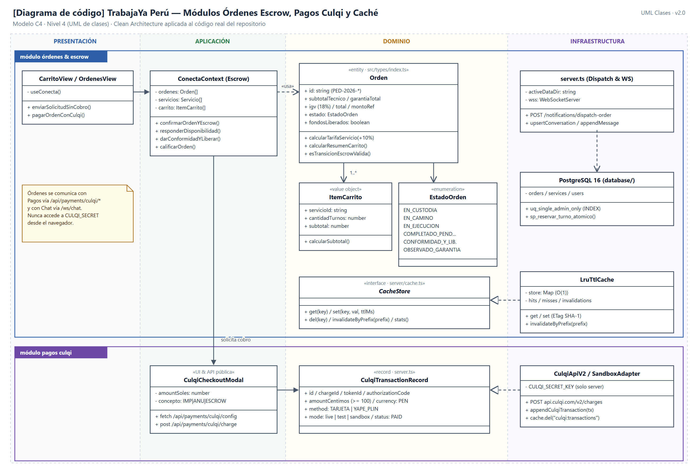
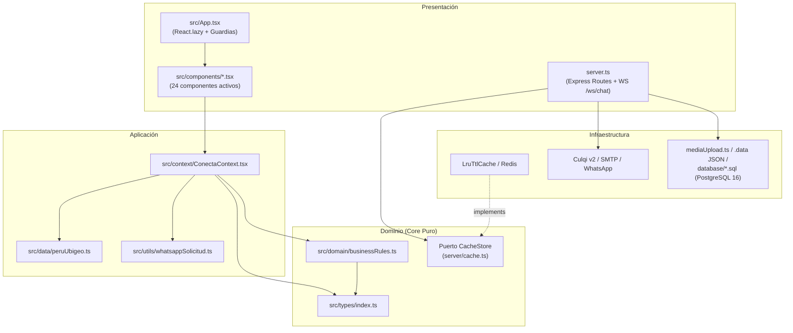
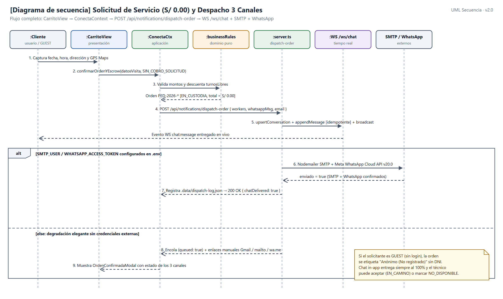
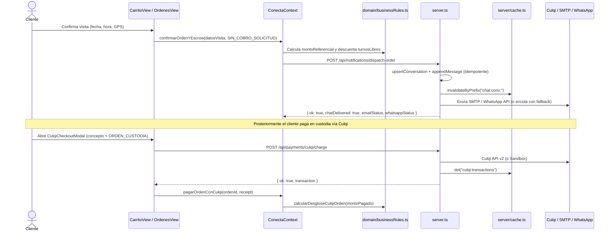

# Diseño Interno de Módulos — TrabajaYa Perú (`conectaoficios`)

> **Proyecto:** TrabajaYa Perú (`conectaoficios`) · **Stack:** React 19 + TypeScript + Node.js/Express + WebSocket + PostgreSQL 16  
> **Módulos de Referencia:** **Órdenes Escrow, Pagos Culqi, Despacho 3 Canales y Caché**  
> **Enfoque:** Clean Architecture dentro del Monolito Modular · **Nivel C4:** 4 – Código

---

## 1. Propósito

Documentar la organización interna real del código fuente y la estructura modular objetivo, asegurando:
1. Que las reglas de negocio puras (tarifa + 10% garantía, IGV 18%, máquina de estados Escrow, validaciones DNI/CE/Pasaporte, privacidad Ley N.º 29733 y ranking comercial) queden aisladas de React y Express.
2. Que la comunicación en tiempo real (`/ws/chat`), los cobros Culqi y la caché LRU/TTL sean testeables de forma aislada (`npm test`).
3. Trazabilidad exacta entre cada archivo del repositorio y su capa Clean Architecture.

---

## 2. Estructura Real de Carpetas y Módulos del Repositorio

```text
conectaoficios/
├── server.ts                                 # Fábrica createAppServer(), Express REST, WS /ws/chat, Graceful Shutdown
├── server/
│   └── cache.ts                              # Puerto CacheStore + LruTtlCache O(1) (TTL, LRU, ETag SHA-1)
├── src/
│   ├── types/
│   │   └── index.ts                          # 17 entidades de dominio, 4 grupos / 14 oficios, enums de estado
│   ├── domain/
│   │   └── businessRules.ts                  # Reglas puras: Escrow, IGV 18%, Culqi, Billetera, RBAC, FSM
│   ├── context/
│   │   └── ConectaContext.tsx                # 45+ casos de uso, hidratación 10 claves localStorage, sync WS
│   ├── data/
│   │   ├── initialData.ts                    # Semillas: 20 usuarios (1 ADMIN), 17 servicios, 5 cert., 4 órdenes, 3 imp.
│   │   └── peruUbigeo.ts                     # 25 regiones, 196 provincias, 1,878 distritos + inferUbicacionPeru
│   ├── utils/
│   │   ├── mediaUpload.ts                    # Compresión canvas JPEG, PDFs <= 1.8MB, videos <= 2.2MB, safeLocalStorageSet
│   │   └── whatsappSolicitud.ts              # Formateo +51, Google Maps, correo, WhatsApp, deduplicación técnicos
│   ├── components/                           # 26 archivos (24 activos: 10 vistas, Expediente 5 bloques, Culqi, 8 modales)
│   └── App.tsx                               # Shell + React.lazy() Code Splitting + Guardias de rol
├── database/
│   ├── 01_schema.sql                         # 14 tablas 3FN, ENUMs, columnas generadas, uq_single_admin_only
│   ├── 02_indexes_and_scalability.sql        # Índices parciales, GIN FTS, particiones, mv_billetera, FOR UPDATE
│   └── 03_seed_data.sql                      # Carga semilla idempotente
└── tests/
    ├── unit/                                 # 27 pruebas Vitest (businessRules, peruUbigeo, whatsappSolicitud, initialData, cache)
    ├── integration/                          # 9 pruebas Supertest + WS (server.api.test.ts)
    ├── e2e/                                  # 6 pruebas Chromium Playwright (trabajaya.e2e.spec.ts)
    └── load/                                 # 3 scripts k6 + run-load-benchmark.ts
```

### Mapa de Responsabilidades y Reglas de Dependencia

| Capa | Archivos Principales | Responsabilidad | Puede importar de | **No** debe importar de |
| :--- | :--- | :--- | :--- | :--- |
| **Dominio (Core)** | `src/types/index.ts`, `src/domain/businessRules.ts` | Tipos, invariantes Escrow/IGV, validadores peruanos, privacidad y transiciones FSM | Solo Dominio | React, Express, `fs`, `localStorage`, pasarelas |
| **Aplicación** | `src/context/ConectaContext.tsx`, `src/data/peruUbigeo.ts`, `src/utils/whatsappSolicitud.ts` | Orquestar flujos de negocio, sincronizar perfiles, calcular billetera y coordinar API/WS | Dominio y puertos | Implementaciones SQL directas o SDKs internos del servidor |
| **Infraestructura** | `server/cache.ts`, adaptadores en `server.ts`, `src/utils/mediaUpload.ts`, `database/*.sql` | Implementar `CacheStore`, Culqi API v2/Sandbox, Nodemailer, Meta WhatsApp API, FS JSON / PostgreSQL | Dominio + librerías técnicas | Componentes visuales React |
| **Presentación** | `src/App.tsx`, `src/components/*.tsx`, rutas Express/WS en `server.ts` | Renderizar vistas/modales, validar inputs de formulario y traducir HTTP/WS a casos de uso | Aplicación y Dominio | Detalles de almacenamiento físico |

---

## 3. Diagrama de Paquetes y Dependencias Internas







---

## 4. Flujo Interno de Ejecución: Solicitud (`S/ 0.00`) → Despacho 3 Canales → Pago Culqi Escrow





---

## 5. Código Real de Referencia de la Capa de Dominio (`src/domain/businessRules.ts`)

```ts
export const IGV_PERU_RATE = 0.18;
export const GARANTIA_ESCROW_RATE = 0.1;

export function calcularTarifaServicio(precioBase: number) {
  const base = Number.isFinite(precioBase) && precioBase > 0 ? round2(precioBase) : 50;
  const garantiaMonto = round2(base * GARANTIA_ESCROW_RATE);
  const tarifaCliente = round2(base + garantiaMonto);
  return { precioBase: base, garantiaMonto, tarifaCliente };
}

export function esTransicionEscrowValida(actual: EstadoOrden, siguiente: EstadoOrden): boolean {
  return TRANSICIONES_ESCROW_PERMITIDAS[actual].includes(siguiente);
}
```
