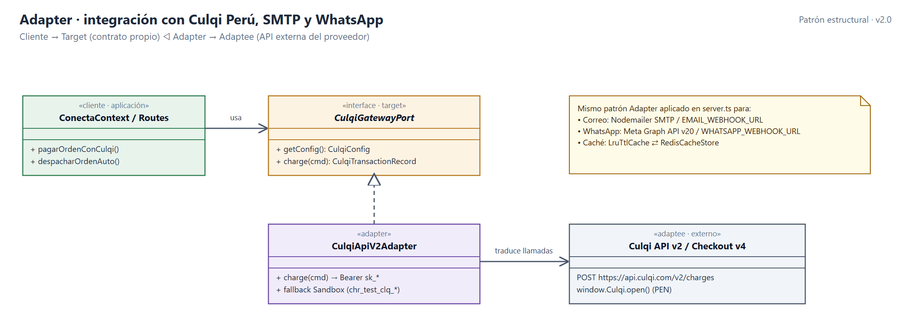
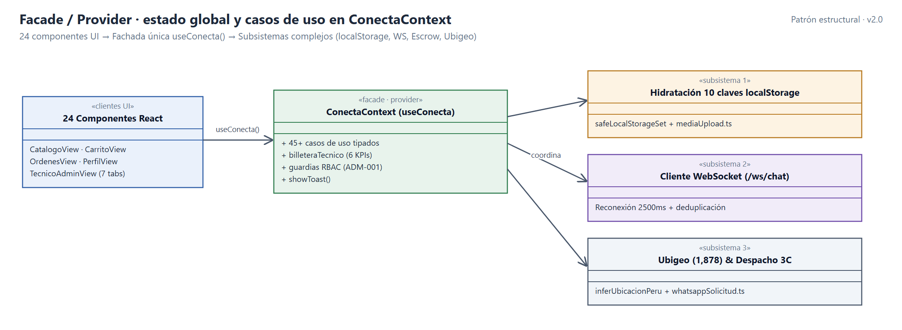
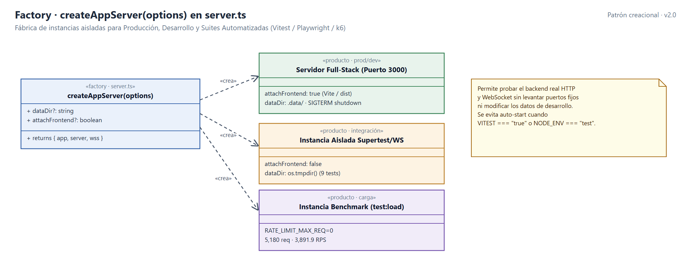
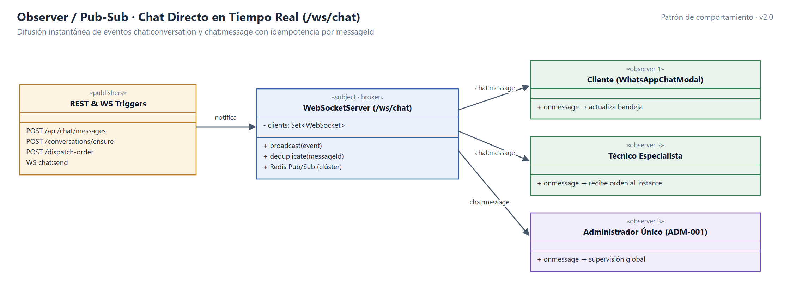
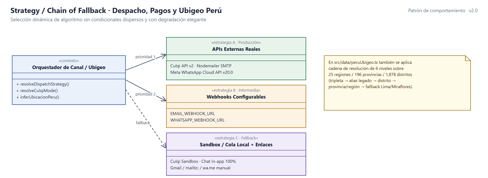

# Patrones de Diseño en TrabajaYa Perú (`conectaoficios`)

## 1. Objetivo

Documentar los patrones de diseño aplicados concretamente en el frontend y backend de **TrabajaYa Perú (`conectaoficios`)**, indicando dónde se emplean, qué problema resuelven y en qué archivos exactos se encuentran implementados.

## 2. Contexto

- **Estilo:** Monolito modular full-stack (React 19 + Node.js/Express + WebSocket).
- **Enfoque interno:** Clean Architecture (`Dominio`, `Aplicación`, `Infraestructura`, `Presentación`).

---

## 3. Catálogo de Patrones Aplicados en el Código Real

| Patrón | Categoría | Dónde se usa | Problema que resuelve | Implementación y archivos reales |
| :--- | :---: | :--- | :--- | :--- |
| **Adapter** | Estructural | Pagos (`Culqi`) y Despacho (`SMTP`, `WhatsApp`) | Aísla la lógica de negocio de APIs externas heterogéneas y permite alternar entre producción (`live`/`test`) y `sandbox`/cola. | `CulqiCheckoutModal.tsx` + `/api/payments/culqi/charge`, Nodemailer SMTP y Meta Cloud API en `server.ts`. |
| **Cache-Aside + Port/Adapter** | Rendimiento / Estructural | Consultas frecuentes del servidor (`culqi/config`, `culqi/transactions`, `chat/conversations`) | Acelera lecturas repetidas (`99.87%` Hit Ratio) con `ETag`/`304` e invalidación automática, listo para cambiar `LruTtlCache` por `Redis 7`. | `server/cache.ts` (`CacheStore`, `LruTtlCache`) + `server.ts`. |
| **Finite State Machine (State)** | Comportamiento | Ciclo de vida de Órdenes Escrow (6 estados), Publicaciones, Imprevistos y Verificación | Impide transiciones ilegales (ej. volver atrás tras `CONFORMIDAD_Y_LIBERADO`) y mantiene bitácora auditable (`historialEstados[]`). | `src/types/index.ts`, `esTransicionEscrowValida` en `src/domain/businessRules.ts`, `ConectaContext.tsx`. |
| **Chain of Responsibility / Fallback** | Comportamiento | Despacho multicanal, resolución geográfica y envío de chat | Garantiza continuidad operativa degradando ordenadamente: SMTP → Webhook → Cola; WA Cloud → Webhook → Cola; POST chat → WS `chat:send`; `inferUbicacionPeru` (6 niveles). | `server.ts`, `ConectaContext.tsx`, `src/data/peruUbigeo.ts`. |
| **Facade / Provider** | Estructural | Estado global y 45+ casos de uso del frontend | Oculta la complejidad de hidratación de 10 claves `localStorage`, WebSocket, cálculos Escrow y propagación de perfiles detrás del hook `useConecta()`. | `src/context/ConectaContext.tsx`. |
| **Observer / Pub-Sub** | Comportamiento | Chat Directo en tiempo real (`/ws/chat`) | Propaga inmediatamente `chat:conversation` y `chat:message` hacia todos los participantes conectados sin polling HTTP. | `WebSocketServer` (`broadcast`) en `server.ts` y listeners WS en `ConectaContext.tsx`. |
| **Idempotency Key** | Confiabilidad | Mensajería de chat y despacho automático de órdenes | Evita mensajes duplicados ante reintentos de red o reconexiones WS verificando `messageId` y claves `auto-order-${ordenId}-${phone}`. | `appendMessage()` en `server.ts` y `enviarMensajeChat` en `ConectaContext.tsx`. |
| **Repository / Factory** | Creacional / Estructural | Persistencia de servidor y arranque testeable | Encapsula lectura/escritura de `.data/*.json` (reemplazable por PostgreSQL) y permite instanciar servidores aislados con `createAppServer({ dataDir, attachFrontend })`. | `server.ts` (`loadConversations`, `appendCulqiTransaction`, `appendDispatchLog`, `createAppServer`) y `database/*.sql`. |
| **Proxy / Guard (RBAC)** | Estructural / Seguridad | Navegación por roles y privacidad Ley N.º 29733 | Bloquea vistas administrativas (`portal`, `perfiles`, `perfil-inspeccion`), archivos privados de terceros y chat anónimo (`401`). | `setActiveTab`, `puedeVerMediosPrivados`, `canViewIdentityMedia` (`PublicProfileModal`, `AdminInspectProfileView`) y `server.ts`. |

---

## 4. Diagramas Visuales de Patrones Aplicados

## 5. Beneficios Concretos Comprobados

- **Testabilidad sin infraestructura externa:** Gracias a Factory (`createAppServer`) y `CacheStore`, las **36 pruebas** (unitarias + integración) ejecutan en `< 1 s` sin ensuciar `.data/`.
- **Resiliencia ante fallas externas:** La cadena de fallback permite que la plataforma entregue el `100%` de solicitudes en Chat in-app aunque no haya credenciales SMTP/WhatsApp/Culqi.
- **Evolución segura:** Cambiar la caché a Redis o la persistencia a PostgreSQL (`database/01_schema.sql`) respeta los mismos contratos de entrada y salida ya verificados por pruebas automatizadas.
