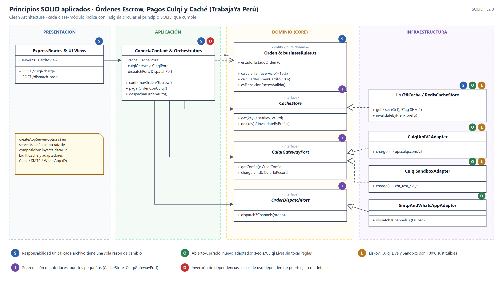
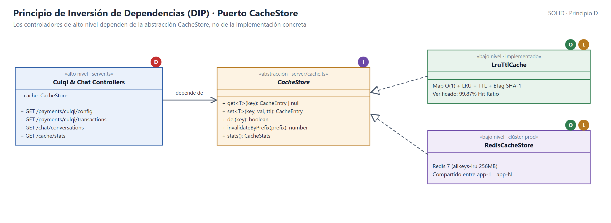
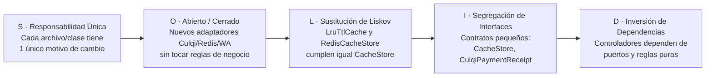

# Principios de Diseño (SOLID) en TrabajaYa Perú (`conectaoficios`)

## 1. Objetivo

Documentar cómo se aplican los principios **SOLID** en la plataforma **TrabajaYa Perú (`conectaoficios`)** con Clean Architecture, manteniendo desacopladas las reglas de negocio multioficios (Escrow, validaciones peruanas, caché, pagos Culqi y despacho en 3 canales) de las tecnologías de soporte.

## 2. Contexto

- **Estilo:** Monolito modular full-stack (`server.ts` + SPA React 19).
- **Enfoque interno:** Clean Architecture (`Dominio`, `Aplicación`, `Infraestructura`, `Presentación`).
- **Módulos de referencia:** **Órdenes Escrow, Pagos Culqi y Caché**, por integrar reglas financieras estrictas, pasarela externa, mensajería WebSocket/SMTP/WhatsApp y persistencia.

---

## 3. Aplicación de SOLID en TrabajaYa Perú

| Principio | Capa donde aplica | Cómo se cumple en el código real de TrabajaYa Perú | Archivos clave del repositorio |
| :--- | :--- | :--- | :--- |
| **S · Responsabilidad Única (SRP)** | Todas las capas | Cada módulo tiene una responsabilidad única: `businessRules.ts` calcula Escrow/IGV/validaciones; `peruUbigeo.ts` resuelve los 1,878 distritos; `mediaUpload.ts` comprime medios; `whatsappSolicitud.ts` construye mensajes/URLs; `cache.ts` gestiona LRU/TTL/ETag; `ExpedienteCumplimientoSection.tsx` renderiza el expediente de 5 bloques. | `src/domain/businessRules.ts`, `src/data/peruUbigeo.ts`, `src/utils/mediaUpload.ts`, `src/utils/whatsappSolicitud.ts`, `server/cache.ts` |
| **O · Abierto / Cerrado (OCP)** | Dominio e Infraestructura | Para añadir un nuevo oficio basta agregar una entrada en `CATEGORIAS_OFICIO`; para cambiar el despacho de correo a Resend o el pago Culqi de Sandbox a Live basta configurar adaptadores/credenciales sin alterar el flujo de `confirmarOrdenYEscrow`. | `src/types/index.ts`, `server.ts` (Culqi v2 / Sandbox, SMTP / Webhook, WA Cloud / Webhook) |
| **L · Sustitución de Liskov (LSP)** | Infraestructura | `LruTtlCache` y el adaptador productivo `RedisCacheStore` implementan exactamente el puerto `CacheStore` (`get`, `set`, `del`, `invalidateByPrefix`, `stats`); de igual forma `CulqiCheckoutModal` entrega siempre un `CulqiPaymentReceipt` idéntico tanto en `live`/`test` como en `sandbox`. | `server/cache.ts`, `src/components/CulqiCheckoutModal.tsx`, `src/types/index.ts` |
| **I · Segregación de Interfaces (ISP)** | Dominio y UI | Los contratos están segregados por caso de uso (`NuevoAnuncioPayload`, `ExpedienteCumplimientoPayload`, `NuevoImprevistoPayload`, `NuevaOfertaImprevistoPayload`, `CacheStore`) evitando interfaces monolíticas con campos obligatorios innecesarios. | `src/context/ConectaContext.tsx`, `src/types/index.ts`, `server/cache.ts` |
| **D · Inversión de Dependencias (DIP)** | Aplicación e Infraestructura | `server.ts` inyecta `dataDir` y `attachFrontend` vía `createAppServer(options)` y opera sobre la abstracción `CacheStore`, permitiendo ejecutar `9/9` pruebas de integración sobre carpetas temporales aisladas sin tocar `.data/` ni depender de Vite. | `server.ts`, `server/cache.ts`, `tests/integration/server.api.test.ts` |

---

## 4. Escenarios Comparativos: Con y Sin SOLID

| Situación real del negocio | Sin SOLID | Con SOLID en TrabajaYa Perú |
| :--- | :--- | :--- |
| Se cambia la caché local por **Redis 7** en clúster | Se reescriben todos los endpoints `/api/payments/*` y `/api/chat/*`. | Se conecta un adaptador `RedisCacheStore` al puerto `CacheStore` manteniendo intactas todas las rutas de `server.ts`. |
| Se pasa de **Culqi Sandbox** a **Culqi Producción (`pk_live_`/`sk_live_`)** | Se modifica la lógica de anuncios, imprevistos y órdenes en varios componentes. | Se cargan las llaves en `.env`; `CulqiCheckoutModal` y `/api/payments/culqi/charge` conmutan automáticamente devolviendo el mismo `CulqiPaymentReceipt`. |
| Se ejecutan pruebas de Escrow, Ubigeo y Caché en CI/CD | Es obligatorio levantar PostgreSQL, Redis y realizar cargos reales con tarjeta. | `npm test` valida **36 pruebas** en `< 1 s` sobre funciones puras y directorios temporales aislados. |
| Se modifica la tasa de garantía (10%) o IGV (18%) | Hay que rastrear fórmulas dispersas en múltiples pantallas y SQL. | Se centraliza en `GARANTIA_ESCROW_RATE` / `IGV_PERU_RATE` (`src/domain/businessRules.ts`) y en las columnas generadas de `database/01_schema.sql`. |
