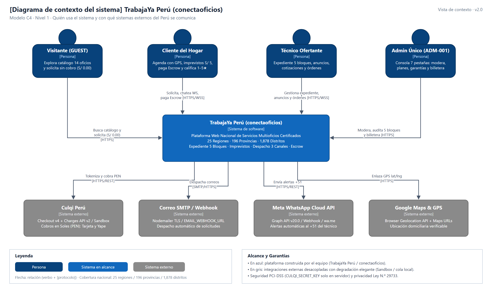
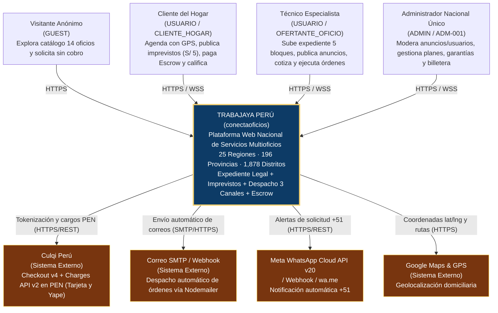

# Nivel 1 · Diagrama de Contexto del Sistema (C4)

> **Proyecto:** TrabajaYa Perú (`conectaoficios`) — Plataforma Web Nacional de Servicios Multioficios Certificados con Custodia Fiduciaria (Escrow)  
> **Modelo:** C4 · Nivel 1 de 4 · **Versión:** 2.0 (Alineado al proyecto real)

---

## 1. Objetivo

Mostrar a **TrabajaYa Perú (`conectaoficios`)** como una única caja negra de alto nivel: qué personas interactúan con ella y con qué sistemas externos se integra en el ecosistema peruano.

| Aspecto | Descripción |
| :--- | :--- |
| Pregunta que responde | ¿Qué es TrabajaYa Perú, quiénes lo usan y con qué servicios externos se integra? |
| Audiencia | Docentes evaluadores, stakeholders, arquitectos, desarrolladores y operaciones |
| Qué **no** muestra | Contenedores internos, motores de BD, librerías ni detalles de código |
| Siguiente nivel | `Nivel2-DiagramadeContenedores.md` |

---

## 2. Diagrama de Contexto (C4 Nivel 1)

---

## 3. Personas (Actores Humanos)

| Persona | Permiso / Rol | Qué hace en el sistema |
| :--- | :--- | :--- |
| **Visitante Anónimo** | `GUEST` | Explora catálogo `APROBADO`, filtra por 14 oficios y Ubigeo, ve perfiles públicos (sin archivos privados) y envía solicitudes `S/ 0.00` etiquetadas como `Anónimo (No registrado)`. |
| **Cliente del Hogar** | `USUARIO` (`CLIENTE_HOGAR` / `AMBOS`) | Agenda con GPS, publica imprevistos (`S/ 5.00`), adjudica cotizaciones, chatea en tiempo real, paga órdenes Escrow en Culqi, otorga conformidad o reporta garantía, imprime comprobantes y califica 1–5★. |
| **Técnico Especialista** | `USUARIO` (`OFERTANTE_OFICIO` / `AMBOS`) | Completa el Expediente Legal de 5 bloques, sube galería `fotosTrabajos`, publica anuncios (`PRUEBA_7`, `BASICO`, `DESTACADO`, `PRO`), cotiza imprevistos, acepta/rechaza disponibilidad y ejecuta servicios. |
| **Administrador Nacional Único** | `ADMIN` (`ADM-001`) | Opera la Consola Admin de 7 pestañas, audita documentos privados en `AdminInspectProfileView`, gestiona la lista blanca de correos, edita planes/promos, resuelve garantías y supervisa la billetera y ledger Culqi. |

---

## 4. Sistemas y Relaciones

| Origen | Destino | Descripción | Protocolo |
| :--- | :--- | :--- | :--- |
| Usuarios / Admin | **TrabajaYa Perú** | Operación web SPA y mensajería directa en tiempo real | `HTTPS` / `WSS` |
| **TrabajaYa Perú** | **Culqi Perú** | Tokenización Checkout v4 y ejecución de cobros en Soles (`PEN`) | `HTTPS / REST` |
| **TrabajaYa Perú** | **SMTP / Email Webhook** | Envío automático de solicitudes de encargo al especialista | `SMTP TLS` / `HTTPS` |
| **TrabajaYa Perú** | **Meta WhatsApp Cloud API** | Envío automático de alertas `+51` + enlace directo `wa.me` | `HTTPS / REST` |
| **TrabajaYa Perú** | **Google Maps / GPS** | Captura de coordenadas `lat/lng` y enlaces de ubicación del domicilio | Browser API / `HTTPS` |

---

## 5. Decisiones y Supuestos de Contexto

1. **Cumplimiento PCI-DSS:** El sistema **nunca almacena números completos ni códigos CVV de tarjetas**; toda tokenización se delega a Culqi Checkout v4 y `CULQI_SECRET_KEY` reside exclusivamente en servidor.
2. **Privacidad Ley N.º 29733:** Los documentos del Expediente de 5 Bloques (DNI, domicilio, antecedentes PNP/PJ/INPE, Ficha RUC) son visibles únicamente para el titular autenticado y el Administrador Único (`ADM-001`).
3. **Degradación Elegante:** Si Culqi, SMTP o WhatsApp Cloud API carecen de llaves en `.env`, el sistema continúa operando mediante Sandbox, cola auditada y enlaces manuales (`Gmail`, `mailto:`, `wa.me`).
