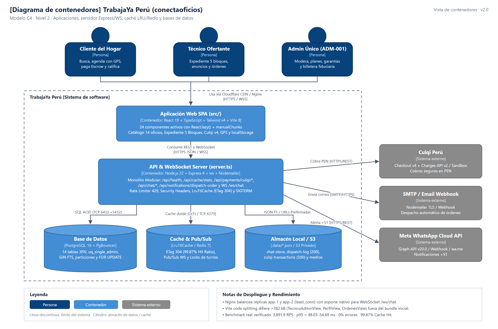
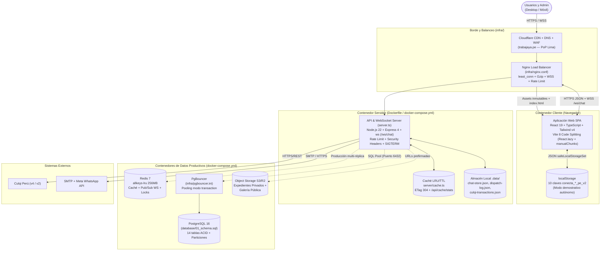

# Nivel 2 · Diagrama de Contenedores (C4)

> **Proyecto:** TrabajaYa Perú (`conectaoficios`)  
> **Modelo:** C4 · Nivel 2 de 4 · **Versión:** 2.0 (Contenedores implementados + Topología productiva escalable)

---

## 1. Objetivo

Abrir la caja **TrabajaYa Perú** del Nivel 1 para detallar los **contenedores ejecutables y de almacenamiento**, su tecnología real y los protocolos de comunicación entre ellos.

| Aspecto | Descripción |
| :--- | :--- |
| Pregunta que responde | ¿Qué aplicaciones, servidores, cachés y bases de datos componen el sistema y cómo se comunican? |
| Nivel anterior | `Nivel1-DiagramadeContextodelSistema.md` |
| Siguiente nivel | `Nivel3-Diagrama-de-Componentes.md` |

---

## 2. Diagrama de Contenedores (C4 Nivel 2 — Implementado y Escalable)

---

## 3. Detalle de Contenedores

| Contenedor | Tecnología | Responsabilidad Principal | Estado |
| :--- | :--- | :--- | :---: |
| **SPA Web (`src/`)** | React 19 + TypeScript + Tailwind v4 + Vite 8 | Interfaz responsive de 10 vistas y 8 modales con `React.lazy` (`> 382 kB` diferidos) y `manualChunks`. | Implementado |
| **Servidor Backend (`server.ts`)** | Node.js ESM + Express 4 + `ws` + Nodemailer | Expone REST API (`/api/*`), WebSocket (`/ws/chat`), Rate Limiter, Graceful Shutdown y sirve la SPA. | Implementado |
| **Motor de Caché (`server/cache.ts`)** | `LruTtlCache` O(1) (puerto `CacheStore`) | Cache-Aside con TTL (`60s`/`30s`/`15s`), `ETag`/`304 Not Modified`, invalidación automática y `/api/cache/stats`. | Implementado (`99.87%` Hit) |
| **Almacén Local (`.data/` + `localStorage`)** | JSON + Web Storage (`safeLocalStorageSet`) | Persistencia autónoma para demostración local sin dependencias externas (10 claves navegador + 3 archivos servidor). | Implementado |
| **Load Balancer (`infra/nginx.conf`)** | Nginx 1.27 Alpine | Balanceo `least_conn` sobre `app-1`/`app-2`, compresión Gzip, WebSocket Upgrade y doble Rate Limit L7. | Configurado (`docker-compose.yml`) |
| **Base de Datos (`database/*.sql`)** | PostgreSQL 16 + PgBouncer (`infra/pgbouncer.ini`) | 14 tablas 3FN, `uq_single_admin_only`, índices GIN/parciales, particionamiento mensual, vista billetera y `FOR UPDATE`. | Scripts SQL listos |
| **Caché Distribuida (`docker-compose.yml`)** | Redis 7 Alpine | Caché compartida multi-réplica, Pub/Sub para `/ws/chat` y candados distribuidos de turnos. | Aprovisionado en Compose |
| **CDN / DNS / WAF (`infra/dns-zone-*`)** | Cloudflare (PoP Lima) | Resolución `trabajaya.pe`, SPF/DKIM/DMARC/CAA, TLS 1.3 Full Strict, WAF OWASP y caché inmutable de `/assets/*`. | Especificado y configurado |

---

## 4. Relaciones y Protocolos

| Origen | Destino | Protocolo / Puerto | Propósito |
| :--- | :--- | :--- | :--- |
| Navegador SPA | Nginx / `server.ts` | `HTTPS (443)` / `HTTP (3000)` | Carga SPA y consumo de `/api/*` |
| Navegador SPA | `server.ts` (`/ws/chat`) | `WSS (443)` / `WS (3000)` | Mensajería de chat directo en tiempo real |
| `server.ts` | Culqi API v2 | `HTTPS (443)` Bearer `sk_*` | Ejecución segura de cargos en `PEN` |
| `server.ts` | SMTP / Meta Graph API v20 | `SMTP (587/465)` / `HTTPS` | Despacho automático de solicitudes |
| `server.ts` | PgBouncer → PostgreSQL 16 | `TCP (6432 → 5432)` | Transacciones ACID Escrow y consultas |
| `server.ts` | Redis 7 | `TCP (6379)` | Caché distribuida, Pub/Sub y locks |
