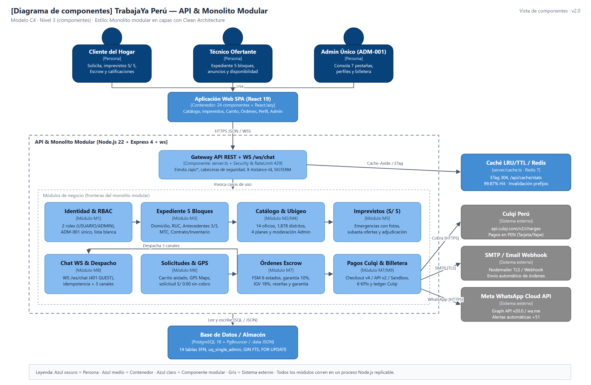
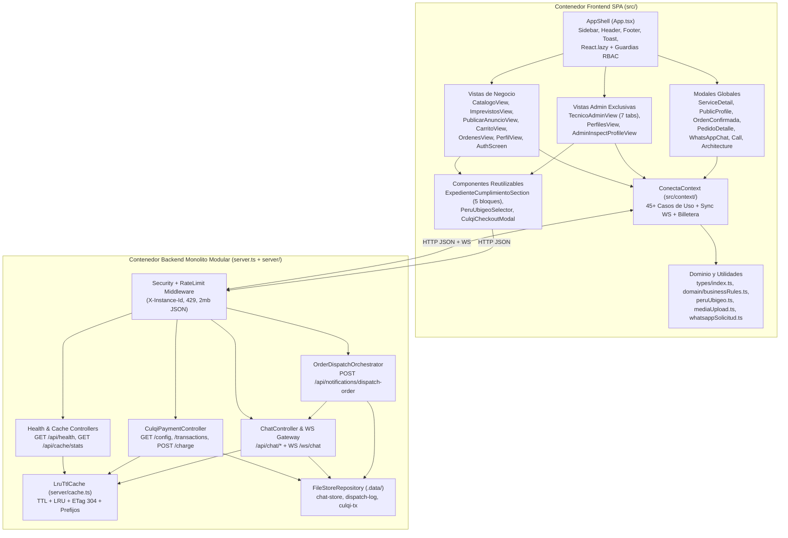

# Nivel 3 · Diagrama de Componentes (C4)

> **Proyecto:** TrabajaYa Perú (`conectaoficios`) · **Contenedores Detallados:** Backend (`server.ts` + `server/`) y Frontend (`src/`)  
> **Modelo:** C4 · Nivel 3 de 4 · **Versión:** 2.0

---

## 1. Objetivo

Abrir los contenedores **Backend (`server.ts`)** y **SPA Frontend (`src/`)** del Nivel 2 para mostrar sus **componentes internos**, responsabilidades, carpetas exactas y cómo interactúan con la caché, persistencia y sistemas externos.

| Aspecto | Descripción |
| :--- | :--- |
| Pregunta que responde | ¿En qué componentes internos se divide el monolito modular y cómo colaboran entre sí? |
| Nivel anterior | `Nivel2-DiagramadeContenedores.md` |
| Siguiente nivel | `Nivel4-DiagramadeCodigo.md` |

---

## 2. Diagrama de Componentes Internos (C4 Nivel 3)

---

## 3. Catálogo de Componentes del Sistema

| Componente | Contenedor | Responsabilidad y Funcionalidades | Ubicación Exacta |
| :--- | :---: | :--- | :--- |
| **Security & RateLimit Middleware** | Backend | Desactiva `x-powered-by`, inyecta cabeceras de seguridad y `X-Instance-Id`, y limita tráfico API (`429`). | `server.ts` |
| **Health & Cache Observability** | Backend | Monitoreo `/api/health` y estadísticas en vivo `/api/cache/stats` (`hits`, `misses`, `hitRatio`, `invalidations`). | `server.ts` + `server/cache.ts` |
| **CulqiPaymentController** | Backend | Expone `publicKey`/modo (cache 60s + `ETag`), lista transacciones (cache 30s) y ejecuta cargos reales API v2 o Sandbox invalidando caché. | `server.ts` |
| **ChatController & WebSocket Gateway** | Backend | Aislamiento RBAC por rol, bloqueo `401` a `GUEST`, idempotencia por `messageId`, caché 15s e invalidación + broadcast `/ws/chat`. | `server.ts` |
| **OrderDispatchOrchestrator** | Backend | Orquesta el envío en 3 canales (Chat in-app + SMTP/Webhook + Meta WhatsApp API/Webhook) y audita `.data/dispatch-log.json`. | `server.ts` |
| **LruTtlCache (`CacheStore`)** | Backend | Caché O(1) con expulsión LRU, expiración TTL, `ETag` SHA-1 e invalidación por prefijo (puerto listo para Redis 7). | `server/cache.ts` |
| **Domain Core (`businessRules` + `types`)** | Frontend / Compartido | 17 entidades, 4 grupos / 14 oficios, cálculos Escrow/IGV/Billetera, validadores DNI/CE/Pasaporte, privacidad y FSM. | `src/types/index.ts`, `src/domain/businessRules.ts` |
| **ConectaContext (Aplicación)** | Frontend | Gestiona 45+ casos de uso, hidratación de 10 claves `localStorage`, protección `ADM-001`, propagación de perfiles y cliente WS. | `src/context/ConectaContext.tsx` |
| **UbigeoEngine & Utilidades** | Frontend | 25 regiones / 196 provincias / 1,878 distritos, `inferUbicacionPeru` (6 niveles), compresión multimedia y enlaces Maps/WhatsApp/Gmail. | `src/data/peruUbigeo.ts`, `src/utils/*` |
| **Shell, Vistas y Modales (24 activos)** | Frontend | Interfaz responsive con `React.lazy`, Expediente Legal de 5 bloques, Consola Admin de 7 pestañas y Culqi Checkout v4. | `src/App.tsx`, `src/components/*` |

---

## 4. Reglas del Monolito Modular

1. Todas las rutas de API y WebSocket comparten un único servidor (`createAppServer`) desplegable en contenedores stateless.
2. Ningún componente UI accede directamente a `CULQI_SECRET_KEY` ni ejecuta cobros sin pasar por `POST /api/payments/culqi/charge`.
3. Toda escritura en pagos o mensajería invalida inmediatamente su clave o prefijo en `CacheStore` para evitar lecturas obsoletas.
4. Las integraciones externas (Culqi, SMTP, WhatsApp) se encapsulan con degradación elegante documentada.
5. Toda regla de negocio crítica se verifica automáticamente en `tests/unit/`, `tests/integration/` y `tests/e2e/`.
