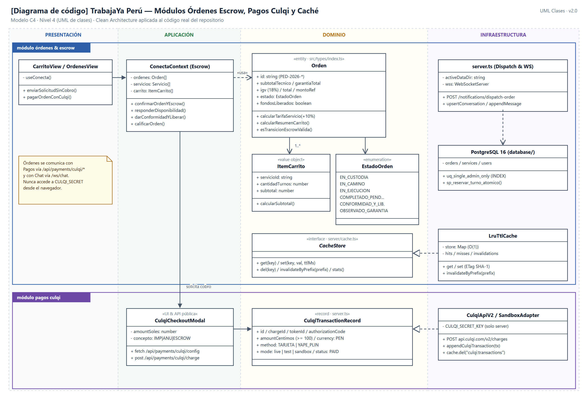
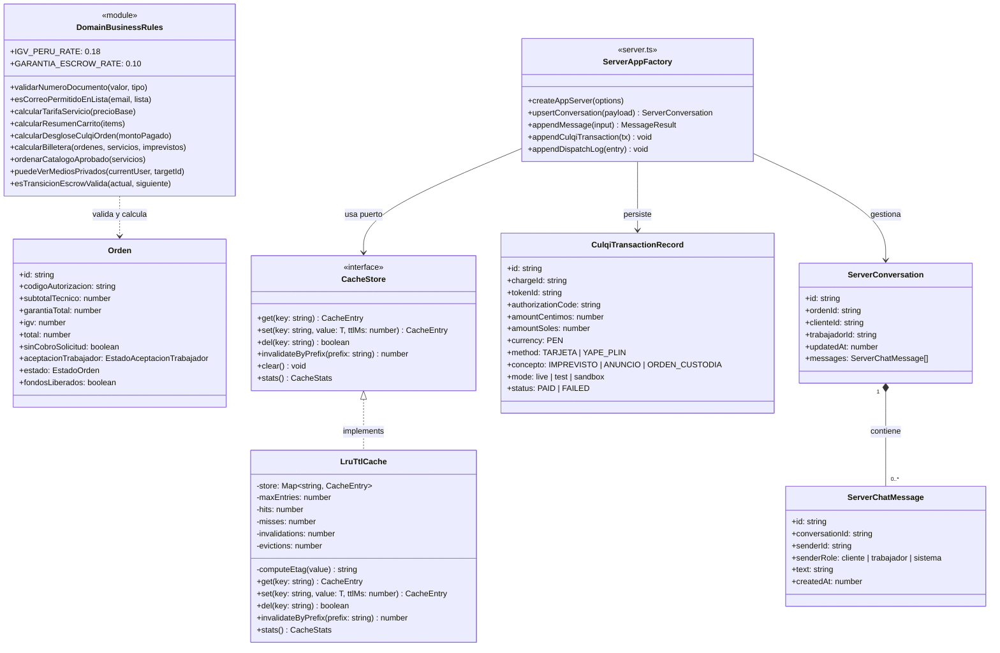
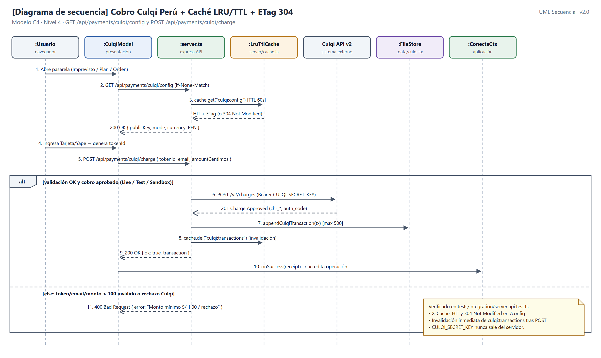
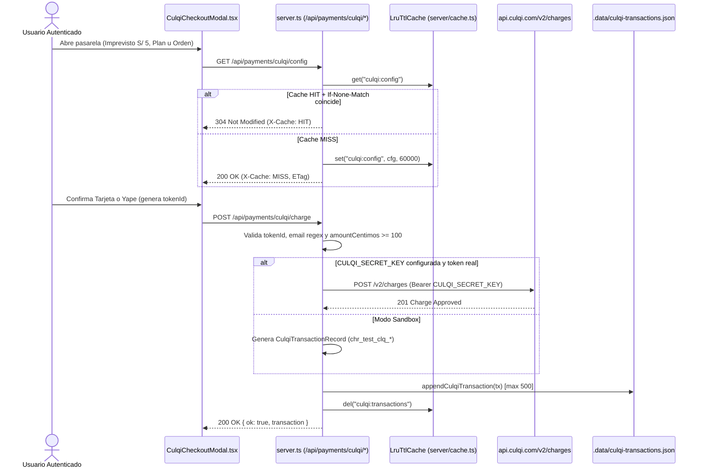

# Nivel 4 · Diagrama de Código (C4)

> **Proyecto:** TrabajaYa Perú (`conectaoficios`) · **Módulos Detallados:** Dominio Escrow, Pagos Culqi, Caché LRU/TTL y Despacho Multicanal  
> **Modelo:** C4 · Nivel 4 de 4 · **Notación:** UML (`classDiagram` y `sequenceDiagram`) · **Versión:** 2.0

---

## 1. Objetivo

Mostrar el diseño a nivel de **clases, interfaces, funciones puras y secuencias reales del código fuente** en los módulos más críticos de **TrabajaYa Perú**: reglas de dominio (`src/domain/businessRules.ts`), caché (`server/cache.ts`) y orquestación HTTP/WebSocket (`server.ts`).

| Aspecto | Descripción |
| :--- | :--- |
| Pregunta que responde | ¿Qué interfaces, clases, funciones y flujos exactos existen en el código fuente? |
| Nivel anterior | `Nivel3-Diagrama-de-Componentes.md` |
| Verificación automatizada | `tests/unit/*.test.ts` (27 tests) + `tests/integration/server.api.test.ts` (9 tests) |

---

## 2. Diagrama de Clases e Interfaces Reales (UML `classDiagram`)

---

## 3. Inventario de Clases y Módulos Clave en el Código

| Elemento | Archivo | Capa | Responsabilidad Exacta |
| :--- | :--- | :--- | :--- |
| `DomainBusinessRules` | `src/domain/businessRules.ts` | Dominio | Funciones puras de Escrow (+10%), IGV (18%), desglose Culqi, Billetera, validadores DNI/CE/Pasaporte, privacidad Ley N.º 29733 y FSM de 6 estados. |
| `UsuarioRegistrado`, `Servicio`, `ImprevistoHogar`, `Orden` | `src/types/index.ts` | Dominio | Entidades tipadas + taxonomía `GRUPOS_OFICIO` (4) y `CATEGORIAS_OFICIO` (14). |
| `CacheStore` / `LruTtlCache` | `server/cache.ts` | Dominio / Infraestructura | Puerto de caché y motor O(1) con LRU, TTL, `ETag` SHA-1 e invalidación por prefijo. |
| `createAppServer(options)` | `server.ts` | Composición / Presentación | Instancia Express, Rate Limiter, cabeceras de seguridad, `LruTtlCache`, rutas `/api/*`, `WebSocketServer /ws/chat` y host SPA opcional. |
| `ConectaProvider` / `useConecta()` | `src/context/ConectaContext.tsx` | Aplicación | Orquesta los 45+ casos de uso de UI, sincronización `localStorage`, reconexión WebSocket y métricas reactivas. |
| `CulqiCheckoutModal` | `src/components/CulqiCheckoutModal.tsx` | Presentación / Adaptador | Carga dinámica de `https://checkout.culqi.com/js/v4` + formulario Sandbox Tarjeta/Yape y ejecución contra `POST /api/payments/culqi/charge`. |
| `sp_reservar_turno_atomico` | `database/02_indexes_and_scalability.sql` | Infraestructura SQL | Procedimiento PL/pgSQL con `SELECT ... FOR UPDATE` para evitar doble reserva simultánea de `turnos_libres`. |

---

## 4. Diagrama de Secuencia a Nivel de Código: Cobro Culqi + Invalidación de Caché + ETag 304

---

## 5. Patrones y Principios Visibles en este Nivel

- **Port & Adapter + LSP:** `LruTtlCache` implementa `CacheStore`, dejando lista la sustitución por `RedisCacheStore` sin alterar los controladores de `server.ts`.
- **Single Responsibility + Pure Domain:** `src/domain/businessRules.ts` concentra las fórmulas financieras y validadores peruanos sin depender de React ni Express, permitiendo **27 pruebas unitarias en milisegundos**.
- **Idempotency & Graceful Degradation:** `appendMessage` valida duplicados por `messageId` y `dispatch-order` asegura entrega en Chat in-app aunque SMTP o WhatsApp API estén sin configurar.
