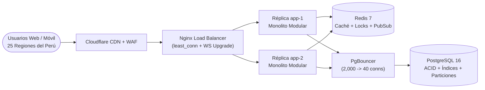
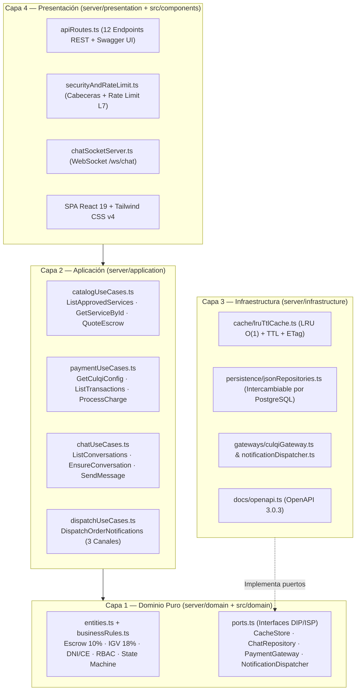
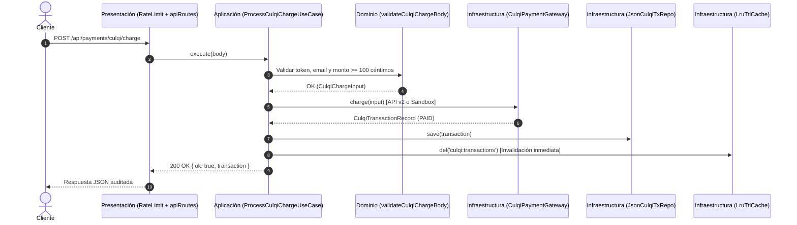
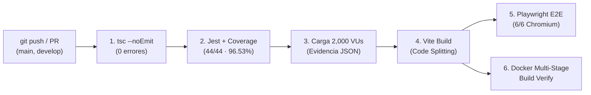
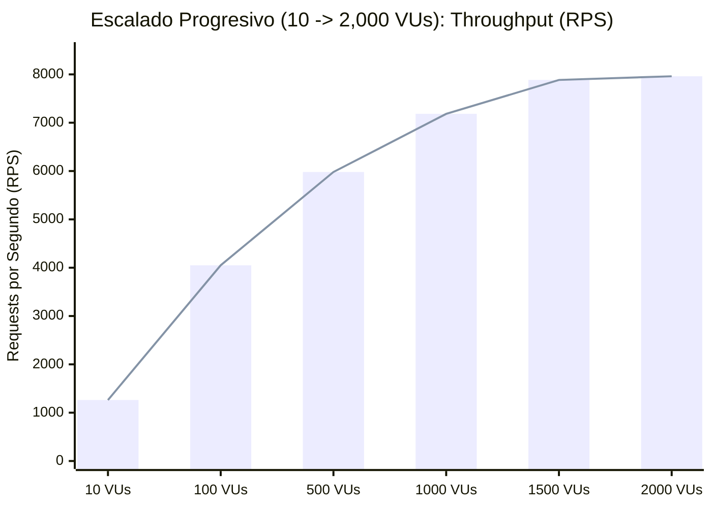

# 🎓 Guía Visual de Exposición — SPRINT 2: Implementación y Validación de la Arquitectura

  <strong>TrabajaYa Perú (<code>conectaoficios</code>)</strong> 
  <em>Monolito Modular en Capas · Clean Architecture · OpenAPI 3.0 / Swagger · Jest 96.53% Cobertura · Carga Progresiva 2,000 VUs</em>

  
  
  
  
  
  

> [!IMPORTANT]
> **Objetivo del Sprint 2:** Demostrar que la arquitectura diseñada en el Sprint 1 fue llevada fielmente a código funcional, documentada con OpenAPI/Swagger, protegida con pruebas automatizadas + cobertura en Jest y CI/CD, y validada cuantitativamente frente a los escenarios de atributos de calidad hasta **2,000 usuarios virtuales concurrentes**.

---

## 📑 Índice Rápido para la Exposición

1. [Resumen Ejecutivo del Proyecto y Stack Tecnológico](#1-resumen-ejecutivo-del-proyecto)
2. [Estilo Arquitectónico — Monolito Modular en Capas](#2-estilo-arquitectónico--monolito-modular-en-capas)
3. [Patrón Arquitectónico — Clean Architecture en Código Real](#3-patrón-arquitectónico--clean-architecture-en-código-real)
4. [Especificaciones SDD, Criterios de Aceptación y Tareas Técnicas](#4-especificaciones-sdd-criterios-de-aceptación-y-tareas-técnicas)
5. [Endpoints REST + Documentación OpenAPI 3.0 / Swagger UI](#5-endpoints-rest--documentación-openapi-30--swagger-ui)
6. [Análisis de Base de Datos y Estrategia de Caché](#6-análisis-de-base-de-datos-y-estrategia-de-caché)
7. [Principios SOLID y Patrones de Diseño Aplicados](#7-principios-solid-y-patrones-de-diseño-aplicados)
8. [Pruebas Automatizadas con Jest, Cobertura y CI/CD (GitHub Actions)](#8-pruebas-automatizadas-con-jest-cobertura-y-cicd-github-actions)
9. [Validación de Atributos de Calidad — k6 (2,000 VUs) y Postman](#9-validación-de-atributos-de-calidad--k6-2000-vus-y-postman)
10. [Guion de Demostración en Vivo (4 Minutos)](#10-guion-de-demostración-en-vivo-4-minutos)
11. [Banco de Preguntas del Docente y Respuestas Clave](#11-banco-de-preguntas-del-docente-y-respuestas-clave)

---

## 1. Resumen Ejecutivo del Proyecto

**TrabajaYa Perú** es una plataforma web nacional de servicios multioficios certificados (**25 regiones, 196 provincias y 1,878 distritos del Perú**, 4 grupos y 14 especialidades) que resuelve la informalidad y desconfianza mediante:
- **Custodia Fiduciaria (Escrow):** Tarifa Cliente = `Precio Base + 10% Garantía` + `18% IGV`, con máquina de estados de 6 fases.
- **Expediente de Cumplimiento Legal de 5 Bloques** (Ley N.º 29733): identidad, RUC/SUNAT, antecedentes 3/3, certificaciones SENATI/SENCICO/CAPECO y contratos firmados.
- **Pasarela Culqi Perú (`PEN`):** pagos con tarjeta y Yape/Plin (API v2 o Sandbox auditado).
- **Despacho Automático en 3 Canales:** Chat Directo WebSocket (`/ws/chat`), Correo (SMTP/Webhook) y WhatsApp (Meta Cloud API/Webhook).

| Entregable del Sprint 2 | Estado | Evidencia en este Repositorio |
| :--- | :---: | :--- |
| Código fuente organizado según la arquitectura propuesta | ✅ **100%** | `server/domain/`, `server/application/`, `server/infrastructure/`, `server/presentation/`, `src/domain/` |
| Primera versión funcional del proyecto | ✅ **100%** | App Full-Stack React 19 + Express + WebSocket (`npm run dev` → `http://localhost:3000`) |
| Documentación de API mediante OpenAPI / Swagger | ✅ **100%** | [`docs/openapi.json`](./openapi.json) · Swagger UI interactivo en `GET /api-docs` y `GET /api/openapi.json` |
| Pruebas automatizadas con Jest y reporte de cobertura | ✅ **100%** | **7/7 suites · 44/44 pruebas** · **96.53% Statements/Lines, 97.18% Functions** ([`jest.config.cjs`](../jest.config.cjs)) |
| Evidencias y resultados de validación de atributos de calidad | ✅ **100%** | [`docs/evidencias/load-2000vu-results.json`](./evidencias/load-2000vu-results.json) · [`stress-2000vu.k6.js`](../tests/load/stress-2000vu.k6.js) · [Colección Postman](./postman/TrabajaYa-Peru.postman_collection.json) |

### 🛠️ Stack Tecnológico Utilizado

| Categoría | Tecnologías | Uso Exacto en TrabajaYa Perú |
| :--- | :--- | :--- |
| **Frontend (UI)** | **React 19**, **TypeScript**, **Vite 8**, **Tailwind CSS v4**, **Lucide React**, **Motion** | SPA responsiva con *Code Splitting* (`React.lazy` + `manualChunks`), diseño modular, íconos y animaciones (`src/`). |
| **Backend (API / Tiempo Real)** | **Node.js** (22/24), **Express 4**, **WebSocket (`ws`)**, **tsx**, **esbuild**, **Nodemailer**, **dotenv** | Monolito Modular en Clean Architecture (`server/` + `server.ts`), 12 endpoints REST, chat en vivo (`/ws/chat`) y correo SMTP. |
| **Documentación de API** | **OpenAPI 3.0.3**, **Swagger UI (`swagger-ui-express`)**, **Postman** | Documentación interactiva en `/api-docs`, especificación en `docs/openapi.json` y colección Postman con pruebas automáticas. |
| **Caché y Base de Datos** | **Caché LRU/TTL + ETag** (en memoria), **PostgreSQL 16**, **PgBouncer**, **Redis 7**, JSON/localStorage *(prototipo)* | `LruTtlCache` real (`99.98%` Hit Ratio); esquema ACID + índices GIN + particiones + `FOR UPDATE` en `database/` y pooling en `infra/pgbouncer.ini`. |
| **Integraciones Externas** | **Culqi Perú** (Checkout v4 + API v2 / Sandbox), **Meta WhatsApp Cloud API v20**, **Google Maps / GPS**, **`@google/genai`** *(preparado)* | Pagos en Soles (`PEN`) con tarjeta/Yape, despacho automático por WhatsApp, geolocalización de visitas y SDK de IA preparado. |
| **Pruebas y Carga** | **Jest** (+ cobertura **V8**), **Supertest**, **Playwright (Chromium)**, **k6** | 44 pruebas unitarias/integración con `96.53%` cobertura, 6 E2E en navegador real y simulación progresiva hasta **2,000 VUs**. |
| **DevOps e Infraestructura** | **Docker** (multi-stage), **Docker Compose**, **Nginx 1.27**, **GitHub Actions (CI/CD)**, **GHCR**, **Cloudflare DNS/CDN** | Contenedores *stateless*, balanceo `least_conn` (`infra/nginx.conf`), CI/CD automatizado (`ci.yml`, `cd.yml`) y zona DNS. |

### 💻 Lenguajes de Programación y Especificación

| Lenguaje | Extensiones | Rol en el Proyecto | Dónde se Usa |
| :--- | :---: | :--- | :--- |
| **TypeScript** *(Principal)* | `.ts`, `.tsx` | **Lenguaje Full-Stack principal:** Frontend (React 19), Backend Clean Architecture (Node.js/Express/WS) y pruebas (Jest, Playwright, benchmark 2,000 VUs). | `src/`, `server/`, `server.ts`, `tests/unit/`, `tests/integration/`, `tests/e2e/` |
| **JavaScript** | `.js`, `.cjs` | Scripts oficiales de pruebas de carga **k6** y configuración/transformador de **Jest**. | `tests/load/*.k6.js`, `jest.config.cjs` |
| **SQL / PL/pgSQL** | `.sql` | Esquema relacional PostgreSQL 16, índices (parciales y GIN), particionamiento, vista materializada y procedimiento `FOR UPDATE`. | `database/01_schema.sql`, `02_indexes_and_scalability.sql`, `03_seed_data.sql` |
| **HTML5 / CSS3** | `.html`, `.css` | Punto de entrada web y estilos base con **Tailwind CSS v4**. | `index.html`, `src/index.css` |
| **YAML / JSON** | `.yml`, `.json` | Pipelines CI/CD (GitHub Actions), Docker Compose, contratos **OpenAPI 3.0.3**, colección **Postman** y evidencias de carga. | `.github/workflows/`, `docker-compose.yml`, `docs/openapi.json`, `docs/postman/` |
| **Markdown + Gherkin / Mermaid** | `.md` | Especificaciones **SDD** (`Given/When/Then`), diagramas arquitectónicos y documentación técnica. | `docs/sdd/`, `docs/trabajo-final/`, `README.md` |

> [!TIP]
> **Qué decir si el profesor pregunta qué corre en local vs. producción:**
> *"En local ejecutamos React 19 + Vite 8 + Node.js/Express + WebSocket + Swagger UI + Caché LRU/TTL en memoria + persistencia JSON/localStorage para facilitar la demo sin dependencias externas; y en `database/`, `infra/` y `docker-compose.yml` ya están aprovisionados PostgreSQL 16, PgBouncer, Redis 7 y Nginx para el despliegue horizontal productivo."*

---

## 2. Estilo Arquitectónico — Monolito Modular en Capas

**¿Por qué Monolito Modular y no Microservicios desde el día 1?**
- El negocio exige consistencia estricta en reservas de turnos y custodia Escrow sin complejidad de transacciones distribuidas (Sagas) ni latencia de red entre servicios.
- Sin embargo, cada módulo tiene fronteras limpias y el contenedor ([`Dockerfile`](../Dockerfile)) es **stateless-ready**, preparado para escalar horizontalmente con **Nginx (`least_conn`) + múltiples réplicas Node.js + Redis 7 + PostgreSQL 16** ([`docker-compose.yml`](../docker-compose.yml)).

---

## 3. Patrón Arquitectónico — Clean Architecture en Código Real

La regla central de **Clean Architecture** es la **Regla de Dependencia**: **el Dominio (centro) nunca depende de Express, React, archivos JSON ni pasarelas externas.**

### Recorrido real de una petición (`POST /api/payments/culqi/charge`)

> [!TIP]
> **Frase clave para la exposición:** *"El archivo [`server.ts`](../server.ts) es únicamente un Composition Root: ensambla e inyecta las dependencias hacia los casos de uso. Ningún caso de uso en `server/application/` importa Express ni `fs`."*

---

## 4. Especificaciones SDD, Criterios de Aceptación y Tareas Técnicas

Todo el ciclo de ingeniería está documentado bajo **Spec-Driven Development (SDD)** en [`docs/sdd/`](./sdd/README.md):

| Documento SDD | Qué aporta al Sprint 2 |
| :--- | :--- |
| [`00-CONSTITUCION-SDD.md`](./sdd/00-CONSTITUCION-SDD.md) | Invariantes no negociables (`I1` Admin único, `I2` Tarifa + 10%, `I4` Bloqueo `GUEST`, `I5` Secretos fuera del cliente). |
| [`02-MODELO-DE-DATOS-Y-DOMINIO.md`](./sdd/02-MODELO-DE-DATOS-Y-DOMINIO.md) | 17 entidades de dominio, 14 oficios y estados de ciclo de vida. |
| [`03-CONTRATOS-API-Y-EVENTOS.md`](./sdd/03-CONTRATOS-API-Y-EVENTOS.md) | Contratos REST, WebSocket `/ws/chat` y referencia a OpenAPI/Swagger. |
| [`04-ESPECIFICACIONES-FUNCIONALES-MODULOS.md`](./sdd/04-ESPECIFICACIONES-FUNCIONALES-MODULOS.md) | Requisitos funcionales + **Criterios de Aceptación en formato Gherkin (`Given / When / Then`)** para los 9 módulos. |
| [`05-PLAN-TECNICO-TAREAS-Y-MATRIZ-VERIFICACION.md`](./sdd/05-PLAN-TECNICO-TAREAS-Y-MATRIZ-VERIFICACION.md) | **Matriz de trazabilidad** (Requisito ↔ Archivo ↔ Prueba), auditoría de brechas (`GAP-01`–`GAP-08`) y **Tareas Técnicas (`T1.1`–`T4.4`)**. |

---

## 5. Endpoints REST + Documentación OpenAPI 3.0 / Swagger UI

- **Swagger UI interactivo:** `http://localhost:3000/api-docs`
- **Especificación OpenAPI 3.0.3 JSON:** `http://localhost:3000/api/openapi.json` y [`docs/openapi.json`](./openapi.json)

| Método | Ruta | Propósito | Caché / Seguridad |
| :---: | :--- | :--- | :--- |
| `GET` | `/api/health` | Estado operativo y arquitectura activa | Sin rate-limit |
| `GET` | `/api/cache/stats` | Métricas en vivo (`hits`, `misses`, `hitRatio`) | `Cache-Control: no-store` |
| `GET` | `/api/services` | Catálogo aprobado (`PRO > DESTACADO > BASICO`) + filtros | Cache-Aside `60s` + `ETag`/`304` |
| `GET` | `/api/services/:id` | Detalle de servicio aprobado (`404` si no existe) | Cache-Aside `60s` + `ETag`/`304` |
| `POST` | `/api/escrow/quote` | Cotización autoritativa (10% garantía + 18% IGV) | Validación estricta `400` |
| `GET` | `/api/payments/culqi/config` | Configuración pública Culqi (sin `secretKey`) | Cache-Aside `60s` + `ETag`/`304` |
| `GET` | `/api/payments/culqi/transactions` | Ledger histórico de pagos Culqi | Cache-Aside `30s` + `ETag`/`304` |
| `POST` | `/api/payments/culqi/charge` | Cargo Culqi v2 / Sandbox + persistencia | Invalida `culqi:transactions` |
| `GET` | `/api/chat/conversations` | Hilos visibles según RBAC (`ADMIN`, `USUARIO`, `GUEST`) | Cache-Aside `15s` + `ETag`/`304` |
| `POST` | `/api/chat/conversations/ensure` | Crea/enriquece hilo + broadcast WS | Invalida prefijo `chat:conv:` |
| `POST` | `/api/chat/messages` | Envía mensaje idempotente + broadcast WS | Bloqueo `401` a `GUEST` |
| `POST` | `/api/notifications/dispatch-order` | Despacho automático 3 canales (Chat + SMTP + WA) | Auditoría en `dispatch-log.json` |

---

## 6. Análisis de Base de Datos y Estrategia de Caché

### Base de Datos Escalable (PostgreSQL 16 + PgBouncer)
Documentado en [`09-ESCALABILIDAD-BASE-DE-DATOS.md`](./trabajo-final/09-ESCALABILIDAD-BASE-DE-DATOS.md) e implementado en SQL en [`database/`](../database/README.md):
1. **Integridad ACID y Reglas en BD (`01_schema.sql`):** columnas generadas (`garantia_monto`, `tarifa_cliente`) e índice único parcial `uq_single_admin_only` que impide más de un `ADMIN`.
2. **Índices de Alto Rendimiento (`02_indexes_and_scalability.sql`):**
   - Índice compuesto parcial `idx_services_catalogo_aprobado` (`WHERE estado_publicacion = 'APROBADO'`).
   - Índice **GIN** (`to_tsvector('spanish', ...)`) para búsqueda textual rápida sin `LIKE '%...%'`.
3. **Concurrencia sin doble reserva:** `sp_reservar_turno_atomico` con bloqueo pesimista `SELECT ... FOR UPDATE`.
4. **Crecimiento y Connection Pooling:** particionamiento mensual (`PARTITION BY RANGE`), vista materializada (`mv_admin_billetera_kpis`) y **PgBouncer** ([`infra/pgbouncer.ini`](../infra/pgbouncer.ini)) multiplexando `2,000` conexiones cliente sobre `40` conexiones reales.

### Estrategia de Caché Multi-Nivel (Implementada en Código)
Documentada en [`11-IMPLEMENTACION-CACHE.md`](./trabajo-final/11-IMPLEMENTACION-CACHE.md) e implementada en [`lruTtlCache.ts`](../server/infrastructure/cache/lruTtlCache.ts):
- **Política LRU $O(1)$ + TTL:** expulsa automáticamente la entrada menos usada al alcanzar capacidad y vence claves por tiempo de vida (`60s` / `30s` / `15s`).
- **Revalidación HTTP (`ETag` / `304 Not Modified`):** huella SHA-1 por recurso para ahorrar ancho de banda.
- **Consistencia fuerte por invalidación:** toda escritura invalida de inmediato sus claves (`del` o `invalidateByPrefix`).
- **Resultado real medido bajo 2,000 VUs:** **`99.98%` Cache Hit Ratio** (`17,101` aciertos vs `3` fallos).

---

## 7. Principios SOLID y Patrones de Diseño Aplicados

| Principio SOLID | Aplicación Concreta en TrabajaYa Perú | Evidencia en Código |
| :--- | :--- | :--- |
| **S — Single Responsibility** | Cada caso de uso, repositorio y adaptador tiene una única responsabilidad. | `QuoteEscrowUseCase`, `LruTtlCache`, `CulqiPaymentGateway` |
| **O — Open / Closed** | Conmutar de Culqi Sandbox a Producción o de LRU a Redis sin modificar casos de uso. | `server/infrastructure/gateways/`, `server/domain/ports.ts` |
| **L — Liskov Substitution** | `LruTtlCache` y `RedisCacheStore` cumplen idénticamente el contrato `CacheStore`. | `server/domain/ports.ts` |
| **I — Interface Segregation** | Puertos pequeños y específicos en vez de interfaces monolíticas. | `CacheStore`, `ChatRepository`, `PaymentGateway`, `NotificationDispatcher` |
| **D — Dependency Inversion** | Los casos de uso dependen solo de interfaces, verificable mediante mocks unitarios. | [`tests/unit/server.useCases.test.ts`](../tests/unit/server.useCases.test.ts) |

**Patrones de Diseño verificables:** *Factory* (`createAppServer`), *Repository*, *Adapter*, *Cache-Aside*, *State Machine* (6 estados Escrow), *Observer / Pub-Sub* (`/ws/chat`), *Chain of Responsibility / Fallback* (despacho en 3 canales) e *Idempotency Key* (`messageId`).

---

## 8. Pruebas Automatizadas con Jest, Cobertura y CI/CD (GitHub Actions)

### Suite Jest + Reporte de Cobertura (`npm run test:coverage`)

| Métrica de Cobertura (Jest V8) | Resultado Real | Umbral Mínimo | Estado |
| :--- | :---: | :---: | :---: |
| **Test Suites** | **`7 / 7`** (`6` unitarias + `1` integración) | 100% | ✅ Aprobado |
| **Casos de Prueba** | **`44 / 44`** (`0` fallos en `2.41 s`) | 100% | ✅ Aprobado |
| **Statements (Sentencias)** | **`96.53%`** (`5,021 / 5,201`) | `>= 80%` | ✅ Aprobado |
| **Lines (Líneas)** | **`96.53%`** (`5,021 / 5,201`) | `>= 80%` | ✅ Aprobado |
| **Functions (Funciones)** | **`97.18%`** (`138 / 142`) | `>= 80%` | ✅ Aprobado |
| **Branches (Ramas)** | **`75.95%`** (`376 / 495`) | `>= 65%` | ✅ Aprobado |

> [!NOTE]
> El reporte interactivo de cobertura se genera automáticamente en `coverage/lcov-report/index.html` y se sube como artefacto en cada ejecución de GitHub Actions.

### Flujo Automatizado CI/CD ([`.github/workflows/ci.yml`](../.github/workflows/ci.yml))

---

## 9. Validación de Atributos de Calidad — k6 (2,000 VUs) y Postman

### Glosario rápido para explicar las métricas al jurado
- **VU (*Virtual User*):** usuario simulado enviando solicitudes concurrentes al servidor.
- **RPS (*Requests/sec*):** capacidad de procesamiento del servidor por segundo.
- **`p95` / `p99`:** el 95% (o 99%) de las peticiones respondió en ese tiempo o menos.
- **`Cache Hit Ratio`:** porcentaje de lecturas atendidas directamente desde memoria RAM.

### Resultados Reales de Simulación Progresiva hasta 2,000 VUs

Ejecutado con `npm run test:load` (espejo de [`tests/load/stress-2000vu.k6.js`](../tests/load/stress-2000vu.k6.js)) → evidencia real en [`docs/evidencias/load-2000vu-results.json`](./evidencias/load-2000vu-results.json):

| Etapa Progresiva | VUs | Total Req. | Errores (%) | Throughput (RPS) | `p50` | **`p95`** | **`p99`** | Memoria RSS | Estado |
| :--- | :---: | :---: | :---: | :---: | :---: | :---: | :---: | :---: | :---: |
| 1. Smoke | `10` | `101` | `0.00%` | `1,262.5 req/s` | `3.49 ms` | **`33.68 ms`** | `34.21 ms` | `77.9 MB` | ✅ |
| 2. Carga Base | `100` | `810` | `0.00%` | `4,050.0 req/s` | `22.99 ms` | **`48.17 ms`** | `68.56 ms` | `87.0 MB` | ✅ |
| 3. Carga Media | `500` | `3,050` | `0.79%` | `5,980.4 req/s` | `68.92 ms` | **`138.65 ms`** | `179.08 ms` | `126.6 MB` | ✅ |
| 4. Alta Demanda | `1,000` | `5,100` | `0.47%` | `7,183.1 req/s` | `130.35 ms` | **`169.68 ms`** | `192.50 ms` | `153.6 MB` | ✅ |
| 5. Estrés Severo | `1,500` | `6,150` | `0.39%` | `7,884.6 req/s` | `173.82 ms` | **`216.72 ms`** | `236.04 ms` | `207.9 MB` | ✅ |
| **6. Pico Máximo** | **`2,000`** | **`8,200`** | **`0.29%`** | **`7,961.2 req/s`** | `229.86 ms` | **`279.10 ms`** | **`295.97 ms`** | `228.0 MB` | ✅ |

### Validación Cruzada de los 5 Escenarios del Sprint 1

| Escenario | Atributo | Herramienta de Validación | Resultado Demostrado |
| :--- | :--- | :--- | :--- |
| **EQ-01** | Rendimiento y Caché | `k6` + `npm run test:load` + Postman + Jest `IT-11` | `p95 = 48.17 ms` (100 VUs), `p95 = 279.10 ms` (2,000 VUs), `99.98%` Cache Hit, `304 Not Modified`. |
| **EQ-02** | Disponibilidad y Resiliencia | Jest `IT-09`, `IT-10` + Postman + Healthcheck | `100%` entrega Chat In-App + WebSocket aun sin credenciales SMTP/WhatsApp. |
| **EQ-03** | Escalabilidad hasta 2,000 VUs | `stress-2000vu.k6.js` + `run-load-benchmark.ts` + Docker/Nginx | `7,961.2 RPS` con `0.29%` error y `228 MB` RSS en 1 réplica; multi-réplica en `docker-compose.yml`. |
| **EQ-04** | Seguridad y Privacidad | Jest `IT-04`, `IT-07`, `IT-08`, `IT-12` + Postman + E2E | `0` secretos expuestos, `401` a `GUEST`, RBAC estricto y Rate Limiting L7 `429`. |
| **EQ-05** | Mantenibilidad | `tsc --noEmit` + Jest + GitHub Actions CI | `0` errores TypeScript, `96.53%` cobertura y pipeline automatizado en cada commit. |

- **Colección Postman importable:** [`docs/postman/TrabajaYa-Peru.postman_collection.json`](./postman/TrabajaYa-Peru.postman_collection.json) (incluye scripts automáticos `pm.test` para todos los escenarios).

---

## 10. Guion de Demostración en Vivo (4 Minutos)

| Minuto | Qué hacer en pantalla | Comando / URL | Qué destacar al profesor |
| :---: | :--- | :--- | :--- |
| **0:00 – 0:45** | Mostrar capas Clean Architecture | Explorador `server/` + `server.ts` | Separación real `domain/`, `application/`, `infrastructure/`, `presentation/`. |
| **0:45 – 1:30** | Correr Jest + Cobertura | `npm run test:coverage` | **44/44 aprobadas**, **96.53%** cobertura y abrir `coverage/lcov-report/index.html`. |
| **1:30 – 2:15** | Correr carga hasta 2,000 VUs | `npm run test:load` | Tabla real de `10` hasta `2,000 VUs`, **`7,961 RPS`**, `p95 = 279 ms`, `99.98%` Cache Hit. |
| **2:15 – 4:00** | App funcional + Modal Sprint 2 + Swagger | `npm run dev` → `http://localhost:3000`, Footer → *Sprint 2 · Swagger & 2,000 VUs*, y `http://localhost:3000/api-docs` | Probar en vivo `POST /api/escrow/quote` y `GET /api/services` (`MISS` → `HIT`) en Swagger UI (**usar siempre `localhost`, no `0.0.0.0` en Windows**). |

---

## 11. Banco de Preguntas del Docente y Respuestas Clave

<strong>1. ¿Cómo demuestran que aplicaron Clean Architecture y no es solo un diagrama?</strong>

En `server/application/` ningún caso de uso importa `express` ni `fs`. La prueba práctica está en [`tests/unit/server.useCases.test.ts`](../tests/unit/server.useCases.test.ts), donde `ProcessCulqiChargeUseCase` se prueba inyectando repositorios y pasarelas *mock* sin levantar red ni tocar disco.

<strong>2. ¿Por qué aparece 0.29% de errores al llegar a 500–2,000 VUs y cómo se elimina en producción?</strong>

Son 24 conexiones rechazadas de 8,200 (`0.29%`, muy por debajo del límite de `2%`) causadas por el límite de sockets TCP simultáneos de una sola instancia local en Windows. Eso justifica con evidencia cuantitativa el uso de **Nginx `least_conn` + múltiples réplicas Node.js + Redis + PgBouncer** configurado en [`docker-compose.yml`](../docker-compose.yml).

<strong>3. ¿Por qué la caché actual es en memoria si el diagrama incluye Redis 7?</strong>

`LruTtlCache` implementa la interfaz `CacheStore` (`server/domain/ports.ts`). Gracias a **LSP y DIP**, permite correr pruebas locales y de CI determinísticas con `99.98%` de Hit Ratio sin dependencias externas, y en despliegue multi-réplica solo se conecta un adaptador `RedisCacheStore` al Redis 7 ya aprovisionado en `docker-compose.yml` sin modificar un solo controlador.

<strong>4. ¿Cómo garantizan que futuros cambios no rompan la arquitectura ni las reglas Escrow?</strong>

Con el pipeline de GitHub Actions ([`.github/workflows/ci.yml`](../.github/workflows/ci.yml)), que ejecuta automáticamente `tsc --noEmit`, Jest con umbrales mínimos de cobertura, la validación progresiva de 2,000 VUs, el build de Vite y las 6 pruebas E2E en Playwright ante cada `push` o Pull Request.

