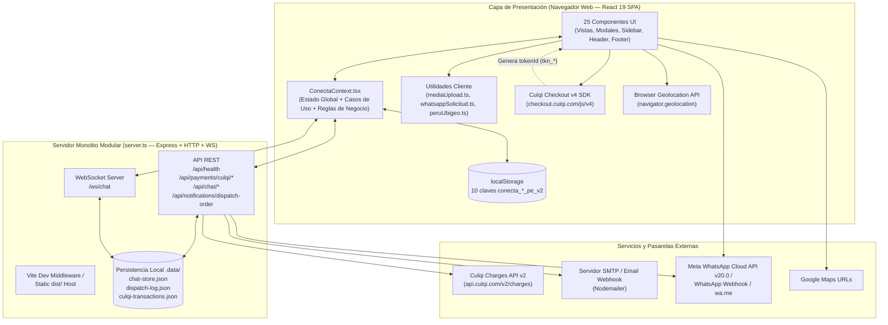
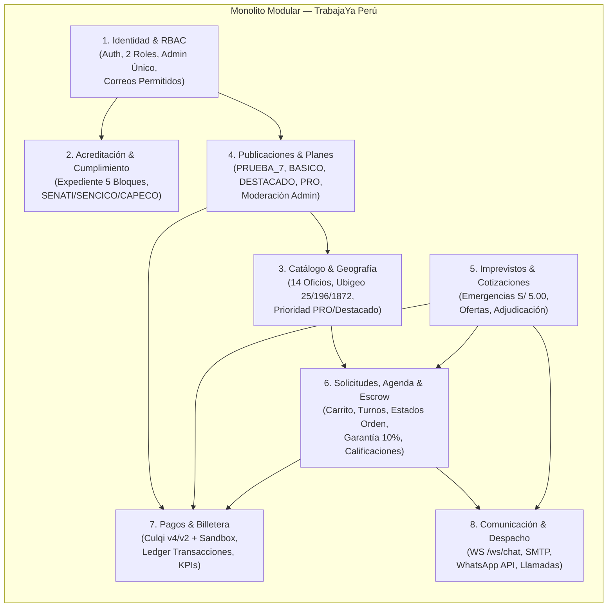
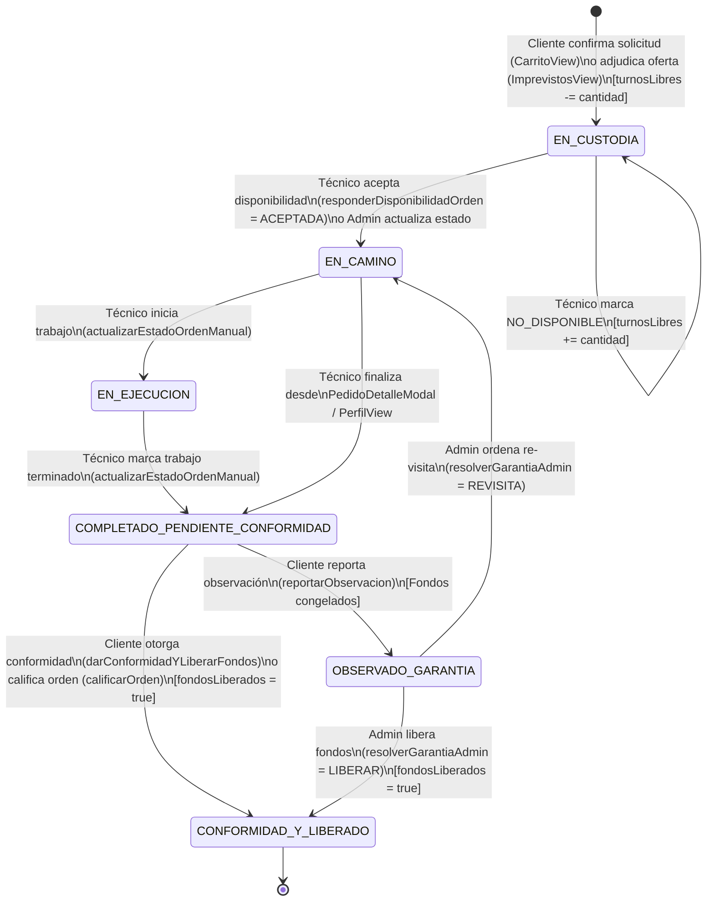
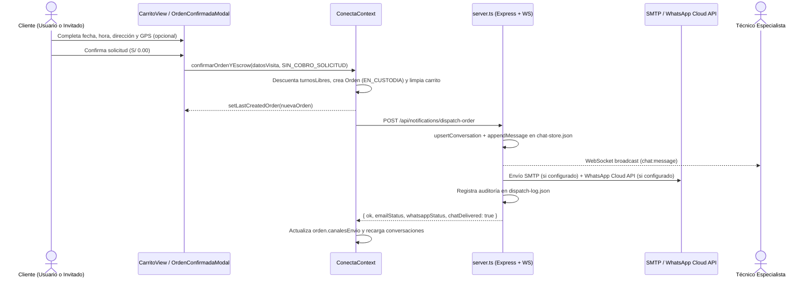
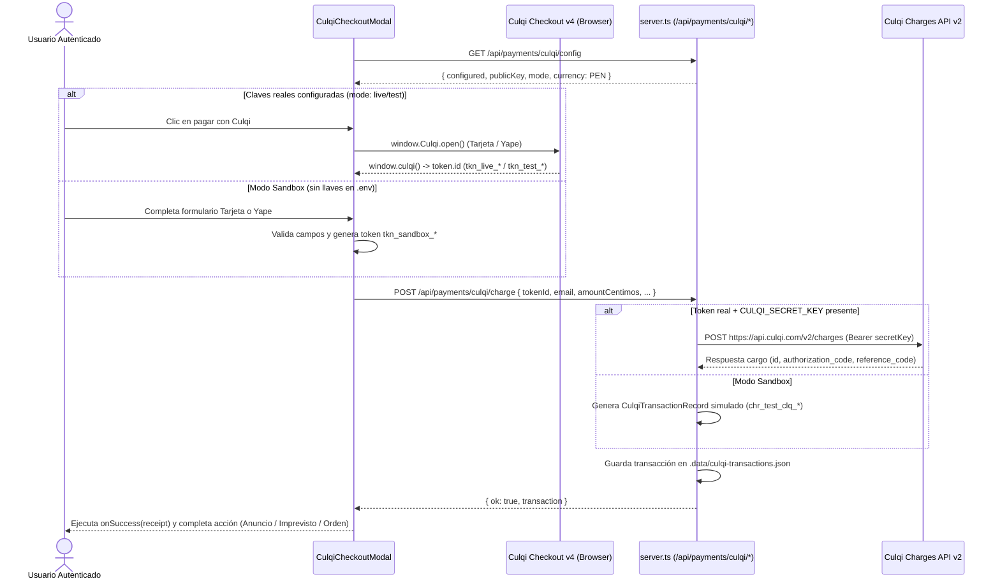

# 01 — Documento de Diseño de Software y Arquitectura (SDD / IEEE 1016)

> **Proyecto:** TrabajaYa Perú (`conectaoficios`)  
> **Estilo Arquitectónico:** Clean Architecture + Monolito Modular Full-Stack (SPA React 19 + Backend Node.js/Express + WebSocket)  
> **Cobertura:** Todo el sistema actual y arquitectura de referencia para despliegue productivo.

---

## 1. Visión Arquitectónica General

**TrabajaYa Perú** opera como un **Monolito Modular** full-stack empaquetado en un único proceso Node.js (`server.ts`) que actúa simultáneamente como:
1. **API REST (`/api/*`)** para configuración y ejecución de cobros Culqi, gestión de conversaciones/mensajes de chat y despacho automático multicanal de órdenes.
2. **Servidor de Mensajería en Tiempo Real (`WebSocket /ws/chat`)** para entrega instantánea de eventos `chat:connected`, `chat:conversation` y `chat:message`.
3. **Host de Aplicación SPA (React 19 + Vite 8)** mediante `vite.middlewares` en desarrollo y archivos estáticos `dist/` con fallback a `index.html` en producción.

### 1.1 Stack Tecnológico Exacto (`package.json`)

| Capa | Tecnología / Paquete | Versión | Uso en el Proyecto |
| :--- | :--- | :--- | :--- |
| **UI Framework** | `react`, `react-dom` | `^19.0.1` | Renderizado SPA y gestión de estado vía Context API. |
| **Lenguaje** | `typescript` | `^7.0.2` | Tipado estático de dominio, estado, componentes y servidor. |
| **Bundler / Dev** | `vite`, `@vitejs/plugin-react` | `^8.3.0` / `^6.1.1` | Compilación de frontend, HMR y copia de assets en `dist/src/assets`. |
| **Estilos e Iconos** | `tailwindcss`, `@tailwindcss/vite`, `lucide-react`, `motion` | `^4.3.3` / `^0.546.0` / `^12.23.24` | Sistema de diseño utility-first, iconografía vectorial y animaciones. |
| **Backend HTTP** | `express`, `tsx`, `dotenv` | `^4.21.2` / `^4.21.0` / `^17.2.3` | Servidor API REST, ejecución directa de TypeScript y lectura de `.env`. |
| **Tiempo Real** | `ws` | `^8.23.0` | Servidor WebSocket nativo en `/ws/chat`. |
| **Notificaciones** | `nodemailer` | `^10.6.0` | Despacho automático de correos vía SMTP (Gmail / servidor corporativo). |
| **Integración IA (Preparado)** | `@google/genai` | `^2.4.0` | Dependencia instalada y `GEMINI_API_KEY` preparada para capacidades de IA del lado del servidor (`metadata.json`). |

---

## 2. Diagrama de Arquitectura del Sistema (Contenedores y Componentes)

---

## 3. Clean Architecture — Mapeo de las 4 Capas Concéntricas

| Capa | Definición Conceptual | Implementación Actual en el Repositorio | Evolución Productiva (Objetivo) |
| :--- | :--- | :--- | :--- |
| **1. Dominio (Core)** | Entidades, value objects, taxonomías, máquinas de estado e invariantes puras. | `src/types/index.ts`, constantes `GRUPOS_OFICIO`, `CATEGORIAS_OFICIO`, `PRECIO_PUBLICACION_IMPREVISTO`, `validarNumeroDocumento`. | Extraer `src/domain/` puro compartido entre backend y frontend con pruebas unitarias de invariantes. |
| **2. Aplicación (Casos de Uso)** | Orquestación de comandos y consultas (CQRS-ready): crear orden, liberar fondos, adjudicar imprevisto, moderar anuncio, validar cumplimiento. | Acciones expuestas en `ConectaProvider` (`src/context/ConectaContext.tsx`) y funciones de orquestación en `server.ts`. | Desacoplar `ConectaContext.tsx` en casos de uso por módulo (`useCases/`) invocados desde endpoints backend autoritativos. |
| **3. Infraestructura (Adaptadores)** | Persistencia, pasarelas de pago, mensajería, notificaciones y archivos. | `server.ts` (Express, `ws`, `nodemailer`, `fetch` a Culqi y Meta Cloud API, archivos `.data/*.json`), `safeLocalStorageSet`, `mediaUpload.ts`. | PostgreSQL (transacciones ACID Escrow/Usuarios/Órdenes), Redis (candados distribuidos de turnos y pub/sub WS), Object Storage (S3/GCS para expedientes y fotos). |
| **4. Presentación (UI)** | Vistas declarativas, formularios con validación inmediata, navegación por roles y modales. | `src/App.tsx` + 25 componentes en `src/components/*.tsx`, `src/index.css`, `index.html`. | Mantener SPA React 19 consumiendo API REST autenticada vía JWT/Cookies HttpOnly. |

---

## 4. Fronteras del Monolito Modular (8 Módulos de Dominio)

---

## 5. Máquina de Estados Finita del Contrato Escrow (`EstadoOrden`)

---

## 6. Diagramas de Secuencia Clave

### 6.1 Flujo de Solicitud de Servicio y Despacho Automático Multicanal

### 6.2 Flujo de Pago con Pasarela Culqi (Live / Test / Sandbox)

---

## 7. Arquitectura de Presentación — Inventario Completo de los 25 Componentes UI

### 7.1 Shell y Navegación (`App.tsx`)
`App.tsx` envuelve toda la aplicación en `<ConectaProvider>` y renderiza:
- **Layout persistente:** `Sidebar` (menú fijo izquierdo en desktop `lg:pl-64` + drawer móvil), marca de agua circular institucional (`Logotipo_circular_de_empleo_y_oficios_632f5abe.webp`), `Header` sticky superior, `<main>` con enrutamiento por estado `activeTab`, y `Footer`.
- **Modales globales siempre montados:** `ServiceDetailModal`, `PublicProfileModal`, `OrdenConfirmadaModal`, `PedidoDetalleModal`, `WhatsAppChatModal`, `CallModal`, `ArchitectureModal`, `Toast`.

### 7.2 Tabla Completa de Componentes (`src/components/`)

| # | Componente | Archivo | Acceso por Rol | Responsabilidad Principal |
| :-: | :--- | :--- | :--- | :--- |
| 1 | `Sidebar` | `Sidebar.tsx` | Todos (adaptativo) | Navegación lateral + drawer móvil, contadores en vivo (carrito, imprevistos, órdenes pendientes, moderación admin, chat) y botón de sesión. |
| 2 | `Header` | `Header.tsx` | Todos | Barra superior con título contextual de pestaña, botón Chat Directo, acceso/perfil y franja de identidad del usuario conectado. |
| 3 | `Footer` | `Footer.tsx` | Todos | Pie de página con pilares Escrow/Certificación/Garantía 10%, cobertura nacional 25/196 y acceso a `ArchitectureModal`. |
| 4 | `AuthScreen` | `AuthScreen.tsx` | Invitado / Público | Pantalla completa de Login y Registro (validación de dominio permitido, documento, Ubigeo, RUC/emergencia y carga multimedia inicial). |
| 5 | `AuthModal` | `AuthModal.tsx` | Legado (no montado) | Modal alternativo de Login/Registro conservado en código; sustituido en `App.tsx` por `AuthScreen`. |
| 6 | `PortalSelectorModal` | `PortalSelectorModal.tsx` | Legado / Selector | Modal selector de portal (`showPortalModal`), superado por navegación directa por rol único. |
| 7 | `CatalogoView` | `CatalogoView.tsx` | Todos | Marketplace público de `serviciosAprobados`, búsqueda en tiempo real, filtros por 4 grupos / 14 oficios y Ubigeo en cascada, ordenamiento por prioridad de plan (`PRO > DESTACADO > BASICO > PRUEBA`). |
| 8 | `ImprevistosView` | `ImprevistosView.tsx` | Lectura: Todos / Acciones: Login | Tablero de emergencias del hogar, publicación pagada (S/ 5.00 vía Culqi) con hasta 4 fotos, envío de ofertas por ofertantes, ordenamiento por estrellas/precio y adjudicación con creación de orden Escrow. |
| 9 | `PublicarAnuncioView` | `PublicarAnuncioView.tsx` | Usuario autenticado (`ACTIVO`) / Admin | Creación de anuncio técnico, selector de habilidades (`tareasComunes`), selector de planes (`PRUEBA_7`, `BASICO`, `DESTACADO`, `PRO`), cobro Culqi y estado de anuncios propios. |
| 10 | `CarritoView` | `CarritoView.tsx` | Todos (Invitado o Registrado) | Formulario de solicitud de encargo sin cobro (`S/ 0.00`), fecha/hora exacta, captura GPS (`navigator.geolocation`), enlace Google Maps y vista previa del despacho en 3 canales. |
| 11 | `OrdenesView` | `OrdenesView.tsx` | Usuario autenticado / Admin | Centro de seguimiento de órdenes con línea de tiempo Escrow (5 hitos), aceptación del técnico, pago Escrow vía Culqi, conformidad/liberación, reporte de garantía, calificación y comprobante imprimible (`window.print()`). |
| 12 | `PerfilView` | `PerfilView.tsx` | Usuario autenticado / Admin | Edición de perfil, adjuntos privados de verificación (4 archivos), galería de trabajos realizados (hasta 6 fotos por carga), expediente de cumplimiento (`mode="owner"`), solicitudes recibidas y edición de anuncios. |
| 13 | `PerfilesView` | `PerfilesView.tsx` | **Exclusivo `ADMIN`** | Directorio nacional filtrable de usuarios, ofertantes, clientes y perfiles con fotos; muestra insignias de cumplimiento (Antecedentes 3/3, RUC, Reglamento). |
| 14 | `TecnicoAdminView` | `TecnicoAdminView.tsx` | **Exclusivo `ADMIN`** | Consola nacional con 7 pestañas: `publicaciones`, `planes`, `imprevistos`, `usuarios`, `billetera` (incluye ledger Culqi en vivo), `turnos` y `certificados`. |
| 15 | `AdminInspectProfileView` | `AdminInspectProfileView.tsx` | **Exclusivo `ADMIN`** | Auditoría completa de un usuario: activar/suspender cuenta, verificar/observar/eliminar archivos de identidad, expediente legal (`mode="admin"`), moderar publicaciones, certificados, órdenes e imprevistos. |
| 16 | `ExpedienteCumplimientoSection` | `ExpedienteCumplimientoSection.tsx` | Propietario / Admin | Módulo reutilizable de 5 bloques de cumplimiento legal y técnico (Identidad/Domicilio/Emergencia, RUC/SUNAT, Antecedentes 3/3, Certificaciones/Licencia MTC, Contrato/Reglamento/Inventario firmado). |
| 17 | `PeruUbigeoSelector` | `PeruUbigeoSelector.tsx` | Todos | Selector reutilizable en cascada Región → Provincia → Distrito en modo `form` (con distrito personalizado `__CUSTOM__`) o `filter` (`TODOS`). |
| 18 | `CulqiCheckoutModal` | `CulqiCheckoutModal.tsx` | Usuarios autenticados | Pasarela de pagos Culqi Checkout v4 + modo Sandbox para Tarjeta (Visa/MC/Amex/Diners) y Yape/Plin en `PEN`. |
| 19 | `ServiceDetailModal` | `ServiceDetailModal.tsx` | Todos | Ficha detallada de servicio con reputación, credenciales, resumen de cumplimiento, galería, reseñas, desglose Escrow y acciones de contacto/reserva. |
| 20 | `PublicProfileModal` | `PublicProfileModal.tsx` | Todos (con privacidad) | Perfil público de un especialista o usuario; oculta archivos sensibles a terceros (`ADMIN` o propietario ven evidencia completa). |
| 21 | `OrdenConfirmadaModal` | `OrdenConfirmadaModal.tsx` | Todos (tras reservar) | Confirmación inmediata post-solicitud con estado de los 3 canales (Web/Chat, Email, WhatsApp) y accesos rápidos. |
| 22 | `PedidoDetalleModal` | `PedidoDetalleModal.tsx` | Participantes / Admin | Expediente completo de una orden; controles exclusivos para que el técnico acepte/rechace disponibilidad o marque trabajo terminado. |
| 23 | `WhatsAppChatModal` | `WhatsAppChatModal.tsx` | Usuarios autenticados | Bandeja y sala de Chat Directo en tiempo real (WebSocket + REST) entre cliente, trabajador y supervisión Admin, más puente a WhatsApp Web. |
| 24 | `CallModal` | `CallModal.tsx` | Usuarios autenticados | Modal de llamada directa `+51` con enlace `tel:`, botón de copiado y recordatorio de protección Escrow (bloqueado a invitados). |
| 25 | `ArchitectureModal` | `ArchitectureModal.tsx` | Todos | Modal expositivo de la arquitectura Clean Architecture, Monolito Modular y Máquina de Estados Escrow. |
| 26 | `Toast` | `Toast.tsx` | Todos | Notificación flotante global (`success`, `warning`, `info`) en la esquina inferior derecha. |

> **Nota de auditoría del código:** En `src/components/` existen 26 archivos `.tsx` en total; 24 están montados activamente desde `App.tsx` o sus vistas hijas, mientras que `AuthModal.tsx` y `PortalSelectorModal.tsx` son componentes legados no montados en el árbol actual (registrado en la auditoría del Documento 05).

---

## 8. Registro de Decisiones Arquitectónicas (ADRs)

| ADR | Decisión | Justificación | Consecuencias / Mitigación |
| :--- | :--- | :--- | :--- |
| **ADR-001** | **Monolito Modular en un solo proceso (`server.ts`)** | Simplifica despliegue local/cloud, comparte puerto HTTP y WebSocket (`/ws/chat`), elimina latencia entre servicios. | Escalado horizontal futuro requerirá Redis Pub/Sub para WebSockets y DB externa. |
| **ADR-002** | **Persistencia Híbrida (`localStorage` + `.data/*.json`) en etapa actual** | Permite ejecución autónoma inmediata sin requerir aprovisionamiento previo de PostgreSQL/Redis para demostración académica y prototipado funcional completo. | El estado de usuarios/órdenes/catálogo es local al navegador; el Documento 05 define el plan exacto de migración a PostgreSQL + Redis. |
| **ADR-003** | **RBAC estricto de 2 roles (`USUARIO`, `ADMIN`) con subtipo funcional (`TipoUsuario`)** | Evita explosión de roles y permite que un mismo ciudadano sea cliente del hogar y ofertante de oficio (`AMBOS`) sin duplicar cuentas. | La autorización fina se evalúa por propiedad (`autorUsuarioId`, `clienteUsuarioId`, `tecnicoDni`) además del rol. |
| **ADR-004** | **Pasarela Culqi con doble modo (API v2 real + Sandbox automático)** | Permite probar pagos completos sin credenciales productivas y pasar a producción únicamente cargando `CULQI_PUBLIC_KEY` y `CULQI_SECRET_KEY` en `.env`. | Toda transacción queda auditada con su campo `mode: 'live' | 'test' | 'sandbox'` en `.data/culqi-transactions.json`. |
| **ADR-005** | **Despacho Automático con Degradación Elegante** | El canal in-app (Chat WebSocket) entrega siempre al instante; Email (SMTP/Webhook) y WhatsApp (Cloud API/Webhook) envían en vivo si hay credenciales o quedan en cola + enlaces manuales (`mailto:`, Gmail, `wa.me`). | Garantiza 100% de operatividad aun sin APIs externas configuradas. |
| **ADR-006** | **Compresión de Medios en Cliente (`mediaUpload.ts`)** | Reduce imágenes a `<= 900–1000px` JPEG (calidad `0.72–0.75`) y limita DataURLs de PDFs (`1.8 MB`) y videos (`2.2 MB`) usando `ObjectURL` para archivos mayores. | Evita colapsar la cuota de `localStorage`; en producción debe reemplazarse por subida firmada a S3/Cloud Storage. |
