# 02 — Especificación del Modelo de Datos y Dominio (SDD)

> **Fuentes de Verdad en Código:** `src/types/index.ts`, `src/data/initialData.ts`, `src/data/peruUbigeo.ts`, `src/context/ConectaContext.tsx` y `server.ts`.

---

## 1. Diagrama Entidad-Relación del Dominio

```mermaid
erDiagram
    USUARIO_REGISTRADO ||--o{ SERVICIO : "publica (autorUsuarioId)"
    USUARIO_REGISTRADO ||--o{ IMPREVISTO_HOGAR : "reporta (autorUsuarioId)"
    USUARIO_REGISTRADO ||--o{ OFERTA_IMPREVISTO : "cotiza (ofertanteUsuarioId)"
    USUARIO_REGISTRADO ||--o{ ORDEN : "solicita (clienteUsuarioId)"
    USUARIO_REGISTRADO ||--o{ INVENTARIO_HERRAMIENTA : "declara"
    USUARIO_REGISTRADO ||--o{ FOTO_TRABAJO_REALIZADO : "exhibe"
    USUARIO_REGISTRADO ||--o{ CHAT_CONVERSATION : "participa (cliente/trabajador)"

    PLAN_PUBLICACION ||--o{ PAGO_PUBLICACION : "define tarifa"
    SERVICIO ||--o| PAGO_PUBLICACION : "financiado por"
    SERVICIO ||--o{ RESENA_PUBLICACION : "recibe"
    SERVICIO ||--o{ ITEM_CARRITO : "se reserva en"

    IMPREVISTO_HOGAR ||--o{ OFERTA_IMPREVISTO : "recibe ofertas"
    IMPREVISTO_HOGAR ||--o| PAGO_IMPREVISTO : "tarifa S/ 5.00"
    IMPREVISTO_HOGAR ||--o| ORDEN : "genera al adjudicar"

    ORDEN ||--|{ ITEM_CARRITO : "contiene"
    ORDEN ||--|| DATOS_VISITA : "programa visita"
    ORDEN ||--o| CALIFICACION_SERVICIO : "evaluada por"
    ORDEN ||--o| CULQI_TRANSACTION : "respaldada por"
    ORDEN ||--o{ DISPATCH_LOG : "audita envio"
    ORDEN ||--o{ CHAT_CONVERSATION : "vincula hilo"

    CHAT_CONVERSATION ||--|{ CHAT_MESSAGE : "contiene mensajes"

    USUARIO_REGISTRADO {
        string id PK
        string permiso "USUARIO | ADMIN"
        string tipoUsuario "CLIENTE_HOGAR | OFERTANTE_OFICIO | AMBOS"
        string estadoCuenta "PENDIENTE | ACTIVO | SUSPENDIDO"
        string tipoDocumento "DNI | CE | PASAPORTE"
        string dni UK
        string email UK
        string nombreCompleto
        string telefonoWhatsapp
        string region
        string provincia
        string distrito
        string estadoVerificacionMedia "SIN_ADJUNTOS | PENDIENTE_REVISION | VERIFICADO | OBSERVADO"
    }

    SERVICIO {
        string id PK
        string autorUsuarioId FK
        string oficio "OficioType (14 valores)"
        string titulo
        number precioBase
        number garantiaMonto "10% precioBase"
        number tarifaCliente "precioBase + 10%"
        number turnosLibres
        number calificacion
        number numResenas
        string estadoPublicacion "PENDIENTE_APROBACION | APROBADO | RECHAZADO"
        string nivelPlan "PRUEBA | BASICO | DESTACADO | PRO"
        boolean destacado
        boolean selloVerificadoPro
    }

    IMPREVISTO_HOGAR {
        string id PK
        string autorUsuarioId FK
        string oficio
        string titulo
        string urgencia "NORMAL | URGENTE | EMERGENCIA"
        number presupuestoReferencial
        string estado "ABIERTO | ADJUDICADO | CERRADO | RETIRADO_ADMIN"
        string ofertaAceptadaId
        string ordenGeneradaId FK
    }

    OFERTA_IMPREVISTO {
        string id PK
        string imprevistoId FK
        string ofertanteUsuarioId FK
        number montoOferta
        string tiempoEstimado
        number garantiaDias
        string estado "ENVIADA | ACEPTADA | DESCARTADA"
    }

    ORDEN {
        string id PK
        string codigoAutorizacion
        string clienteUsuarioId FK
        number subtotalTecnico
        number garantiaTotal
        number igv
        number total
        number montoReferencial
        boolean sinCobroSolicitud
        string aceptacionTrabajador "PENDIENTE | ACEPTADA | NO_DISPONIBLE"
        string estado "EstadoOrden (6 estados)"
        string metodoPago
        boolean fondosLiberados
    }

    CULQI_TRANSACTION {
        string id PK
        string chargeId
        string tokenId
        string authorizationCode
        number amountCentimos
        number amountSoles
        string currency "PEN"
        string method "TARJETA | YAPE_PLIN"
        string concepto "IMPREVISTO | ANUNCIO | ORDEN_CUSTODIA"
        string mode "live | test | sandbox"
        string status "PAID | FAILED"
    }

    CHAT_CONVERSATION {
        string id PK
        string ordenId FK
        string imprevistoId FK
        string clienteId
        string trabajadorId
        number updatedAt
    }

    CHAT_MESSAGE {
        string id PK
        string conversationId FK
        string senderId
        string senderRole "cliente | trabajador | sistema"
        string text
        number createdAt
    }
```

---

## 2. Taxonomía Oficial de Oficios (4 Grupos / 14 Especialidades)

Definida en `GRUPOS_OFICIO` y `CATEGORIAS_OFICIO` (`src/types/index.ts`):

| Grupo (`GrupoOficioId`) | Oficio (`OficioType`) | Etiqueta Visible | Servicios / Tareas Comunes |
| :--- | :--- | :--- | :--- |
| **1. `CRITICAS`** *(Instalaciones y Reparaciones Críticas)* | `GASFITERIA` | 🔧 Gasfitería | Fugas de agua, desatoros, griferías/sanitarios, termas, tanques/cisternas. |
| **1. `CRITICAS`** | `ELECTRICIDAD` | ⚡ Electricidad Residencial | Cortocircuitos, luminarias/tomacorrientes, tableros/llaves termomagnéticas, cableado y pozo a tierra. |
| **1. `CRITICAS`** | `CERRAJERIA` | 🔑 Cerrajería | Apertura de emergencia, cambio de chapas/cilindros, cerraduras multipunto, chapas inteligentes. |
| **1. `CRITICAS`** | `CLIMATIZACION` | ❄️ Aire Acondicionado | Mantenimiento preventivo Split, instalación, recarga de gas, limpieza de evaporadora y drenaje. |
| **2. `ACABADOS`** *(Acabados y Estructuras)* | `PINTURA` | 🎨 Pintura | Empastado y lijado, interiores/fachadas, humedad y salitre, impermeabilización. |
| **2. `ACABADOS`** | `ALBANILERIA` | 🧱 Albañilería Básica | Resanes/tarrajeo, enchapado de cerámicos/mayólicas, porcelanato, pequeñas remodelaciones. |
| **2. `ACABADOS`** | `DRYWALL` | 🏗️ Instalación de Drywall | Divisiones de habitaciones, falsos techos/cielo raso, aislamiento acústico/térmico, masillado. |
| **2. `ACABADOS`** | `VIDRIERIA` | 🪟 Vidriería y Aluminio | Mamparas vidrio templado, puertas de ducha/herrajes, ventanas de aluminio, sellado estructural. |
| **3. `MOBILIARIO`** *(Mobiliario y Equipamiento)* | `CARPINTERIA` | 🪚 Carpintería (Madera y Melamina) | Reparación de puertas/bisagras, armado de muebles prefabricados, roperos/centros de TV, reposteros. |
| **3. `MOBILIARIO`** | `SOLDADURA` | 🔥 Soldadura (Herrería) | Rejas, portones/bisagras metálicas, ventanas y barandas, pintura base zincromato. |
| **3. `MOBILIARIO`** | `ELECTRODOMESTICOS` | 🔌 Técnico de Línea Blanca | Lavadoras, refrigeradoras, cocinas/hornos, diagnóstico de tarjetas inverter. |
| **4. `COMPLEMENTARIOS`** *(Servicios Complementarios)* | `LIMPIEZA` | 🧹 Limpieza y Saneamiento | Lavado de alfombras/muebles, limpieza post-construcción, fumigación y desinfección. |
| **4. `COMPLEMENTARIOS`** | `JARDINERIA` | 🌿 Jardinería | Áreas verdes, poda técnica/ornamental, siembra de césped/plantas, control de plagas exteriores. |
| **4. `COMPLEMENTARIOS`** | `SOPORTE_TI` | 💻 Cámaras y Redes TI | Cámaras CCTV, redes Wi-Fi Mesh, cableado estructurado Cat6, alarmas inteligentes. |

---

## 3. Especificación Detallada de Entidades del Dominio

### 3.1 `UsuarioRegistrado` (Incluye Expediente de Cumplimiento de 5 Bloques)

| Bloque | Campos | Reglas y Restricciones |
| :--- | :--- | :--- |
| **Identificación y Cuenta** | `id`, `permiso` (`USUARIO` \| `ADMIN`), `tipoUsuario` (`CLIENTE_HOGAR` \| `OFERTANTE_OFICIO` \| `AMBOS`), `estadoCuenta` (`PENDIENTE` \| `ACTIVO` \| `SUSPENDIDO`), `tipoDocumento` (`DNI` \| `CE` \| `PASAPORTE`), `dni`, `nombreCompleto`, `telefonoWhatsapp`, `email`, `region`, `provincia`, `distrito`, `direccion`, `password`, `fechaRegistro`, `especialidadPrincipal` | `dni` y `email` únicos globalmente. `DNI` = 8 dígitos exactos; `CE`/`PASAPORTE` = 6–15 alfanuméricos. `email` validado contra `correosPermitidos`. Solo un `ADMIN` (`ADM-001`). |
| **Bloque 1: Identidad, Domicilio y Emergencia** | `dniFotoUrl`, `fotoPersonaUrl`, `videoPersonaUrl`, `videoPersonaNombre`, `comprobanteDomicilioTipo` (`AGUA` \| `LUZ` \| `TELEFONO`), `comprobanteDomicilioUrl`, `comprobanteDomicilioNombre`, `emergenciaFamiliarNombre`, `emergenciaFamiliarParentesco`, `emergenciaFamiliarTelefono` | Archivos privados restringidos a propietario y `ADMIN`. |
| **Bloque 2: Legal y Tributario** | `rucNumero`, `rucActivo`, `tipoComprobanteTributario` (`RECIBO_HONORARIOS` \| `FACTURA`), `fichaRucUrl`, `fichaRucNombre` | RUC de 11 dígitos; comprobante tributario para emisión legal. |
| **Bloque 3: Seguridad y Antecedentes** | `antecedentesPolicialesUrl/Nombre` (PNP), `antecedentesPenalesUrl/Nombre` (PJ), `antecedentesJudicialesUrl/Nombre` (INPE) | Insignia `Antecedentes 3/3` cuando los tres documentos están cargados. |
| **Bloque 4: Validaciones Técnicas y MTC** | `certificacionTecnicaDetalle`, `certificadoOpcionalUrl/Nombre`, `licenciaConducirNumero`, `licenciaConducirCategoria` (`A-I`, `A-IIa`, `A-IIb`, `A-III`, `B-IIc`), `licenciaConducirUrl/Nombre` | Respalda formación técnica y movilidad a domicilio. |
| **Bloque 5: Acuerdos e Inventario** | `contratoTipo` (`LOCACION_SERVICIOS` \| `CONTRATO_TRABAJO`), `contratoFirmado`, `contratoFirmaNombre`, `contratoFechaFirma`, `normasConductaFirmadas`, `normasConductaFecha`, `inventarioHerramientas: InventarioHerramientaItem[]`, `inventarioFirmado`, `inventarioFechaFirma` | Cada herramienta registra `{ id, equipo, codigoSerie, cantidad, estado: 'OPERATIVO'|'NUEVO'|'DEVUELTO', origen: 'EMPRESA'|'PROPIA' }`. |
| **Portafolio y Estado de Auditoría** | `fotosTrabajos: FotoTrabajoRealizado[]`, `estadoVerificacionMedia` (`SIN_ADJUNTOS` \| `PENDIENTE_REVISION` \| `VERIFICADO` \| `OBSERVADO`), `observacionVerificacion` | `fotosTrabajos` son públicas; la subida de documentos por usuarios no-admin dispara `PENDIENTE_REVISION`. |

### 3.2 `Servicio` y `PlanPublicacion`

- **`Servicio`**: `id` (`SRV-*` o `PUB-2026-XXX`), `oficio`, `oficioLabel`, `titulo`, `descripcion`, datos del especialista (`tecnicoNombre`, `tecnicoDni`, `tecnicoTelefono`, `tecnicoEmail`, `tecnicoAvatar`, `institucionCertificadora`, `codigoCertificado`), precios (`precioBase`, `garantiaMonto = 10%`, `tarifaCliente = precioBase + 10%`), agenda (`turnosLibres`), reputación (`calificacion`, `numResenas`, `experienciaAnos`, `resenasPublicadas`), ubicación (`region`, `provincia`, `distrito`), `imagen`, `capacitado`, `habilidades[]`, moderación (`autorUsuarioId`, `estadoPublicacion`, `fechaPublicacion`, `pagoPublicacion`, `motivoRechazo`), posicionamiento (`destacado`, `nivelPlan`, `selloVerificadoPro`).
- **Planes Comerciales Configurables (`PLANES_PUBLICACION` + `PLAN_PRUEBA_GRATIS`)**:

| `PlanPublicacionId` | Nombre por Defecto | Duración | Precio Promo | Precio Regular | Prioridad | Beneficios Clave |
| :--- | :--- | :---: | :---: | :---: | :---: | :--- |
| `PRUEBA_7` | Prueba Gratis de Lanzamiento | 7 días | **S/ 0.00** | — | `0` | 1 sola vez por usuario cuando `promoConfig.pruebaGratisActiva === true`. |
| `BASICO` | Plan Básico | 30 días | **S/ 4.90** | — | `0` | Publicación estándar en catálogo nacional. |
| `DESTACADO` | Plan Destacado | 180 días | **S/ 24.90** | S/ 29.90 | `1` | Badge destacado y prioridad media (`descuentoDestacadoActivo` controla el precio aplicado). |
| `PRO` | Especialista PRO | 365 días | **S/ 59.90** | — | `2` | Máxima prioridad en catálogo + `selloVerificadoPro: true`. |

### 3.3 `ImprevistoHogar` y `OfertaImprevisto`

- **`ImprevistoHogar`**: `id` (`IMP-2026-XXX`), autor (`autorUsuarioId`, `autorNombre`, `autorDni`, `autorTelefono`, `autorFotoUrl`), ubicación (`region`, `provincia`, `distrito`, `direccion`), detalle (`oficio`, `oficioLabel`, `titulo`, `descripcion`, `urgencia`: `NORMAL | URGENTE | EMERGENCIA`, `presupuestoReferencial`, `imagenes[]` hasta 4 fotos), publicación (`fechaPublicacion`, `estado`: `ABIERTO | ADJUDICADO | CERRADO | RETIRADO_ADMIN`, `pagoPublicacion` por **S/ 5.00**), adjudicación (`ofertaAceptadaId`, `ordenGeneradaId`, `ofertas: OfertaImprevisto[]`).
- **`OfertaImprevisto`**: `id` (`OFR-XXX`), `imprevistoId`, ofertante (`ofertanteUsuarioId`, `ofertanteNombre`, `ofertanteDni`, `ofertanteTelefono`, `ofertanteFotoUrl`, `especialidad`, `institucionCertificadora`, `verificadoAdmin`, `calificacionEstrellas`, `numResenas`), propuesta (`montoOferta >= 10`, `tiempoEstimado`, `garantiaDias`, `mensajePropuesta >= 10 chars`, `fechaOferta`), `estado` (`ENVIADA | ACEPTADA | DESCARTADA`).

### 3.4 `Orden`, `ItemCarrito`, `DatosVisita`, `CalificacionServicio` y `CertificadoTecnico`

- **`Orden`**: `id` (`PED-2026-XXXX`), `codigoAutorizacion` (`SOL-PE-*`, `AUT-NBZ-*`, `AUT-IMP-*`), `fecha`, `clienteUsuarioId`, `items: ItemCarrito[]`, `datosVisita: DatosVisita`, finanzas (`subtotalTecnico`, `garantiaTotal`, `igv`, `total`, `montoReferencial`, `sinCobroSolicitud`), aceptación del especialista (`aceptacionTrabajador`, `fechaRespuestaTrabajador`, `notaDisponibilidadTrabajador`), trazabilidad de despacho (`canalesEnvio`), estado Escrow (`estado: EstadoOrden`, `metodoPago`, `pagoCulqi`, `fondosLiberados`, `fechaLiberacion`), evaluación (`calificacion: CalificacionServicio`) y bitácora (`historialEstados[]`).
- **`DatosVisita`**: `clienteNombre`, `clienteDni`, `region`, `provincia`, `distrito`, `direccion`, `referencia`, `fechaVisita` (`YYYY-MM-DD`), `horaVisita` (`HH:mm`), `coordenadas?: { lat, lng }`, `enlaceMapa`, `turno` (`Mañana (08:00 - 12:00)` | `Tarde (14:00 - 18:00)` | `Atención de Urgencia`), `telefonoWhatsapp`, `clienteEmail`, `notasAdicionales`.
- **`CalificacionServicio`**: `estrellas` (1–5), `comentario`, `fecha`, `criterios: { puntualidad, calidad, limpieza }`.
- **`CertificadoTecnico`**: `id`, `tecnicoNombre`, `institucion` (`SENATI | SENCICO | CAPECO`), `especialidad`, `codigoRegistro`, `fechaEmision`, `vigencia`, `estado` (`VERIFICADO | EN_REVISION`), `horasCapacitacion`.

---

## 4. Modelo Geográfico Oficial: Ubigeo Perú (`src/data/peruUbigeo.ts`)

| Métrica | Valor Exacto | Constante Exportada |
| :--- | :---: | :--- |
| Regiones (24 Departamentos + Provincia Constitucional del Callao) | **25** | `TOTAL_REGIONES_PERU`, `REGIONES_PERU` |
| Provincias | **196** | `TOTAL_PROVINCIAS_PERU` |
| Distritos | **1,872** | `TOTAL_DISTRITOS_PERU` |

**Funciones de resolución geográfica:**
- `getProvinciasByRegion(region)`: búsqueda insensible a mayúsculas.
- `getDistritosByProvincia(region, provincia)`: devuelve distritos de la provincia seleccionada.
- `inferUbicacionPeru(distrito?, provincia?, region?)`: algoritmo de 6 niveles (tripleta completa → `LEGACY_CITY_MAP` de 16 nombres legados → coincidencia exacta de distrito → coincidencia de provincia/región → primera provincia/distrito de la región → fallback `{ region: 'Lima', provincia: 'Lima', distrito: raw || 'Miraflores' }`).
- `formatUbicacion(distrito, provincia, region)`: formatea etiquetas limpias evitando repeticiones (ej. `Yanahuara, Arequipa` o `Callao, Perú`).

---

## 5. Persistencia de Datos (Cliente + Servidor)

### 5.1 Claves `localStorage` en el Navegador (`ConectaContext.tsx`)

Todas las escrituras se protegen con `safeLocalStorageSet(key, value)` (`src/utils/mediaUpload.ts`):

| Clave `localStorage` | Estructura | Regla Especial de Hidratación |
| :--- | :--- | :--- |
| `conecta_correos_permitidos_pe_v2` | `string[]` | Default: `['@conectaoficios.pe', '@gmail.com', '@outlook.com', '@hotmail.com']`. |
| `conecta_usuarios_pe_v2` | `UsuarioRegistrado[]` | Fusiona defaults de cumplimiento en usuarios semilla, agrega nuevos seeds `USUARIO` sin duplicar email/DNI y garantiza **exactamente 1 `ADMIN`** (`ADM-001`). |
| `conecta_current_user_pe_v2` | `UsuarioRegistrado \| null` | Si `permiso === 'ADMIN'`, `activeTab` inicia en `'portal'`; en caso contrario `'catalogo'`. Al cerrar sesión se elimina la clave. |
| `conecta_servicios_pe_v2` | `Servicio[]` | Enriquecimiento de `autorUsuarioId` y adición de nuevos servicios semilla ausentes. |
| `conecta_planes_publicacion_pe_v2` | `PlanPublicacion[]` | Requiere `Array.isArray(parsed) && parsed.length === 3`; si no, restaura `PLANES_PUBLICACION`. |
| `conecta_promo_lanzamiento_pe_v2` | `PromoLanzamientoConfig` | Default: `{ pruebaGratisActiva: true, descuentoDestacadoActivo: true }`. |
| `conecta_imprevistos_pe_v2` | `ImprevistoHogar[]` | Fallback a `IMPREVISTOS_INICIALES`. |
| `conecta_carritos_por_usuario_pe_v2` | `Record<string, ItemCarrito[]>` | Carrito aislado por `currentUser.id` o `'GUEST'`. Al registrarse, el carrito `'GUEST'` se migra al nuevo usuario. |
| `conecta_ordenes_pe_v2` | `Orden[]` | Garantiza presencia de la orden muestra `PED-2026-9045` si faltara. |
| `conecta_certificados_pe_v2` | `CertificadoTecnico[]` | Fallback a `CERTIFICADOS_OFICIALES`. |

### 5.2 Almacenes JSON en Servidor (`server.ts` → `.data/`)

| Archivo | Interfaz | Retención / Límite | Propósito |
| :--- | :--- | :--- | :--- |
| `.data/chat-store.json` | `ServerConversation[]` | Sin recorte fijo; ordenado por `updatedAt` descendente | Persistencia de conversaciones y mensajes en tiempo real (`/api/chat/*` y `/ws/chat`). |
| `.data/dispatch-log.json` | `DispatchLogEntry[]` | Últimos **200** registros (`slice(0, 200)`) | Auditoría de envíos automáticos por orden (Email, WhatsApp, Chat in-app). |
| `.data/culqi-transactions.json` | `CulqiTransactionRecord[]` | Últimas **500** transacciones (`slice(0, 500)`) | Libro contable de cobros Culqi (`live` / `test` / `sandbox`) consultado en la Billetera Admin. |

---

## 6. Inventario de Datos Semilla (`src/data/initialData.ts`)

| Colección | Cantidad | Desglose Exacto |
| :--- | :---: | :--- |
| `USUARIOS_INICIALES` | **20** | 1 Administrador Único (`ADM-001`, `admin@conectaoficios.pe`, pass `admin123`) + 19 `USUARIO` (`USR-000` `AMBOS`; `USR-001` y `USR-018` `CLIENTE_HOGAR`; `USR-002` a `USR-017` `OFERTANTE_OFICIO` verificados con expediente completo y galería). |
| `SERVICIOS_INICIALES` | **17** | 15 `APROBADO` cubriendo los 14 oficios + 2 `PENDIENTE_APROBACION` (`PUB-2026-104` Destacado S/ 24.90, `PUB-2026-105` Básico S/ 4.90) para pruebas de moderación. |
| `CERTIFICADOS_OFICIALES` | **5** | `CERT-001` a `CERT-005` (`SENATI`, `SENCICO`, `CAPECO`), todos `VERIFICADO`. |
| `ORDENES_DEMO_INICIALES` | **4** | `PED-2026-9045` (`EN_CUSTODIA`, sin cobro S/ 0.00, `PENDIENTE`), `PED-2026-8812` (`COMPLETADO_PENDIENTE_CONFORMIDAD`, S/ 103.84), `PED-2026-7910` (`CONFORMIDAD_Y_LIBERADO`, 5★, S/ 84.37), `PED-2026-7501` (`CONFORMIDAD_Y_LIBERADO`, 5★, S/ 103.84). |
| `IMPREVISTOS_INICIALES` | **3** | `IMP-2026-301` (2 ofertas: `OFR-901`, `OFR-902`), `IMP-2026-302` (1 oferta: `OFR-903`), `IMP-2026-303` (0 ofertas); todos `ABIERTO`. |
