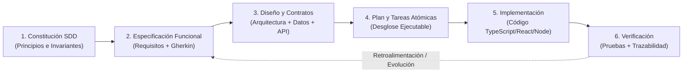

# Sistema de Desarrollo Basado en Especificaciones (SDD) — TrabajaYa Perú (`conectaoficios`)

> **Proyecto:** TrabajaYa Perú (`conectaoficios`) — Plataforma Web Nacional de Servicios Multioficios Certificados con Custodia Fiduciaria (Escrow).  
> **Enfoque Metodológico:** **SDD (*Spec-Driven Development* + *Software Design Document* IEEE 1016)**.  
> **Alcance:** 100% del programa (Backend Express + WebSocket, Pasarela Culqi v4/v2, Despacho Automático Multicanal, Estado Global `ConectaContext`, Modelo de Dominio, Geografía Ubigeo Perú y los 25 componentes React 19 + TypeScript).

---

## 1. ¿Cómo funciona este repositorio SDD?

En el **Desarrollo Basado en Especificaciones (SDD)**, la documentación estructurada actúa como la **Fuente Única de Verdad (*Single Source of Truth*)** del sistema. Todo cambio, auditoría académica, migración a producción o nueva funcionalidad debe seguir el ciclo SDD:

---

## 2. Índice Maestro de Documentos SDD

| # | Documento | Rol en SDD | Contenido Principal |
| :-: | :--- | :--- | :--- |
| **00** | [`00-CONSTITUCION-SDD.md`](./00-CONSTITUCION-SDD.md) | **Gobernanza e Invariantes** | Principios inmutables, Clean Architecture, Monolito Modular, RBAC estricto de 2 roles, invariantes financieras de Escrow, privacidad documental y protocolo de cambios SDD. |
| **01** | [`01-ARQUITECTURA-Y-DISENO-SDD.md`](./01-ARQUITECTURA-Y-DISENO-SDD.md) | **SDD / Diseño Técnico (IEEE 1016)** | Stack tecnológico, arquitectura actual vs. objetivo, 4 capas concéntricas, fronteras del Monolito Modular, diagramas C4/Secuencia/Estados, inventario completo de los 25 componentes UI y ADRs. |
| **02** | [`02-MODELO-DE-DATOS-Y-DOMINIO.md`](./02-MODELO-DE-DATOS-Y-DOMINIO.md) | **Modelo de Dominio y Datos** | Entidades TypeScript, diagrama ER, taxonomía de 4 grupos y 14 oficios, Ubigeo Perú (25 regiones / 196 provincias / 1,872 distritos), esquemas de `localStorage` y almacenes JSON en servidor, y datos semilla. |
| **03** | [`03-CONTRATOS-API-Y-EVENTOS.md`](./03-CONTRATOS-API-Y-EVENTOS.md) | **Contratos de Interfaz y Eventos** | Endpoints REST Express (`/api/*`), protocolo WebSocket (`/ws/chat`), pasarela Culqi Checkout v4 + Charges API v2, despacho SMTP/WhatsApp Cloud API, geolocalización GPS y variables de entorno. |
| **04** | [`04-ESPECIFICACIONES-FUNCIONALES-MODULOS.md`](./04-ESPECIFICACIONES-FUNCIONALES-MODULOS.md) | **Especificaciones Ejecutables (Specs)** | Requisitos funcionales (RF), reglas de negocio (RN), validaciones exactas y criterios de aceptación Gherkin (`Given / When / Then`) de los 9 módulos funcionales del programa. |
| **05** | [`05-PLAN-TECNICO-TAREAS-Y-MATRIZ-VERIFICACION.md`](./05-PLAN-TECNICO-TAREAS-Y-MATRIZ-VERIFICACION.md) | **Plan, Trazabilidad y QA** | Matriz de trazabilidad completa (Spec ↔ Código ↔ Pruebas), plan de pruebas E2E/integración/seguridad, auditoría de brechas (Prototipo vs. Producción) y backlog de tareas SDD para producción. |

---

## 3. Mapa Rápido del Sistema (`conectaoficios`)

| Capa | Ubicación en el Repositorio | Responsabilidad |
| :--- | :--- | :--- |
| **Servidor Backend + SPA Host** | `server.ts` | Servidor HTTP Express, WebSocket `/ws/chat`, pagos Culqi, despacho automático Email/WhatsApp/Chat, persistencia `.data/*.json` y middleware Vite/static `dist/`. |
| **Dominio y Contratos de Tipos** | `src/types/index.ts` | Tipos estrictos del dominio, catálogo de 4 grupos y 14 oficios, estados de cuenta/verificación/publicación/imprevisto/orden/escrow. |
| **Estado Global y Casos de Uso** | `src/context/ConectaContext.tsx` | Contexto React central (`ConectaProvider`) con toda la lógica de negocio, hidratación `localStorage`, sincronización WebSocket y cálculos financieros. |
| **Datos Semilla y Geografía** | `src/data/initialData.ts`, `src/data/peruUbigeo.ts` | 20 usuarios, 17 servicios, 5 certificados, 4 órdenes, 3 imprevistos, planes comerciales y estructura oficial Ubigeo del Perú (25/196/1,872). |
| **Utilidades de Soporte** | `src/utils/mediaUpload.ts`, `src/utils/whatsappSolicitud.ts` | Compresión de imágenes/videos/PDFs en cliente, `safeLocalStorageSet`, generadores de enlaces WhatsApp/Gmail/Mailto/Google Maps. |
| **Interfaz de Usuario (UI)** | `src/App.tsx`, `src/components/*.tsx` (25 componentes) | Shell responsive con sidebar, vistas públicas/autenticadas/admin, expediente legal de 5 bloques, pasarela Culqi y modales interactivos. |
| **Configuración y Build** | `package.json`, `vite.config.ts`, `tsconfig.json`, `.env.example`, `index.html`, `src/index.css` | Toolchain React 19, Vite 8, Tailwind CSS v4, TypeScript, `tsx` y variables de entorno. |

---

## 4. Resumen de Cobertura de Módulos SDD

1. **M1 — Autenticación, RBAC y Política de Correos** (`AuthScreen`, `AuthModal`, `ConectaContext`)
2. **M2 — Catálogo Nacional Multioficios y Perfiles** (`CatalogoView`, `ServiceDetailModal`, `PerfilesView`, `PublicProfileModal`, `PeruUbigeoSelector`)
3. **M3 — Perfil de Usuario, Expediente de Cumplimiento Legal (5 Bloques) y Galería** (`PerfilView`, `ExpedienteCumplimientoSection`, `AdminInspectProfileView`, `mediaUpload`)
4. **M4 — Publicación de Anuncios, Planes Comerciales y Moderación** (`PublicarAnuncioView`, `TecnicoAdminView`)
5. **M5 — Imprevistos del Hogar y Subasta de Cotizaciones** (`ImprevistosView`, `TecnicoAdminView`)
6. **M6 — Solicitud de Encargo (S/ 0.00), GPS y Despacho Automático Multicanal** (`CarritoView`, `OrdenConfirmadaModal`, `whatsappSolicitud`, `server.ts`)
7. **M7 — Órdenes, Custodia Fiduciaria (Escrow), Pagos Culqi y Calificaciones** (`OrdenesView`, `PedidoDetalleModal`, `CulqiCheckoutModal`, `server.ts`)
8. **M8 — Comunicación Directa en Tiempo Real (Chat WebSocket + Llamadas)** (`WhatsAppChatModal`, `CallModal`, `server.ts`)
9. **M9 — Consola Nacional de Administración (7 Pestañas), Billetera y Arquitectura** (`TecnicoAdminView`, `ArchitectureModal`, `Sidebar`, `Header`, `Footer`, `Toast`)
