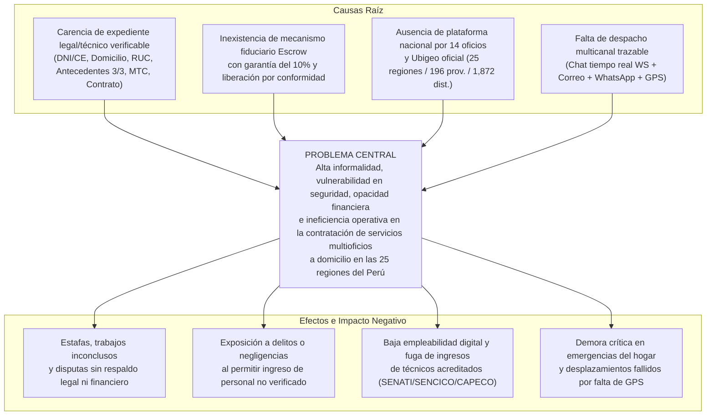

# Paso 1 — Identificación del Problema y Requerimientos (Cobertura Completa del Programa)

> **Proyecto:** TrabajaYa Perú (`conectaoficios`) — *"Tu talento, nuestro compromiso"*  
> **Tipo de Sistema:** Plataforma Web Nacional Full-Stack de Servicios Multioficios Certificados con Expediente de Cumplimiento Legal, Cotización de Imprevistos, Despacho Multicanal y Pago Protegido en Custodia (Escrow).  
> **Cobertura Geográfica:** Nacional — **25 regiones, 196 provincias y 1,872 distritos del Perú** (`src/data/peruUbigeo.ts`).  
> **Estándares Aplicados:** IEEE 830 / ISO/IEC/IEEE 29148 (Ingeniería de Requisitos), ISO/IEC 25010 (Atributos de Calidad) y Ley N.º 29733 (Protección de Datos Personales — Perú).

---

## 1. Descripción General del Problema

### 1.1 Contexto de la Realidad Problemática (Mercado de Oficios en el Perú)
En el Perú, las familias, condominios y pequeños comercios requieren frecuentemente técnicos especializados en **14 oficios esenciales** agrupados en 4 rubros:
1. **Instalaciones y Reparaciones Críticas:** Gasfitería, Electricidad Residencial, Cerrajería y Aire Acondicionado (Climatización).
2. **Acabados y Estructuras:** Pintura, Albañilería Básica, Instalación de Drywall y Vidriería y Aluminio.
3. **Mobiliario y Equipamiento:** Carpintería (Madera y Melamina), Soldadura (Herrería) y Técnico de Línea Blanca (Electrodomésticos).
4. **Servicios Complementarios:** Limpieza y Saneamiento, Jardinería y Cámaras y Redes TI.

Sin embargo, el proceso tradicional de búsqueda y contratación (recomendaciones informales, redes sociales sin filtros o anuncios impresos) presenta **seis fallas estructurales graves**:

| # | Problema Detectado | Impacto en Clientes / Hogares | Impacto en Técnicos / Especialistas |
| :-: | :--- | :--- | :--- |
| **1** | **Falta de verificación de identidad y antecedentes** | Riesgo de seguridad física y patrimonial al recibir desconocidos en casa sin validar DNI/CE/Pasaporte, domicilio ni antecedentes PNP, Poder Judicial e INPE. | Técnicos honestos y formales (egresados de SENATI, SENCICO, CAPECO) no logran diferenciarse de informales. |
| **2** | **Ausencia de protección financiera (Escrow)** | Estafas por adelantos de dinero, trabajos inconclusos o defectuosos sin garantía de re-visita. | Incertidumbre de cobro al culminar el servicio cuando no hay un acuerdo formal trazable. |
| **3** | **Comisiones abusivas y barreras de entrada** | Sobrecostos ocultos trasladados al cliente final. | Cobros elevados por cada contacto o solicitud recibida aun cuando el técnico no esté disponible en ese horario. |
| **4** | **Desorden ante emergencias domésticas (Imprevistos)** | Demora crítica para conseguir cotizaciones comparables ante fugas de agua, cortocircuitos o puertas trabadas. | Pérdida de demanda urgente en su propio distrito por falta de un tablero en tiempo real. |
| **5** | **Comunicación dispersa sin trazabilidad** | Acuerdos verbales sin fecha/hora exacta, sin ubicación GPS verificable, sin confirmación de disponibilidad y sin comprobante. | Confusiones de dirección, desplazamientos en vano y pérdida de mensajes entre distintos canales. |
| **6** | **Falta de cobertura geográfica estructurada y reputación auditable** | Imposibilidad de filtrar especialistas reales por Región, Provincia y Distrito en todo el Perú o consultar reseñas verificadas ligadas a órdenes reales. | Ausencia de un portafolio digital verificado (fotos de trabajos realizados + reseñas por puntualidad, calidad y limpieza). |

### 1.2 Árbol de Problemas (Causas → Problema Central → Efectos)

### 1.3 Formulación del Problema
> *¿De qué manera el diseño e implementación de una arquitectura web escalable bajo Clean Architecture y Monolito Modular (**TrabajaYa Perú / `conectaoficios`**) permite formalizar, asegurar y agilizar la contratación de servicios multioficios a domicilio en todo el Perú, integrando verificación documental de 5 bloques, catálogo nacional por Ubigeo, tablero de imprevistos con subasta de cotizaciones, despacho automático en 3 canales, chat en tiempo real y custodia fiduciaria (Escrow) con pasarela Culqi?*

---

## 2. Propuesta de Solución, Objetivos y Alcance

### 2.1 Propuesta de Valor Integral del Programa
**TrabajaYa Perú (`conectaoficios`)** integra en una sola plataforma full-stack (React 19 + TypeScript + Express + WebSocket):
1. **Gobernanza y Seguridad RBAC:** Strictly 2 permisos (`USUARIO` con modalidades `CLIENTE_HOGAR` / `OFERTANTE_OFICIO` / `AMBOS`, y 1 único `ADMIN` Nacional `ADM-001`) + lista blanca dinámica de dominios/correos permitidos.
2. **Expediente de Cumplimiento Legal de 5 Bloques:** Identidad/Domicilio/Emergencia, RUC/SUNAT, Antecedentes 3/3 (PNP, PJ, INPE), Certificaciones/Licencia MTC y Acuerdos firmados (Contrato, Reglamento de Conducta, Inventario de Herramientas/EPP) + Galería Pública de Trabajos Realizados.
3. **Catálogo Nacional Moderado:** 4 grupos, 14 oficios, cobertura total Ubigeo (25/196/1,872 + distrito personalizado), moderación previa del Admin y ranking por planes comerciales (`PRUEBA_7`, `BASICO`, `DESTACADO`, `PRO`).
4. **Tablero de Imprevistos del Hogar (`S/ 5.00`):** Publicación de urgencias con fotos y subasta abierta de cotizaciones de técnicos verificados que se adjudican y convierten automáticamente en órdenes Escrow.
5. **Modelo Justo de Contratación (`S/ 0.00` al solicitar) + Escrow (10% Garantía) + Culqi:** Sin cobro al trabajador por recibir encargos, captura GPS de Google Maps, despacho automático en 3 canales (Chat WebSocket + Correo SMTP/Webhook + WhatsApp Cloud API/Webhook), aceptación exclusiva del técnico, pago protegido vía Culqi (Tarjeta / Yape en PEN), liberación por conformidad, resolución de garantías y calificaciones verificadas.
6. **Consola Nacional de Administración (7 Pestañas):** Moderación de publicaciones, gestión de planes/promos, moderación de imprevistos, administración de usuarios y correos, billetera fiduciaria + ledger Culqi en vivo, gestión de turnos y verificación de certificados SENATI/SENCICO/CAPECO.

### 2.2 Objetivos del Proyecto
- **Objetivo General:** Diseñar, implementar, verificar y escalar la plataforma web nacional **TrabajaYa Perú (`conectaoficios`)** para conectar clientes residenciales y técnicos multioficios acreditados en todo el Perú bajo garantías de seguridad documental, trazabilidad operativa y custodia fiduciaria (Escrow).
- **Objetivos Específicos:**
  - **OE-01:** Implementar el control de acceso RBAC de 2 roles (con Administrador Único `ADM-001`), política de correos permitidos y el Expediente de Cumplimiento Legal de 5 bloques con privacidad estricta.
  - **OE-02:** Construir el Catálogo Nacional de 14 oficios con búsqueda reactiva, filtros Ubigeo completos (25 regiones, 196 provincias, 1,872 distritos), perfiles públicos/privados y moderación de anuncios por planes comerciales configurables.
  - **OE-03:** Desarrollar el módulo de Imprevistos del Hogar (tarifa `S/ 5.00`) con competencia de ofertas y adjudicación automatizada hacia órdenes Escrow.
  - **OE-04:** Implementar el flujo completo de Solicitud (`S/ 0.00`), geolocalización GPS, despacho automático en 3 canales, máquina de estados Escrow (6 estados), pasarela Culqi Perú (`PEN`), resolución de garantías, calificaciones y comprobante imprimible.
  - **OE-05:** Habilitar comunicación directa en tiempo real vía WebSocket (`/ws/chat`) + REST con idempotencia, persistencia y compuerta de autenticación, además de llamadas directas protegidas (`+51`).
  - **OE-06:** Dotar al proyecto de ingeniería profesional completa: SDD, pruebas unitarias/integración, E2E, UX/UI, caché, escalabilidad Frontend/Backend/BD, DNS/CDN, pruebas de carga k6 y CI/CD en GitHub.

### 2.3 Alcance del Sistema

| Dentro del Alcance (*In-Scope*) | Fuera del Alcance (*Out-of-Scope*) |
| :--- | :--- |
| SPA responsive React 19 + Backend Express/WebSocket (`server.ts`) operando en escritorio y móvil. | Apps móviles nativas publicadas en Google Play / App Store. |
| Los 14 oficios en 4 grupos y los 1,872 distritos de las 25 regiones del Perú. | Operación internacional o multimoneda distinta a Soles (`PEN`). |
| Integración Culqi Checkout v4 + Charges API v2 (con modo Sandbox automático cuando no hay llaves `.env`). | Dispersión bancaria automática interbancaria CCI hacia cuentas de terceros. |
| Envío automático vía SMTP Nodemailer / Webhook y Meta WhatsApp Cloud API v20.0 / Webhook + fallback manual (`Gmail`, `mailto:`, `wa.me`). | Central telefónica VoIP integrada (se utiliza marcador nativo `tel:+51...`). |
| Auditoría documental de los 5 bloques por el Administrador Nacional Único. | Interoperabilidad directa con APIs privadas gubernamentales (RENIEC, SUNAT OSE, PNP, INPE). |
| Diseño de BD PostgreSQL, estrategia Redis/Caché, pruebas Unitarias/Integración/E2E/k6, DNS/CDN y CI/CD. | Emisión de comprobantes electrónicos firmados digitalmente ante SUNAT (OSE/SEE). |

---

## 3. Stakeholders y Matriz de Roles y Permisos (RBAC)

| Capacidad del Sistema | Visitante (`GUEST`) | `USUARIO` (`CLIENTE_HOGAR`) | `USUARIO` (`OFERTANTE_OFICIO`) | `USUARIO` (`AMBOS`) | `ADMIN` Único (`ADM-001`) |
| :--- | :---: | :---: | :---: | :---: | :---: |
| Explorar catálogo `APROBADO`, filtros Ubigeo/Oficios y `ServiceDetailModal` | ✅ | ✅ | ✅ | ✅ | ✅ |
| Ver perfil público (portafolio, reseñas, badges sin archivos privados) | ✅ | ✅ | ✅ | ✅ | ✅ |
| Ver archivos privados de identidad/expediente de **terceros** y `PerfilesView` | ❌ | ❌ | ❌ | ❌ | ✅ |
| Agregar al carrito y enviar solicitud `S/ 0.00` (con GPS y 3 canales) | ✅ *(Anónimo)* | ✅ | ✅ | ✅ | ✅ |
| Acceder a Chat Directo WebSocket (`/ws/chat`) y ver teléfono en `CallModal` | ❌ | ✅ | ✅ | ✅ | ✅ *(Supervisión total)* |
| Editar propio perfil, Expediente de 5 bloques y Galería de Trabajos | ❌ | ✅ | ✅ | ✅ | ✅ *(Propio y de terceros)* |
| Publicar anuncios pagados/prueba (`PRUEBA_7`, `BASICO`, `DESTACADO`, `PRO`) | ❌ | ✅ *(Si `ACTIVO`)* | ✅ *(Si `ACTIVO`)* | ✅ *(Si `ACTIVO`)* | ✅ |
| Publicar Imprevisto del Hogar (`S/ 5.00` Culqi) y adjudicar oferta propia | ❌ | ✅ | ✅ | ✅ | ✅ |
| Enviar cotización (`OfertaImprevisto`) en imprevistos de otros | ❌ | 🔁 *(Activando `AMBOS`)* | ✅ | ✅ | ✅ |
| Aceptar/rechazar disponibilidad y avanzar ejecución de orden asignada | ❌ | ❌ *(Solo si asignado)* | ✅ *(Exclusivo asignado)* | ✅ *(Exclusivo asignado)* | ✅ *(Control manual)* |
| Pagar orden con Culqi, dar conformidad, reportar garantía y calificar | ❌ | ✅ *(Sus órdenes)* | ✅ *(Sus órdenes)* | ✅ *(Sus órdenes)* | ✅ |
| Consola Admin de 7 pestañas (Moderar, Planes, Usuarios, Billetera, Turnos, Certificados) | ❌ | ❌ | ❌ | ❌ | ✅ |

---

## 4. Catálogo Completo de Requisitos Funcionales (`RF-01` a `RF-42`)

Todos los requisitos están directamente trazados a las capacidades existentes del programa y clasificados bajo **MoSCoW** (`Must`, `Should`, `Could`).

### 4.1 Dominio A — Autenticación, RBAC Estricto y Lista Blanca de Correos
| ID | Requisito Funcional | Prioridad | Componente / Fuente |
| :--- | :--- | :---: | :--- |
| **RF-01** | Permitir el registro de cuentas asignando obligatoriamente `permiso = 'USUARIO'`, `estadoCuenta = 'PENDIENTE'` y modalidad `tipoUsuario` (`CLIENTE_HOGAR`, `OFERTANTE_OFICIO` o `AMBOS`). | **Must** | `AuthScreen.tsx`, `ConectaContext.tsx` |
| **RF-02** | Validar identidad peruana en registro y edición: `DNI` (exactamente 8 dígitos), `CE`/`PASAPORTE` (6–15 caracteres alfanuméricos), unicidad global de documento y correo, teléfono de 9 dígitos, dirección `>= 5` chars y contraseña `>= 6` chars. | **Must** | `validarNumeroDocumento`, `AuthScreen.tsx` |
| **RF-03** | Aplicar política de correos permitidos (`correosPermitidos`: `@conectaoficios.pe`, `@gmail.com`, `@outlook.com`, `@hotmail.com` + reglas configuradas por Admin), impidiendo eliminar `@conectaoficios.pe` o el correo del Admin y auto-agregando correos nuevos modificados desde perfil/admin. | **Must** | `ConectaContext.tsx`, `TecnicoAdminView.tsx` |
| **RF-04** | Garantizar estrictamente un **Administrador Nacional Único (`ADM-001`)**: bloquear registro de nuevos admins, impedir su suspensión o eliminación y auto-sanear duplicados en la hidratación. | **Must** | `ConectaContext.tsx` |
| **RF-05** | Permitir inicio de sesión con validación de credenciales, bloqueo de cuentas `SUSPENDIDO`, carga opcional de evidencia multimedia al iniciar sesión (`mediaOnLogin`) y redirección automática (`ADMIN → portal`, `USUARIO → catalogo`). | **Must** | `AuthScreen.tsx`, `ConectaContext.tsx` |
| **RF-06** | Aplicar guardias de navegación por rol (`GUEST` solo accede a `catalogo`, `imprevistos`, `solicitud`, `acceso`; `portal`, `perfiles` y `perfil-inspeccion` son exclusivos de `ADMIN`) y migrar automáticamente el carrito `GUEST` al nuevo usuario al registrarse. | **Must** | `App.tsx`, `ConectaContext.tsx` |

### 4.2 Dominio B — Catálogo Nacional Multioficios, Geografía Ubigeo y Perfiles
| ID | Requisito Funcional | Prioridad | Componente / Fuente |
| :--- | :--- | :---: | :--- |
| **RF-07** | Mostrar en el catálogo público únicamente servicios en estado `APROBADO` (`serviciosAprobados`), ordenados automáticamente por jerarquía de plan (`PRO > DESTACADO > BASICO > PRUEBA`) y luego por calificación descendente. | **Must** | `CatalogoView.tsx` |
| **RF-08** | Proveer búsqueda textual en vivo, filtro por los 4 grupos (`GRUPOS_OFICIO`) y 14 especialidades (`CATEGORIAS_OFICIO`), y selector geográfico en cascada (`PeruUbigeoSelector`) para las 25 regiones, 196 provincias y 1,872 distritos (incluyendo opción de distrito personalizado `__CUSTOM__` en formularios). | **Must** | `CatalogoView.tsx`, `PeruUbigeoSelector.tsx`, `peruUbigeo.ts` |
| **RF-09** | Mostrar en cada tarjeta y en `ServiceDetailModal` badges de confianza (`PRO`, `Destacado`, `Verificado`, `Antecedentes 3/3`, `RUC`, `Reglamento`), credenciales técnicas (`SENATI`/`SENCICO`/`CAPECO`), portafolio fotográfico, reseñas consolidadas y desglose `precioBase + 10% garantía`. | **Must** | `CatalogoView.tsx`, `ServiceDetailModal.tsx` |
| **RF-10** | Mostrar el perfil público de cualquier especialista (`PublicProfileModal`) con galería, servicios, reseñas e imprevistos, ocultando estrictamente archivos privados de identidad y números completos de DNI/RUC cuando el observador no es ni el titular ni el `ADMIN`. | **Must** | `PublicProfileModal.tsx` |
| **RF-11** | Proveer el Directorio Nacional de Perfiles (`PerfilesView`) de acceso exclusivo para `ADMIN`, con filtros por rol/fotos (`TODOS`, `OFERTANTES`, `CLIENTES`, `CON_FOTOS`), buscador, filtro Ubigeo e insignias de cumplimiento. | **Should** | `PerfilesView.tsx` |

### 4.3 Dominio C — Perfil, Expediente de Cumplimiento (5 Bloques) y Galería
| ID | Requisito Funcional | Prioridad | Componente / Fuente |
| :--- | :--- | :---: | :--- |
| **RF-12** | Permitir al usuario editar sus datos personales, modalidad (`tipoUsuario`), especialidad, Ubigeo y contraseña en `PerfilView`, propagando automáticamente los cambios a sus servicios, carritos, imprevistos y ofertas (`sincronizarPublicacionesConUsuario`). | **Must** | `PerfilView.tsx`, `ConectaContext.tsx` |
| **RF-13** | Gestionar los **5 bloques del Expediente de Cumplimiento Legal** (`ExpedienteCumplimientoSection` en modo `owner` y `admin`): (1) Identidad/Domicilio (`AGUA`/`LUZ`/`TELEFONO`)/Emergencia familiar, (2) RUC 11 dígitos/SUNAT/Comprobante (`RECIBO_HONORARIOS`/`FACTURA`)/Ficha RUC, (3) Antecedentes 3/3 (PNP, PJ, INPE), (4) Certificaciones Técnicas y Licencia MTC (`A-I` a `B-IIc`), y (5) Contrato (`LOCACION_SERVICIOS`/`CONTRATO_TRABAJO`), Normas de Conducta e Inventario de Herramientas/EPP firmado. | **Must** | `ExpedienteCumplimientoSection.tsx` |
| **RF-14** | Comprimir automáticamente imágenes en cliente (`compressImageToDataUrl`, `<= 900–1000 px`), leer PDFs (`<= 1.8 MB` en DataURL o `ObjectURL`) y videos (`<= 2.2 MB` en DataURL o `ObjectURL`) protegiendo `localStorage` con `safeLocalStorageSet`. | **Must** | `mediaUpload.ts` |
| **RF-15** | Cambiar automáticamente `estadoVerificacionMedia` a `PENDIENTE_REVISION` cuando un usuario no-admin sube documentos de identidad o cumplimiento, permitiendo al `ADMIN` marcar `VERIFICADO`, `OBSERVADO` (con motivo) o eliminar archivos individuales (`eliminarArchivoVerificacionAdmin`). | **Must** | `AdminInspectProfileView.tsx`, `ConectaContext.tsx` |
| **RF-16** | Permitir a cada especialista cargar hasta 6 fotos comprimidas por lote en su Galería Pública de Trabajos (`fotosTrabajos`) con título, oficio, ubicación, descripción, visor lightbox y eliminación por propietario o `ADMIN`. | **Should** | `PerfilView.tsx`, `AdminInspectProfileView.tsx` |

### 4.4 Dominio D — Publicación de Anuncios, Planes Comerciales y Moderación
| ID | Requisito Funcional | Prioridad | Componente / Fuente |
| :--- | :--- | :---: | :--- |
| **RF-17** | Permitir a usuarios autenticados con `estadoCuenta === 'ACTIVO'` publicar anuncios técnicos validando DNI (8 dígitos), nombre (`>= 4` chars), teléfono (9 dígitos), título (`>= 8` chars), descripción (`>= 15` chars), `precioBase >= 20`, habilidades sugeridas (`tareasComunes`) y Ubigeo. | **Must** | `PublicarAnuncioView.tsx` |
| **RF-18** | Calcular automáticamente `garantiaMonto = 10% de precioBase` y `tarifaCliente = precioBase + garantiaMonto` en cada anuncio creado o editado. | **Must** | `ConectaContext.tsx` |
| **RF-19** | Soportar 4 planes de publicación: `PRUEBA_7` (`S/ 0.00`, 7 días, utilizable 1 sola vez cuando `pruebaGratisActiva === true`), `BASICO` (30 días, `S/ 4.90`), `DESTACADO` (180 días, `S/ 24.90` con promo o `S/ 29.90` regular) y `PRO` (365 días, `S/ 59.90`, otorga `selloVerificadoPro`). | **Must** | `PublicarAnuncioView.tsx`, `initialData.ts` |
| **RF-20** | Exigir pago vía `CulqiCheckoutModal` (`concepto = 'ANUNCIO'`) para planes con monto `> 0`, registrar todo anuncio nuevo como `PENDIENTE_APROBACION`, y permitir moderación Admin (`admitirPublicacion` / `rechazarPublicacion`) así como edición del autor que reenvía automáticamente un anuncio `RECHAZADO` a `PENDIENTE_APROBACION`. | **Must** | `PublicarAnuncioView.tsx`, `TecnicoAdminView.tsx`, `PerfilView.tsx` |

### 4.5 Dominio E — Imprevistos del Hogar y Subasta de Cotizaciones
| ID | Requisito Funcional | Prioridad | Componente / Fuente |
| :--- | :--- | :---: | :--- |
| **RF-21** | Permitir a usuarios autenticados publicar emergencias domésticas (`ImprevistoHogar`) con título (`>= 3` chars), descripción (`>= 5` chars), oficio, nivel de urgencia (`NORMAL`, `URGENTE`, `EMERGENCIA`), Ubigeo, dirección, presupuesto referencial y hasta 4 fotos comprimidas, previo pago único de **`S/ 5.00`** vía Culqi (`concepto = 'IMPREVISTO'`). | **Must** | `ImprevistosView.tsx`, `CulqiCheckoutModal.tsx` |
| **RF-22** | Permitir a usuarios ofertantes (`OFERTANTE_OFICIO`, `AMBOS`, `ADMIN`) cotizar sobre imprevistos `ABIERTO` (`montoOferta >= 10`, `tiempoEstimado`, `garantiaDias`, `mensajePropuesta >= 10` chars), ofreciendo activación en 1 clic a `AMBOS` para clientes, bloqueando auto-ofertas (excepto `ADMIN`) y reemplazando pujas previas del mismo técnico. | **Must** | `ImprevistosView.tsx`, `ConectaContext.tsx` |
| **RF-23** | Permitir ordenar ofertas recibidas por mejor calificación o menor precio, iniciar chat/llamada directa por oferta y adjudicar una oferta ganadora (solo autor o `ADMIN`), marcando el imprevisto como `ADJUDICADO`, las demás ofertas como `DESCARTADA` y generando automáticamente una `Orden` en `EN_CUSTODIA` con cálculo de 10% garantía + 18% IGV y despacho multicanal. | **Must** | `ImprevistosView.tsx`, `ConectaContext.tsx` |

### 4.6 Dominio F — Solicitud de Encargo (`S/ 0.00`), GPS y Despacho Multicanal
| ID | Requisito Funcional | Prioridad | Componente / Fuente |
| :--- | :--- | :---: | :--- |
| **RF-24** | Mantener carritos aislados por usuario (`carritosPorUsuario[userId | 'GUEST']`) permitiendo agregar, modificar cantidad sin superar `turnosLibres`, eliminar ítems y visualizar el desglose transparente (subtotal, garantía 10%, IGV 18% y tarifa referencial). | **Must** | `CarritoView.tsx`, `ConectaContext.tsx` |
| **RF-25** | Capturar programación completa de la visita: fecha (`min` hoy), hora exacta (`HH:mm` + chips rápidos), turno (`Mañana`, `Tarde`, `Atención de Urgencia`), Ubigeo, dirección, referencia, notas y **geolocalización GPS real** (`navigator.geolocation`) o enlace Google Maps manual. | **Must** | `CarritoView.tsx`, `whatsappSolicitud.ts` |
| **RF-26** | Confirmar solicitudes bajo modalidad `SIN_COBRO_SOLICITUD` (`S/ 0.00` en solicitud y sin comisión al trabajador, código `SOL-PE-*`), descontar `turnosLibres`, etiquetar clientes sin sesión como `Anónimo (No registrado)` y mostrar resumen inmediato en `OrdenConfirmadaModal`. | **Must** | `CarritoView.tsx`, `OrdenConfirmadaModal.tsx` |
| **RF-27** | Ejecutar despacho automático en servidor (`POST /api/notifications/dispatch-order`) hacia todos los trabajadores únicos de la orden por **3 canales**: (1) Chat Directo in-app instantáneo, (2) Correo vía SMTP Nodemailer o `EMAIL_WEBHOOK_URL` y (3) WhatsApp vía Meta Cloud API v20.0 o `WHATSAPP_WEBHOOK_URL`, registrando auditoría en `.data/dispatch-log.json` y ofreciendo respaldo manual (`Gmail`, `mailto:`, `wa.me`, copiar). | **Must** | `server.ts`, `whatsappSolicitud.ts`, `OrdenConfirmadaModal.tsx` |

### 4.7 Dominio G — Gestión de Órdenes, Escrow, Pasarela Culqi y Calificaciones
| ID | Requisito Funcional | Prioridad | Componente / Fuente |
| :--- | :--- | :---: | :--- |
| **RF-28** | Filtrar `OrdenesView` por participación (`ADMIN` ve todas; `USUARIO` solo aquellas donde es cliente o técnico asignado) y por pestañas (`TODAS`, `POR_ACEPTAR`, `EN_CURSO`, `LIBERADAS`), mostrando línea de tiempo Escrow de 5 hitos y dossier completo en `PedidoDetalleModal`. | **Must** | `OrdenesView.tsx`, `PedidoDetalleModal.tsx` |
| **RF-29** | Permitir **exclusivamente al técnico asignado** responder disponibilidad (`responderDisponibilidadOrden`): `ACEPTADA` avanza automáticamente de `EN_CUSTODIA` a `EN_CAMINO`; `NO_DISPONIBLE` restaura automáticamente los `turnosLibres` descontados. | **Must** | `PedidoDetalleModal.tsx`, `PerfilView.tsx`, `OrdenesView.tsx` |
| **RF-30** | Permitir el avance controlado de la máquina de estados Escrow (`EN_CUSTODIA → EN_CAMINO → EN_EJECUCION → COMPLETADO_PENDIENTE_CONFORMIDAD → CONFORMIDAD_Y_LIBERADO | OBSERVADO_GARANTIA`), registrando cada transición en `historialEstados[]`. | **Must** | `OrdenesView.tsx`, `ConectaContext.tsx` |
| **RF-31** | Integrar **Culqi Perú** (`CulqiCheckoutModal` + `/api/payments/culqi/config` + `/api/payments/culqi/charge`) con soporte dual: **Culqi Checkout v4 + API v2 real** (`live`/`test`) y **modo Sandbox** (Tarjeta Visa/MC/Amex/Diners y Yape con código 6 dígitos), validando correo, monto mínimo `S/ 1.00` (100 céntimos) y auditando en `.data/culqi-transactions.json`. | **Must** | `CulqiCheckoutModal.tsx`, `server.ts` |
| **RF-32** | Permitir al cliente pagar una orden en custodia con Culqi (`pagarOrdenConCulqi`), otorgar conformidad liberando fondos (`darConformidadYLiberarFondos`), activar garantía congelando fondos (`reportarObservacion`) e imprimir el comprobante digital (`window.print()`). | **Must** | `OrdenesView.tsx`, `ConectaContext.tsx` |
| **RF-33** | Permitir al cliente calificar la orden (1–5 estrellas + puntualidad, calidad, limpieza + comentario), liberando automáticamente fondos si estaba en `COMPLETADO_PENDIENTE_CONFORMIDAD` y propagando la reseña al catálogo con recálculo de promedio `[1, 5]`. | **Must** | `OrdenesView.tsx`, `ConectaContext.tsx` |

### 4.8 Dominio H — Comunicación en Tiempo Real (Chat WebSocket y Llamadas)
| ID | Requisito Funcional | Prioridad | Componente / Fuente |
| :--- | :--- | :---: | :--- |
| **RF-34** | Proveer mensajería directa en tiempo real (`WhatsAppChatModal`, `/api/chat/*`, `WS /ws/chat`) persistida en `.data/chat-store.json`, con reconexión automática (`2500ms`), deduplicación de hilos, idempotencia por `messageId`, detección de rol (`cliente`/`trabajador`/`ADMIN`) y fallback por WebSocket ante fallo HTTP. | **Must** | `WhatsAppChatModal.tsx`, `ConectaContext.tsx`, `server.ts` |
| **RF-35** | Bloquear el acceso al envío/lectura del chat (`401` en backend y compuerta UI) y ocultar el número de teléfono en `CallModal` para usuarios no autenticados (`GUEST`), ofreciendo acceso directo a registro/login y enlaces externos (`wa.me/51...`, `tel:+51...`) para usuarios autenticados. | **Must** | `WhatsAppChatModal.tsx`, `CallModal.tsx`, `server.ts` |

### 4.9 Dominio I — Consola Nacional de Administración (7 Pestañas) y Auditoría
| ID | Requisito Funcional | Prioridad | Componente / Fuente |
| :--- | :--- | :---: | :--- |
| **RF-36** | **Pestaña `publicaciones`:** Listar, filtrar (`TODAS`, `PENDIENTE_APROBACION`, `APROBADO`, `RECHAZADO`), aprobar, rechazar con motivo e inspeccionar el perfil del autor de cada anuncio. | **Must** | `TecnicoAdminView.tsx` |
| **RF-37** | **Pestaña `planes`:** Editar en vivo nombre (`>= 3` chars), subtítulo, duración (`1–3650` días), precio (`>= S/ 1`), precio regular, beneficios (`>= 1`) y bandera destacado de los 3 planes pagos, alternar promociones (`pruebaGratisActiva`, `descuentoDestacadoActivo`) y restablecer valores de fábrica. | **Should** | `TecnicoAdminView.tsx`, `ConectaContext.tsx` |
| **RF-38** | **Pestaña `imprevistos`:** Moderar emergencias (reabrir, cerrar, retirar, eliminar), eliminar ofertas individuales e inspeccionar perfiles de autores y ofertantes. | **Must** | `TecnicoAdminView.tsx` |
| **RF-39** | **Pestaña `usuarios` + `AdminInspectProfileView`:** Gestionar lista blanca de correos, buscar/filtrar usuarios, activar/suspender/editar/eliminar cuentas (protegiendo `ADM-001`), auditar los 5 bloques del expediente, aprobar/observar/borrar archivos privados y fotos de trabajos. | **Must** | `TecnicoAdminView.tsx`, `AdminInspectProfileView.tsx` |
| **RF-40** | **Pestaña `billetera`:** Mostrar 6 KPIs financieros en tiempo real (`fondosLiberados`, `fondosEnCustodia`, `fondoGarantia`, `totalContratos`, `ingresosPublicaciones`, `ingresosImprevistos`), consultar el libro en vivo de pagos Culqi (`GET /api/payments/culqi/transactions`) y resolver garantías (`REVISITA` / `LIBERAR`). | **Must** | `TecnicoAdminView.tsx`, `server.ts` |
| **RF-41** | **Pestañas `turnos` y `certificados`:** Ajustar `turnosLibres` (`+/-`) en tiempo real por servicio y alternar estado (`VERIFICADO` / `EN_REVISION`) de diplomas SENATI, SENCICO y CAPECO. | **Should** | `TecnicoAdminView.tsx` |

### 4.10 Dominio J — Experiencia Global, Navegación y Transparencia Arquitectónica
| ID | Requisito Funcional | Prioridad | Componente / Fuente |
| :--- | :--- | :---: | :--- |
| **RF-42** | Proveer un shell responsive con `Sidebar` (desktop fijo `lg:pl-64` + drawer móvil) con badges reactivos en vivo, `Header` sticky con franja de identidad conectada, `Footer`, notificaciones `Toast` (`success`/`warning`/`info`) y modal expositivo `ArchitectureModal`. | **Should** | `App.tsx`, `Sidebar.tsx`, `Header.tsx`, `Footer.tsx`, `Toast.tsx`, `ArchitectureModal.tsx` |

---

## 5. Requisitos No Funcionales (`RNF-01` a `RNF-16` — ISO/IEC 25010)

| ID | Atributo ISO 25010 | Especificación del Requisito | Métrica / Criterio de Verificación |
| :--- | :--- | :--- | :--- |
| **RNF-01** | **Eficiencia / Latencia API** | Los endpoints REST del backend deben responder rápidamente bajo tráfico normal y pico. | `p95 < 250 ms`, `p99 < 500 ms` en pruebas de carga **k6**. |
| **RNF-02** | **Eficiencia / Rendimiento UI** | Carga ágil de la SPA, filtrado reactivo sin congelamiento y compresión automática de medios en cliente. | FCP `< 1.8 s`; imágenes comprimidas `<= 900–1000 px` (JPEG 0.72–0.75). |
| **RNF-03** | **Escalabilidad Frontend** | División de código (code splitting / lazy loading), caché de activos estáticos y entrega vía CDN en bordes. | Reducción de bundle inicial y `Cache-Control: immutable` en assets versionados. |
| **RNF-04** | **Escalabilidad Backend** | Diseño preparado para múltiples réplicas stateless detrás de balanceador de carga + pub/sub Redis para `/ws/chat`. | Soportar `>= 500` VUs concurrentes en k6 con error HTTP `< 1%`. |
| **RNF-05** | **Escalabilidad de BD** | Modelo relacional PostgreSQL normalizado con índices compuestos (Ubigeo, oficio, estado), pooling PgBouncer y réplicas de lectura. | Consultas de catálogo `< 50 ms` con `>= 100,000` registros simulados. |
| **RNF-06** | **Rendimiento / Caché** | Caché en capa de aplicación (TTL/LRU + adaptador Redis) y cabeceras HTTP `Cache-Control` / `ETag`. | Tasa de acierto de caché (*hit ratio*) `>= 80%` en consultas frecuentes (`/api/payments/culqi/config`, catálogos). |
| **RNF-07** | **Seguridad de Secretos** | `CULQI_SECRET_KEY`, `SMTP_PASS`, `WHATSAPP_ACCESS_TOKEN` y `GEMINI_API_KEY` residen únicamente en servidor (`.env`). | `0` secretos filtrados en el bundle cliente `dist/` o en endpoints GET públicos. |
| **RNF-08** | **Seguridad y Privacidad (Ley 29733)** | Control estricto de documentos privados, contraseñas protegidas (hashing en fase producción) y bloqueo `401` a anónimos en chat. | `100%` de cumplimiento en pruebas de autorización negativa (RBAC + privacidad). |
| **RNF-09** | **Integridad Financiera** | Exactitud matemática en redondeo a 2 decimales (`garantia 10%`, `IGV 18%`, céntimos Culqi) y coherencia de `billeteraTecnico`. | `0` discrepancias en suite de pruebas unitarias financieras. |
| **RNF-10** | **Confiabilidad / Tolerancia a Fallos** | Reconexión WS automática (`2500ms`), fallback WS si falla POST, y degradación elegante si SMTP/WhatsApp/Culqi no están configurados. | `100%` de órdenes continúan entregándose en Chat in-app aunque fallen integraciones externas. |
| **RNF-11** | **Disponibilidad y Salud** | Monitoreo activo mediante `GET /api/health`, SSL/TLS estricto y protección WAF/DDoS mediante DNS + CDN. | Disponibilidad objetivo en producción `>= 99.5%`. |
| **RNF-12** | **Usabilidad y Accesibilidad** | Interfaz en español peruano (`es-PE`), responsive (`360px` a `1920px+`), feedback inmediato (`Toast`, badges, estados vacíos claros). | Cero scroll horizontal accidental (`overflow-x-clip`), contraste legible y etiquetas ARIA en botones críticos. |
| **RNF-13** | **Mantenibilidad y Tipado** | Tipado TypeScript estricto y trazabilidad completa SDD (Constitución → Specs → Código → Pruebas). | `npm run lint` (`tsc --noEmit`) con `0` errores. |
| **RNF-14** | **Testabilidad y CI/CD** | Cobertura automatizada con pruebas unitarias, integración, E2E y k6 integradas en GitHub Actions. | Pipeline CI verde en cada push/PR (`lint + build + test + e2e`). |
| **RNF-15** | **Portabilidad** | Ejecución consistente en Windows, Linux y contenedores Docker/Cloud Run mediante Node.js ESM. | Arranque en `< 10 s` con `npm run dev` o `npm run build && npm start`. |
| **RNF-16** | **Auditabilidad** | Trazabilidad cronológica completa de órdenes (`historialEstados`), despachos (`dispatch-log.json`, 200 registros) y cobros Culqi (`culqi-transactions.json`, 500 registros). | Cada operación financiera y cambio de estado conserva fecha, hora `es-PE`, actor y código de autorización. |

---

## 6. Reglas de Negocio Inmutables (`RN-01` a `RN-15`)

| Código | Regla de Negocio |
| :--- | :--- |
| **RN-01** | **Moneda e Impuesto:** Todos los montos están en Soles (`PEN`, `S/`). El IGV aplicable a contratos/carrito es **18%**. El cobro mínimo en Culqi es **S/ 1.00 (`100` céntimos)**. |
| **RN-02** | **Fórmula de Tarifa Cliente y Garantía:** `garantiaMonto = round2(precioBase * 0.10)` y `tarifaCliente = round2(precioBase + garantiaMonto)`. |
| **RN-03** | **Solicitud Sin Cobro:** Cuando `metodoPago === 'SIN_COBRO_SOLICITUD'`, `subtotalTecnico = garantiaTotal = igv = total = 0`, preservando `montoReferencial = sum(precioBase * cantidadTurnos)`. |
| **RN-04** | **Tarifa Fija de Imprevistos:** Publicar un `ImprevistoHogar` cuesta siempre `S/ 5.00` (`PRECIO_PUBLICACION_IMPREVISTO = 5.0`), pagadero con `TARJETA` o `YAPE_PLIN` vía Culqi. |
| **RN-05** | **Administrador Único:** Solo puede existir 1 cuenta `ADMIN` (`ADM-001`, `admin@conectaoficios.pe`). No puede crearse otro, suspenderse ni eliminarse. |
| **RN-06** | **Moderación Obligatoria:** Solo anuncios con `estadoPublicacion === 'APROBADO'` se muestran en `CatalogoView`. Todo anuncio nuevo o editado tras rechazo pasa a `PENDIENTE_APROBACION`. |
| **RN-07** | **Prueba Gratis Única:** El plan `PRUEBA_7` (`S/ 0.00`, 7 días) solo está habilitado si `promoConfig.pruebaGratisActiva === true` y el usuario tiene `0` anuncios previos. |
| **RN-08** | **Exclusividad de Aceptación de Orden:** Únicamente el técnico asignado (`autorUsuarioId` o `tecnicoDni`) puede marcar `ACEPTADA` o `NO_DISPONIBLE`. |
| **RN-09** | **Restitución de Agenda:** Si el técnico marca `NO_DISPONIBLE`, los `turnosLibres` reservados se devuelven automáticamente al servicio. |
| **RN-10** | **Liberación Escrow:** `fondosLiberados` pasa a `true` solo por conformidad del cliente, calificación de orden en `COMPLETADO_PENDIENTE_CONFORMIDAD` o resolución Admin `LIBERAR`. |
| **RN-11** | **Anti-Auto-Oferta:** El autor de un imprevisto no puede ofertar en su propia publicación (salvo el `ADMIN` en pruebas/operación). |
| **RN-12** | **Anonimato Explícito de Invitados:** Toda solicitud creada sin sesión registra `clienteNombre = 'Anónimo (No registrado)'` y `clienteDni = ''`. |
| **RN-13** | **Identidad Obligatoria en Chat y Llamadas:** Ningún usuario sin sesión puede leer/enviar mensajes de chat ni ver el teléfono completo del técnico. |
| **RN-14** | **Privacidad de Expediente:** Los archivos de los 5 bloques del expediente solo son accesibles por el propietario autenticado y el `ADMIN`. |
| **RN-15** | **Idempotencia de Mensajería:** Todo mensaje enviado con un `messageId` ya registrado en la conversación se ignora sin duplicación ni rebroadcast. |

---

## 7. Glosario de Términos del Dominio

- **Custodia Fiduciaria (Escrow):** Mecanismo mediante el cual el pago del cliente queda retenido hasta que confirma que el trabajo se ejecutó satisfactoriamente.
- **Garantía del 10%:** Recargo transparente del 10% sobre el `precioBase` del especialista destinado al fondo de garantía que respalda re-visitas ante observaciones.
- **Expediente de Cumplimiento (5 Bloques):** Carpeta digital auditable que reúne identidad/domicilio/emergencia, RUC/SUNAT, antecedentes PNP/PJ/INPE, certificaciones/MTC y acuerdos firmados.
- **Imprevisto del Hogar:** Emergencia o necesidad puntual publicada por un cliente (`S/ 5.00`) para recibir múltiples cotizaciones competitivas de técnicos.
- **Ubigeo Perú:** Codificación y jerarquía territorial oficial del Perú estructurada en 25 regiones, 196 provincias y 1,872 distritos.
- **Despacho Multicanal Automático:** Entrega simultánea de una nueva orden por Chat Directo in-app (WebSocket), Correo Electrónico (SMTP/Webhook) y WhatsApp (Cloud API/Webhook).
