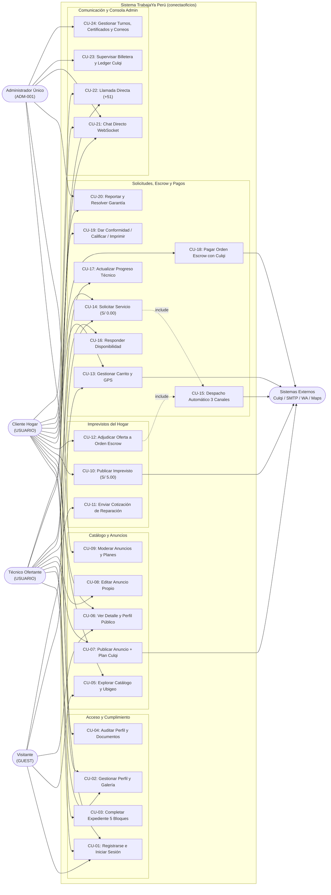
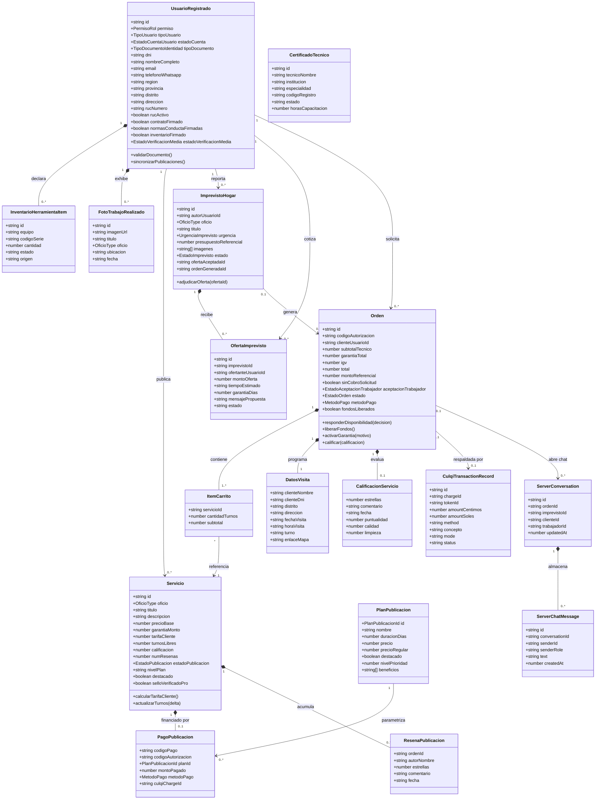
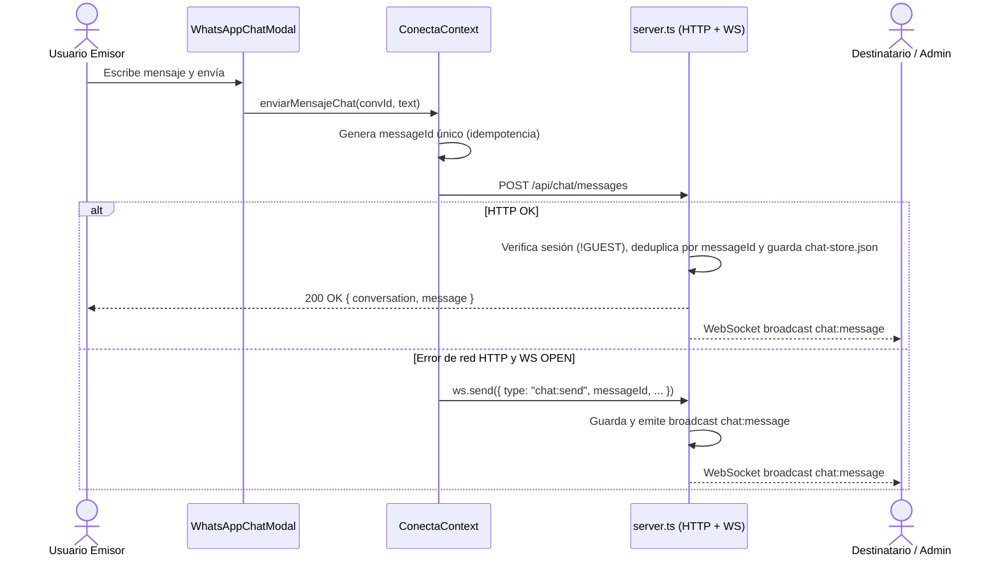
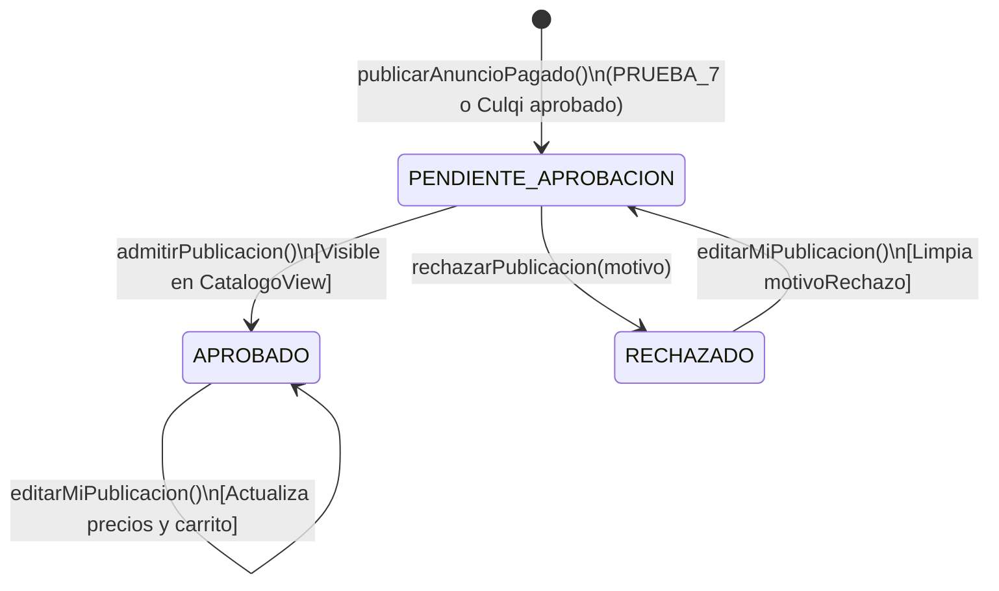
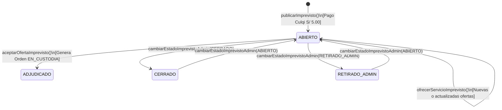
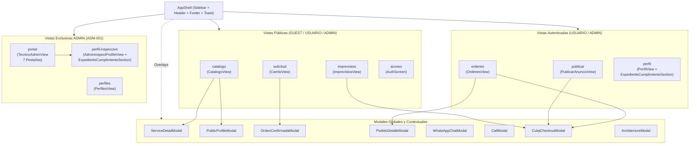

# Paso 2 — Análisis y Diseño del Sistema (UML, Flujos y Dominio Completo)

> **Proyecto:** TrabajaYa Perú (`conectaoficios`) — Plataforma Web Nacional de Servicios Multioficios Certificados con Custodia Fiduciaria (Escrow).  
> **Notación Estándar:** UML 2.5 (Casos de Uso, Clases de Dominio, Secuencia, Estados y Actividad/Navegación) + Modelo Entidad-Relación (ER).  
> **Cobertura:** 100% de los módulos, entidades, pantallas, modales y algoritmos implementados en el programa.

---

## 1. Análisis de Casos de Uso del Sistema

### 1.1 Diagrama General de Casos de Uso (Actores vs. 24 Casos de Uso)



### 1.2 Especificación Detallada de Casos de Uso Críticos

| ID y Nombre | Actor Principal | Precondiciones | Flujo Principal Resumido | Flujos Alternativos / Excepciones | Postcondiciones |
| :--- | :--- | :--- | :--- | :--- | :--- |
| **CU-01: Registro e Inicio de Sesión** | Visitante (`GUEST`) | Correo pertenece a `correosPermitidos`. | 1. Selecciona `tipoUsuario`, tipo de documento y Ubigeo. 2. Adjunta media/RUC/emergencia opcionales. 3. Valida unicidad de DNI/correo y crea cuenta `USUARIO` (`PENDIENTE`). | A1: Correo fuera de lista blanca → rechazo. A2: Cuenta `SUSPENDIDO` al loguear → acceso denegado. A3: `mediaOnLogin` adjuntada → pasa a `PENDIENTE_REVISION`. | Sesión activa en `conecta_current_user_pe_v2`; carrito `GUEST` migrado al nuevo usuario. |
| **CU-03 / CU-04: Expediente Legal (5 Bloques) y Auditoría** | Ofertante / `ADMIN` | Sesión iniciada. | 1. Usuario completa bloques 1–5 en `ExpedienteCumplimientoSection` (domicilio, RUC, antecedentes 3/3, MTC, contrato/reglamento/inventario). 2. Sistema marca `PENDIENTE_REVISION`. 3. `ADMIN` inspecciona en `AdminInspectProfileView` y aprueba (`VERIFICADO`). | A1: Documento borroso → `ADMIN` marca `OBSERVADO` con motivo o elimina archivo (`eliminarArchivoVerificacionAdmin`). | Expediente auditado; insignias (`Antecedentes 3/3`, `RUC`, `Reglamento`, `Verificado`) visibles en catálogo sin exponer archivos privados. |
| **CU-07 / CU-09: Publicación de Anuncio + Plan Culqi + Moderación** | Ofertante (`ACTIVO`) / `ADMIN` | `estadoCuenta === 'ACTIVO'`. | 1. Llena formulario (`precioBase >= 20`, habilidades, Ubigeo). 2. Elige plan (`PRUEBA_7`, `BASICO`, `DESTACADO`, `PRO`). 3. Paga con `CulqiCheckoutModal` si `precio > 0`. 4. Crea anuncio `PENDIENTE_APROBACION`. 5. `ADMIN` aprueba en pestaña `publicaciones`. | A1: `PRUEBA_7` solo si `0` anuncios previos y promo activa. A2: Rechazo Admin con motivo → autor edita (`editarMiPublicacion`) y reingresa a `PENDIENTE_APROBACION`. | Servicio visible en `CatalogoView` ordenado por prioridad (`PRO > DESTACADO > BASICO > PRUEBA`) y transacción registrada en ledger Culqi. |
| **CU-10 / CU-11 / CU-12: Imprevisto (`S/ 5.00`), Cotizaciones y Adjudicación** | Cliente / Ofertante | Sesión iniciada; pago `S/ 5.00` Culqi. | 1. Cliente publica emergencia con urgencia y hasta 4 fotos pagando `S/ 5.00`. 2. Ofertantes envían cotizaciones (`monto >= S/ 10`). 3. Cliente ordena por estrellas/precio y adjudica ganadora. 4. Sistema genera `Orden` Escrow y despacha 3 canales. | A1: Cliente sin rol ofertante pulsa `habilitarAmbosRoles`. A2: Auto-oferta bloqueada (salvo `ADMIN`). A3: Segunda oferta del mismo técnico reemplaza la anterior. | Imprevisto `ADJUDICADO`, ofertas restantes `DESCARTADA`, `Orden` creada en `EN_CUSTODIA` (`AUT-IMP-*`). |
| **CU-13 / CU-14 / CU-15: Carrito, GPS, Solicitud `S/ 0.00` y Despacho 3 Canales** | Cliente o `GUEST` | Carrito con `>= 1` ítem. | 1. Captura fecha, hora exacta, turno, dirección y GPS (`navigator.geolocation`). 2. Confirma solicitud `SIN_COBRO_SOLICITUD` (`S/ 0.00`). 3. Descuenta `turnosLibres`. 4. Backend ejecuta `POST /api/notifications/dispatch-order` (Chat WS + SMTP + WhatsApp). | A1: `GUEST` → orden marcada `Anónimo (No registrado)` sin DNI. A2: Sin credenciales SMTP/WA → en cola + respaldo manual (`Gmail`, `mailto:`, `wa.me`). | Orden `EN_CUSTODIA` (`SOL-PE-*`), conversación `ORD:*` creada, auditoría en `.data/dispatch-log.json`. |
| **CU-16 a CU-20: Ciclo Escrow, Pago Culqi, Garantía y Calificación** | Técnico / Cliente / `ADMIN` | Orden existente. | 1. Técnico asignado acepta (`ACEPTADA` → `EN_CAMINO`) → `EN_EJECUCION` → `COMPLETADO_PENDIENTE_CONFORMIDAD`. 2. Cliente paga vía Culqi (`ORDEN_CUSTODIA`), otorga conformidad o califica 1–5★ + 3 criterios. 3. Imprime comprobante. | A1: Técnico marca `NO_DISPONIBLE` → devuelve `turnosLibres`. A2: Cliente reporta falla → `OBSERVADO_GARANTIA` → `ADMIN` resuelve `REVISITA` o `LIBERAR`. | `CONFORMIDAD_Y_LIBERADO`, `fondosLiberados = true`, reseña propagada al catálogo y `billeteraTecnico` actualizada. |
| **CU-21 / CU-22: Chat Directo WebSocket y Llamada** | Usuario / `ADMIN` | Sesión iniciada (`currentUser !== null`). | 1. Abre hilo por orden/imprevisto/servicio (`POST /api/chat/conversations/ensure`). 2. Envía mensaje (`POST /api/chat/messages`) con `messageId` único. 3. Servidor guarda y emite broadcast WS `chat:message`. 4. Opcionalmente abre `CallModal` (`tel:+51...`). | A1: `GUEST` → bloqueo UI + `401` backend. A2: Fallo HTTP → fallback por `ws.send({ type: 'chat:send' })`. A3: Caída WS → reconexión cada `2500ms`. | Historial persistido en `.data/chat-store.json` sin mensajes duplicados. |

---

## 2. Diagrama de Clases del Dominio (UML `classDiagram`)

Modela fielmente las entidades de `src/types/index.ts`, `src/context/ConectaContext.tsx` y `server.ts`:



---

## 3. Diagramas de Secuencia del Sistema (UML `sequenceDiagram`)

### 3.1 Secuencia 1 — Registro, Expediente Legal de 5 Bloques y Auditoría Admin

```mermaid
sequenceDiagram
    actor U as Técnico (Usuario)
    participant AUTH as AuthScreen / PerfilView
    participant EXP as ExpedienteCumplimientoSection
    participant MEDIA as mediaUpload.ts
    participant CTX as ConectaContext
    actor A as Administrador Único (ADM-001)
    participant INSPECT as AdminInspectProfileView

    U->>AUTH: Registra cuenta (DNI/CE, correo permitido, Ubigeo)
    AUTH->>CTX: registrarUsuario(payload)
    CTX->>CTX: Valida documento + lista blanca + unicidad; asigna estadoCuenta = PENDIENTE
    CTX-->>AUTH: { ok: true } + migra carrito GUEST

    U->>EXP: Sube Domicilio, RUC, Antecedentes 3/3, Licencia MTC y firma Contrato/Inventario
    EXP->>MEDIA: compressImageToDataUrl / readCertificateFile / readPersonVideoFile
    MEDIA-->>EXP: DataURL comprimido o ObjectURL seguro
    EXP->>CTX: actualizarExpedienteCumplimiento(data)
    CTX->>CTX: Guarda expediente y cambia estadoVerificacionMedia = PENDIENTE_REVISION

    A->>INSPECT: Abre auditoría del usuario desde TecnicoAdminView
    A->>INSPECT: Verifica archivos privados y activa cuenta
    INSPECT->>CTX: cambiarEstadoCuentaUsuario(id, ACTIVO)
    INSPECT->>CTX: gestionarVerificacionUsuarioAdmin(id, VERIFICADO)
    CTX-->>U: Cuenta ACTIVA y VERIFICADA (habilitada para publicar anuncios)
```

### 3.2 Secuencia 2 — Publicación de Anuncio con Plan Comercial, Culqi y Moderación

```mermaid
sequenceDiagram
    actor T as Técnico (ACTIVO)
    participant PUB as PublicarAnuncioView
    participant CULQI as CulqiCheckoutModal
    participant SRV as server.ts (/api/payments/culqi/*)
    participant CTX as ConectaContext
    actor A as Administrador Único

    T->>PUB: Completa anuncio (precioBase, oficio, habilidades, Ubigeo) y selecciona Plan
    alt Plan pagado (BASICO / DESTACADO / PRO)
        PUB->>CULQI: Abre pasarela (concepto = ANUNCIO, amountCentimos)
        CULQI->>SRV: GET /api/payments/culqi/config
        SRV-->>CULQI: { configured, publicKey, mode }
        CULQI->>SRV: POST /api/payments/culqi/charge
        SRV->>SRV: Cobra vía Culqi API v2 o Sandbox y guarda culqi-transactions.json
        SRV-->>CULQI: { ok: true, transaction }
        CULQI-->>PUB: onSuccess(receipt)
    else Plan PRUEBA_7 (S/ 0.00 primera vez)
        PUB->>PUB: Omite pasarela (monto = 0)
    end
    PUB->>CTX: publicarAnuncioPagado(payload)
    CTX->>CTX: Calcula garantia 10% + tarifaCliente; estadoPublicacion = PENDIENTE_APROBACION
    A->>CTX: admitirPublicacion(servicioId)
    CTX-->>T: Anuncio APROBADO y visible en CatalogoView según prioridad de plan
```

### 3.3 Secuencia 3 — Imprevisto (`S/ 5.00`), Subasta de Cotizaciones y Adjudicación

```mermaid
sequenceDiagram
    actor C as Cliente Hogar
    actor T1 as Técnico 1
    actor T2 as Técnico 2
    participant IMP as ImprevistosView
    participant CULQI as CulqiCheckoutModal
    participant CTX as ConectaContext
    participant SRV as server.ts

    C->>IMP: Llena emergencia (urgencia, Ubigeo, hasta 4 fotos)
    IMP->>CULQI: Cobra tarifa fija S/ 5.00 (concepto = IMPREVISTO)
    CULQI-->>IMP: Recibo Culqi aprobado
    IMP->>CTX: publicarImprevisto(payload)
    CTX-->>IMP: Imprevisto creado (estado = ABIERTO)

    T1->>CTX: ofrecerServicioImprevisto(impId, S/ 120)
    T2->>CTX: ofrecerServicioImprevisto(impId, S/ 105)
    C->>IMP: Ordena ofertas por calificación o menor precio
    C->>CTX: aceptarOfertaImprevisto(impId, OFR_T2, crearOrdenEscrow = true)
    CTX->>CTX: Imprevisto = ADJUDICADO; OFR_T2 = ACEPTADA; OFR_T1 = DESCARTADA
    CTX->>CTX: Crea Orden Escrow (base + 10% garantía + 18% IGV) en EN_CUSTODIA
    CTX->>SRV: POST /api/notifications/dispatch-order
    SRV-->>T2: Notificación automática en Chat WS + Email + WhatsApp
```

### 3.4 Secuencia 4 — Solicitud (`S/ 0.00`) con GPS, Despacho 3 Canales, Escrow y Calificación

```mermaid
sequenceDiagram
    actor C as Cliente
    participant CART as CarritoView
    participant CTX as ConectaContext
    participant SRV as server.ts
    actor T as Técnico Asignado
    participant ORD as OrdenesView / PedidoDetalleModal

    C->>CART: Captura GPS (navigator.geolocation) y confirma solicitud S/ 0.00
    CART->>CTX: confirmarOrdenYEscrow(datosVisita, SIN_COBRO_SOLICITUD)
    CTX->>CTX: Descuenta turnosLibres; Orden en EN_CUSTODIA (total = 0, montoReferencial)
    CTX->>SRV: POST /api/notifications/dispatch-order
    SRV-->>T: Entrega inmediata en Chat WS + cola/envío SMTP + WhatsApp

    T->>ORD: Abre PedidoDetalleModal y acepta horario
    ORD->>CTX: responderDisponibilidadOrden(ordenId, ACEPTADA)
    CTX->>CTX: Transición automática EN_CUSTODIA -> EN_CAMINO
    T->>CTX: actualizarEstadoOrdenManual(EN_EJECUCION -> COMPLETADO_PENDIENTE_CONFORMIDAD)

    C->>ORD: Paga con Culqi (ORDEN_CUSTODIA) y registra calificación 5★
    ORD->>CTX: pagarOrdenConCulqi(ordenId, receipt)
    ORD->>CTX: calificarOrden(ordenId, calificacion)
    CTX->>CTX: Libera fondos (CONFORMIDAD_Y_LIBERADO), agrega reseña y recalcula promedio
```

### 3.5 Secuencia 5 — Chat Directo en Tiempo Real (REST + WebSocket + Fallback)



---

## 4. Máquinas de Estado del Sistema (`stateDiagram-v2`)

### 4.1 Ciclo de Vida de Publicaciones (`EstadoPublicacion`)


### 4.2 Ciclo de Vida de Imprevistos (`EstadoImprevisto`)


### 4.3 Ciclo de Vida de Cuenta y Verificación Documental
```mermaid
stateDiagram-v2
    state "Estado de Cuenta (EstadoCuentaUsuario)" as CTA {
        [*] --> PENDIENTE : registrarUsuario()
        PENDIENTE --> ACTIVO : Admin activa cuenta
        ACTIVO --> SUSPENDIDO : Admin suspende\n(bloquea login; prohibido en ADM-001)
        SUSPENDIDO --> ACTIVO : Admin reactiva cuenta
    }

    state "Verificación Documental (EstadoVerificacionMedia)" as VER {
        [*] --> SIN_ADJUNTOS : Registro sin archivos
        [*] --> PENDIENTE_REVISION : Registro con archivos
        SIN_ADJUNTOS --> PENDIENTE_REVISION : Usuario sube documento/media
        PENDIENTE_REVISION --> VERIFICADO : Admin aprueba verificación
        PENDIENTE_REVISION --> OBSERVADO : Admin observa / borra archivo
        VERIFICADO --> PENDIENTE_REVISION : Usuario reemplaza documento
        OBSERVADO --> PENDIENTE_REVISION : Usuario subsana archivo
        OBSERVADO --> SIN_ADJUNTOS : Admin borra último archivo
    }
```

*(La Máquina de Estados del Contrato Escrow de 6 estados — `EN_CUSTODIA`, `EN_CAMINO`, `EN_EJECUCION`, `COMPLETADO_PENDIENTE_CONFORMIDAD`, `CONFORMIDAD_Y_LIBERADO`, `OBSERVADO_GARANTIA` — está especificada en detalle en `docs/sdd/01-ARQUITECTURA-Y-DISENO-SDD.md`.)*

---

## 5. Diseño de Navegación y Arquitectura de Información (10 Vistas + Modales)



---

## 6. Diseño de Algoritmos y Motores Críticos del Sistema

### 6.1 Motor de Resolución Geográfica (`inferUbicacionPeru` — 6 Niveles)
Resuelve ubicaciones completas `{ region, provincia, distrito }` sobre el dataset de **25 regiones / 196 provincias / 1,872 distritos** (`src/data/peruUbigeo.ts`):
1. Si los 3 niveles ya vienen informados → retorna directamente.
2. Busca coincidencia en `LEGACY_CITY_MAP` (16 alias históricos como `"lima metropolitana"` o `"trujillo (la libertad)"`).
3. Busca coincidencia exacta de `distrito` en `PERU_UBIGEO` (acotado por `region`/`provincia` si existen).
4. Comprueba si el texto ingresado corresponde al nombre de una `provincia` o `region`.
5. Si existe `region` válida, asigna su primera provincia y primer distrito.
6. Fallback determinístico seguro: `{ region: 'Lima', provincia: 'Lima', distrito: raw || 'Miraflores' }`.

### 6.2 Algoritmo de Priorización Comercial del Catálogo (`CatalogoView.tsx`)
1. Filtra estrictamente `s.estadoPublicacion === 'APROBADO'`.
2. Aplica filtros reactivos acumulativos: búsqueda de texto (título, descripción, oficio, técnico, habilidades, distrito) + `filtroOficio` + `filtroRegion` + `filtroProvincia` + `filtroDistrito`.
3. Asigna peso comercial por plan: `PRO = 3`, `DESTACADO = 2`, `BASICO = 1`, `PRUEBA = 0`.
4. Ordena por `(pesoPlan desc, calificacion desc)`.

### 6.3 Motor Financiero Escrow y Billetera (`ConectaContext.tsx`)
- **Tarifa por Servicio:** `garantia = round2(precioBase * 0.10)`, `tarifaCliente = round2(precioBase + garantia)`.
- **Carrito / Contrato:** `subtotal = sum(cantidad * tarifaCliente)`, `igv = round2(subtotal * 0.18)`, `total = round2(subtotal + igv)`.
- **Conversión de Solicitud `S/ 0.00` a Pago Culqi (`pagarOrdenConCulqi`):**
  - Si la orden tenía `subtotalTecnico === 0`, calcula inversamente: `subtotalTecnico = round2(montoPagado / 1.1)` y `garantiaTotal = round2(montoPagado - subtotalTecnico)`.
- **Consolidación de `billeteraTecnico`:**
  - `fondosLiberados` = $\sum (\text{subtotalTecnico} - \text{garantiaTotal})$ donde `estado === 'CONFORMIDAD_Y_LIBERADO'`.
  - `fondosEnCustodia` = $\sum \text{subtotalTecnico}$ donde `estado !== 'CONFORMIDAD_Y_LIBERADO'`.
  - `fondoGarantia` = $\sum \text{garantiaTotal}$ de todas las órdenes.
  - `ingresosPublicaciones` = $\sum \text{pagoPublicacion.montoPagado}$ de servicios.
  - `ingresosImprevistos` = $\sum \text{pagoPublicacion.montoPagado}$ de imprevistos.

### 6.4 Propagación de Identidad y Reputación
- **`sincronizarPublicacionesConUsuario`:** Cada edición en `PerfilView` o `TecnicoAdminView` propaga instantáneamente nombre, DNI, teléfono, correo, Ubigeo y foto a todos los `servicios`, `carritosPorUsuario`, `selectedServiceForModal`, `imprevistos` y `ofertas` asociados al usuario.
- **`calificarOrden`:** Inserta o actualiza `ResenaPublicacion` por `ordenId` en todos los servicios coincidentes del técnico y recalcula el promedio ponderado acotado al intervalo `[1, 5]`.
