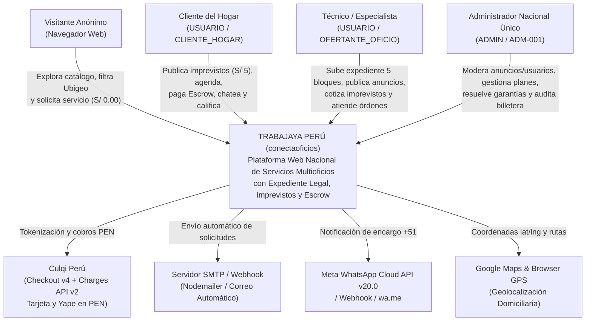
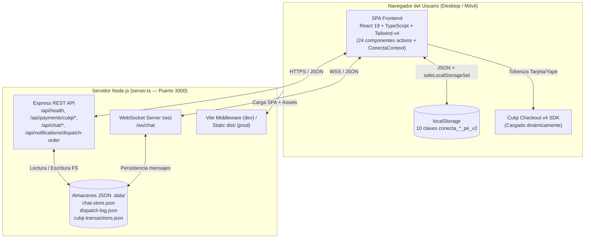
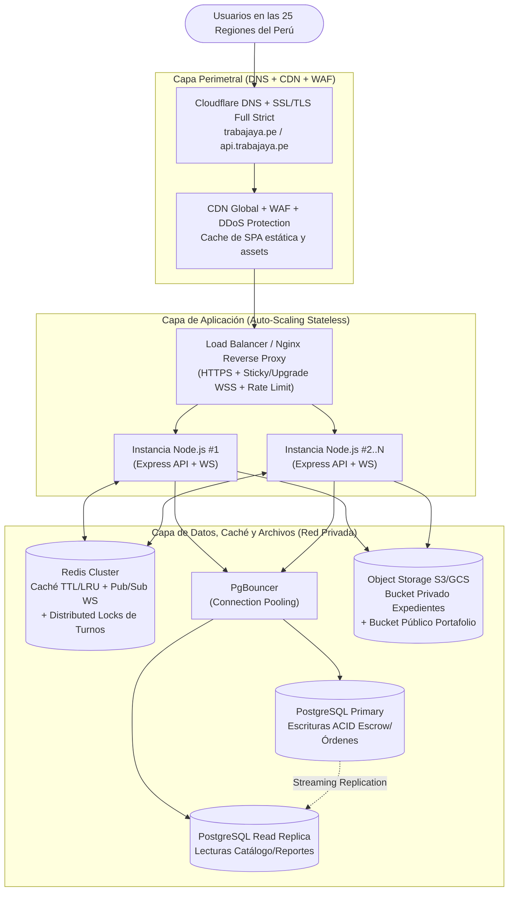
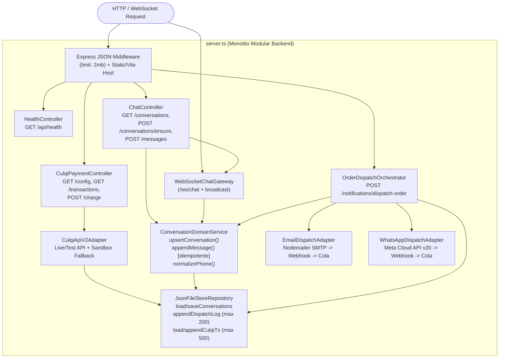
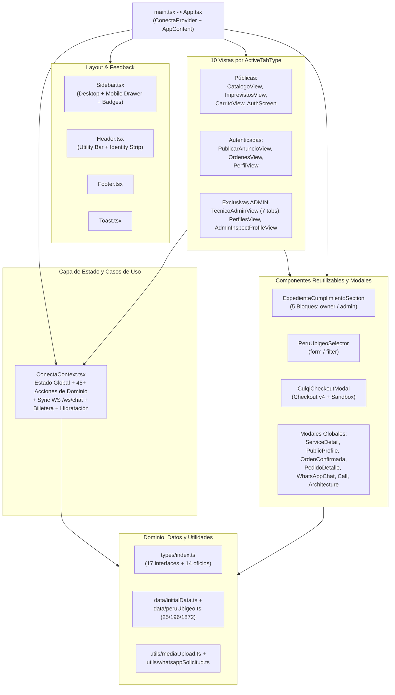

# Paso 3 — Arquitectura de Alto y Bajo Nivel (C4, 4+1 de Kruchten y Diseño Detallado)

> **Proyecto:** TrabajaYa Perú (`conectaoficios`) — Plataforma Web Nacional de Servicios Multioficios Certificados con Custodia Fiduciaria (Escrow).  
> **Enfoque Arquitectónico:** **Clean Architecture + Monolito Modular + Modelo C4 (Niveles 1 a 4) + Vistas 4+1 de Kruchten**.  
> **Alcance:** Arquitectura actual implementada en código y arquitectura objetivo de producción escalable.

---

# PARTE I — ARQUITECTURA DE ALTO NIVEL (HLA)

## 1. Estilos y Patrones Arquitectónicos

**TrabajaYa Perú** combina cinco decisiones arquitectónicas complementarias:
1. **Monolito Modular:** Todo el dominio reside en una unidad desplegable con fronteras claras entre módulos (`Identidad/RBAC`, `Cumplimiento/Acreditación`, `Catálogo/Ubigeo`, `Publicaciones/Planes`, `Imprevistos`, `Escrow/Órdenes`, `Pagos Culqi`, `Chat/Notificaciones`), evitando la latencia, complejidad operativa y transacciones distribuidas prematuras de microservicios.
2. **Clean Architecture (4 Capas Concéntricas):** Dependencias orientadas hacia el dominio puro (`Dominio ← Aplicación ← Infraestructura / Presentación`), permitiendo sustituir la persistencia (`localStorage`/JSON → PostgreSQL/Redis) sin alterar las reglas de negocio Escrow ni los componentes de UI.
3. **Domain Escrow Pattern (Máquina de Estados Finita):** Protege el ciclo de vida económico del contrato de servicio mediante transiciones explícitas e historial inmutable.
4. **Arquitectura Orientada a Eventos en Tiempo Real (WebSocket):** Sincronización bidireccional inmediata en `/ws/chat` para mensajería y entrega instantánea de órdenes.
5. **Degradación Elegante (*Graceful Degradation*):** Las pasarelas externas (Culqi, SMTP, Meta WhatsApp Cloud API) operan en modo real cuando existen credenciales en `.env` y conmutan automáticamente a Sandbox / Cola local + enlaces manuales sin detener la plataforma.

---

## 2. Modelo C4 — Nivel 1: Diagrama de Contexto del Sistema

---

## 3. Modelo C4 — Nivel 2: Diagrama de Contenedores (Actual vs. Producción Objetivo)

### 3.1 Contenedores Implementados Actualmente en el Repositorio

### 3.2 Contenedores de Producción Escalable (Arquitectura Objetivo)

---

## 4. Modelo de Vistas 4+1 de Kruchten

| Vista | Qué describe en TrabajaYa Perú | Artefacto / Evidencia |
| :--- | :--- | :--- |
| **1. Vista Lógica** | Descomposición funcional en 8 módulos de dominio, 17 entidades, 4 grupos / 14 oficios y reglas Escrow/RBAC. | `src/types/index.ts`, `02-ANALISIS-Y-DISENO-DEL-SISTEMA.md`. |
| **2. Vista de Procesos (Concurrencia)** | Concurrencia en chat WebSocket (`/ws/chat`), despacho asíncrono no bloqueante de 3 canales (`Promise.all` en WhatsApp API), reconexión WS cada `2500ms`, idempotencia por `messageId` y bloqueo de turnos (Redis en producción). | `server.ts`, `ConectaContext.tsx`, Diagramas de Secuencia. |
| **3. Vista de Desarrollo (Implementación)** | Organización modular en `server.ts`, `src/types/`, `src/context/`, `src/data/`, `src/utils/`, `src/components/`, build con `vite.config.ts` y validación `tsc --noEmit`. | Árbol de código en Sección 7 (Nivel 4). |
| **4. Vista Física (Despliegue)** | Topología actual monolítica en Node.js (`0.0.0.0:3000`) y topología cloud multi-capa (Cloudflare Edge → Load Balancer → Cluster Node.js → PostgreSQL/PgBouncer + Redis + S3). | Diagramas de Contenedores y Topología Física (Secciones 3 y 5). |
| **+1. Vista de Escenarios** | Flujos transversales críticos que validan las 4 vistas: solicitud `S/ 0.00` + despacho 3 canales, cobro Culqi, ciclo Escrow + garantía, subasta de imprevistos y moderación Admin. | `04-ESPECIFICACIONES-FUNCIONALES-MODULOS.md` (Escenarios Gherkin). |

---

## 5. Arquitectura Física y Zonas de Seguridad Perimetral

| Zona de Red | Componentes | Protocolos Permitidos | Controles de Seguridad |
| :--- | :--- | :--- | :--- |
| **Zona 0 — Borde (Edge)** | DNS + CDN + WAF (Cloudflare) | `HTTPS (443)`, `HTTP/3`, `WSS (443)` | TLS 1.3 obligatorio, HSTS, mitigación DDoS L3/L4/L7, caché de assets inmutables. |
| **Zona 1 — DMZ / Proxy** | Nginx / Cloud Load Balancer | `HTTPS → HTTP interno`, `WSS Upgrade` | Terminación TLS, `rate limiting`, cabeceras de seguridad (`CSP`, `X-Frame-Options`, `X-Content-Type-Options`), límite payload `2mb`. |
| **Zona 2 — Capa Aplicación** | Instancias Node.js (`server.ts`) | Puerto interno `3000` (sin exposición directa pública) | Variables secretas en `.env` / Secret Manager (`CULQI_SECRET_KEY`, `SMTP_PASS`, `WHATSAPP_ACCESS_TOKEN`), validación de entradas y RBAC. |
| **Zona 3 — Datos Privados** | PostgreSQL, PgBouncer, Redis, S3 Privado | Solo tráfico interno VPC (`5432`, `6379`, TLS) | Cifrado en reposo (AES-256) y tránsito (TLS), backups diarios PITR, URLs prefirmadas de corta duración para DNI y antecedentes (Ley N.º 29733). |

---

# PARTE II — ARQUITECTURA DE BAJO NIVEL (LLA)

## 6. Modelo C4 — Nivel 3: Diagrama de Componentes Internos

### 6.1 Componentes Internos del Backend (`server.ts`)

### 6.2 Componentes Internos del Frontend (`src/`)

---

## 7. Modelo C4 — Nivel 4: Diseño a Nivel de Código (Mapa de Módulos del Repositorio)

| Ruta del Archivo | Líneas Aprox. | Responsabilidad de Bajo Nivel | Dependencias Clave |
| :--- | :---: | :--- | :--- |
| `server.ts` | 852 | Punto de entrada único HTTP/WS, endpoints Culqi/Chat/Dispatch, persistencia `.data/*.json` y servicio SPA (Vite dev / `dist/` prod). | `express`, `ws`, `nodemailer`, `dotenv`, `vite` |
| `src/types/index.ts` | 702 | Contratos TypeScript puros del dominio, taxonomía `GRUPOS_OFICIO` (4) y `CATEGORIAS_OFICIO` (14), tipos de estado finito y expedientes. | Ninguna (capa pura de dominio) |
| `src/context/ConectaContext.tsx` | 3,810 | `ConectaProvider` y hook `useConecta()`: hidratación de 10 claves `localStorage`, enforcing de `ADM-001`, 45+ casos de uso, cliente WS `/ws/chat`, cálculos Escrow y `billeteraTecnico`. | `types`, `initialData`, `peruUbigeo`, `mediaUpload`, `whatsappSolicitud` |
| `src/data/peruUbigeo.ts` | — | Dataset completo del Perú (25 regiones, 196 provincias, 1,872 distritos) + `inferUbicacionPeru` (6 niveles) y `formatUbicacion`. | Ninguna |
| `src/data/initialData.ts` | — | Datos semilla completos: 20 usuarios, 17 servicios, 5 certificados, 4 órdenes, 3 imprevistos y 4 definiciones de planes. | `types` |
| `src/utils/mediaUpload.ts` | 133 | Compresión canvas JPEG (`compressImageToDataUrl`), lectura PDF/certificado (`<= 1.8 MB`), lectura video (`<= 2.2 MB` / `ObjectURL`) y `safeLocalStorageSet`. | Web APIs (`FileReader`, `Canvas`, `URL`) |
| `src/utils/whatsappSolicitud.ts` | 259 | Formateo `+51`, resolución de correo técnico, generación de URLs Google Maps/WhatsApp/Gmail/Mailto y plantillas de solicitud/respuesta. | `types`, `peruUbigeo` |
| `src/App.tsx` | 99 | Enrutamiento declarativo por `activeTab` con guardias de rol, layout shell y montaje de modales globales. | `ConectaContext`, `components/*` |
| `src/components/*.tsx` | 26 archivos | 24 componentes activos (vistas, formularios, expediente 5 bloques, pasarela Culqi, consola Admin de 7 pestañas, modales) + 2 legados (`AuthModal`, `PortalSelectorModal`). | `ConectaContext`, `lucide-react`, `motion` |
| `vite.config.ts` | 42 | Configuración Vite 8 + React + Tailwind v4 + plugin custom `copy-unbundled-src-assets` que copia `src/assets` a `dist/src/assets` en `closeBundle`. | `vite`, `@vitejs/plugin-react`, `@tailwindcss/vite` |

---

## 8. Patrones de Diseño de Bajo Nivel Aplicados en el Código

| Patrón de Diseño | Ubicación Exacta | Problema que Resuelve |
| :--- | :--- | :--- |
| **Facade / Context Provider** | `ConectaContext.tsx` (`useConecta`) | Expone una interfaz unificada y tipada de acciones de negocio y métricas derivadas a los 24 componentes sin prop-drilling. |
| **State Machine (Finite State)** | `EstadoOrden`, `EstadoPublicacion`, `EstadoImprevisto`, `EstadoVerificacionMedia` | Impide transiciones inválidas y registra cada cambio en `historialEstados[]`. |
| **Adapter Pattern** | `CulqiCheckoutModal.tsx` + `POST /api/payments/culqi/charge` | Aísla la aplicación del protocolo HTTP externo de Culqi v4/v2 permitiendo alternar transparentemente entre `live`, `test` y `sandbox`. |
| **Chain of Responsibility / Fallback** | `POST /api/notifications/dispatch-order` (SMTP → Webhook → Cola; WA Cloud → Webhook → Cola), `enviarMensajeChat` (HTTP → WS), `inferUbicacionPeru` (6 niveles) | Garantiza continuidad operativa ante ausencia de credenciales o degradación de red. |
| **Idempotency Key Pattern** | `appendMessage()` en `server.ts` (`messageId` y `auto-order-${ordenId}-${phone}`) | Evita duplicación de mensajes y notificaciones ante reintentos de red o reconexiones WebSocket. |
| **RBAC / Ownership Guard** | `setActiveTab`, `responderDisponibilidadOrden`, `canViewIdentityMedia` (`PublicProfileModal`, `AdminInspectProfileView`) | Garantiza control de acceso por rol (`ADMIN` vs `USUARIO`) y por propiedad del recurso (`autorUsuarioId`, `tecnicoDni`). |
| **Observer / Pub-Sub** | `WebSocketServer` (`wss.clients.forEach`) + `useEffect` listeners en `ConectaContext` | Propaga mensajes y creación de conversaciones en tiempo real a todos los clientes conectados. |
| **Controlled Component** | `PeruUbigeoSelector.tsx` (`mode="form" \| "filter"`) y `ExpedienteCumplimientoSection.tsx` (`mode="owner" \| "admin"`) | Reutiliza lógica compleja de UI en múltiples contextos sin duplicación de código. |

---

## 9. Arquitectura de Seguridad y Modelo de Amenazas (STRIDE)

| Amenaza STRIDE | Riesgo en el Sistema | Control Actual Implementado | Control Objetivo en Producción |
| :--- | :--- | :--- | :--- |
| **Spoofing (Suplantación)** | Ingreso de falsos técnicos o usurpación de cuenta `ADMIN`. | Unicidad de DNI/correo, lista blanca `correosPermitidos`, protección de `ADM-001` y bloqueo de `GUEST` en chat (`401`). | Hashing `argon2`, JWT en cookie `HttpOnly` + verificación de firma en handshake WS + 2FA para `ADMIN`. |
| **Tampering (Manipulación)** | Alteración de precios, estados Escrow o `turnosLibres` desde el navegador. | Recálculo de montos y validaciones en `ConectaContext` y `server.ts` (monto mínimo Culqi `100` céntimos). | Mover toda lógica de precios, transición Escrow y descuento de turnos a transacciones ACID en backend PostgreSQL. |
| **Repudiation (Repudio)** | Negación de envío de solicitud, aceptación de orden o cobro Culqi. | `historialEstados[]`, `.data/dispatch-log.json`, `.data/culqi-transactions.json` y comprobante imprimible con `codigoAutorizacion`. | Auditoría inmutable append-only en PostgreSQL con timestamp UTC, IP y actor autenticado. |
| **Information Disclosure (Fuga de Datos)** | Exposición de DNI, antecedentes PNP/PJ/INPE, teléfonos o llaves secretas. | `CULQI_SECRET_KEY` solo en servidor; `canViewIdentityMedia` oculta archivos privados; `CallModal` oculta teléfono a `GUEST`. | Bucket S3 privado con URLs prefirmadas (TTL 5 min), enrutamiento WS por sala privada y cifrado TLS 1.3. |
| **Denial of Service (DoS)** | Saturación de `/api/chat/messages`, `/api/payments/culqi/charge` o payloads gigantes. | Límite de cuerpo Express `2mb` y recorte de logs (`slice(0, 200)` / `slice(0, 500)`). | Rate limiting por IP/usuario (Nginx + Redis), WAF Cloudflare y límites de conexión WS. |
| **Elevation of Privilege** | Escalada de `USUARIO` a `ADMIN` o aceptación de orden ajena. | `registrarUsuario` fuerza `permiso: 'USUARIO'`; guardias en `setActiveTab`, `inspeccionarPerfil`, `responderDisponibilidadOrden` y gestión de planes. | Middleware backend `requireRole('ADMIN')` y validación de ownership en cada endpoint SQL. |

---

## 10. Tácticas Arquitectónicas por Atributo de Calidad

| Atributo | Tácticas Aplicadas / Planificadas | Paso del Proyecto donde se Implementa / Verifica |
| :--- | :--- | :--- |
| **Rendimiento** | Compresión de imágenes en cliente, lazy loading/code splitting en Vite, caché TTL/LRU + `ETag` en backend, índices compuestos en PostgreSQL. | Pasos 8, 9, 11 y 13 (k6) |
| **Escalabilidad** | Stateless Node.js + Load Balancer + Redis Pub/Sub para WS + Read Replicas PostgreSQL + CDN Edge. | Pasos 8, 9 y 10 |
| **Confiabilidad / Disponibilidad** | Healthcheck `/api/health`, reconexión WS automática (`2500ms`), idempotencia `messageId`, degradación elegante de integraciones externas. | Pasos 3, 5, 6 y 12 |
| **Seguridad** | RBAC estricto de 2 roles, secretos exclusivos de servidor, WAF/SSL Full Strict, privacidad documental de 5 bloques. | Pasos 3, 5, 6 y 10 |
| **Mantenibilidad** | Clean Architecture, SDD como fuente única de verdad, TypeScript estricto y pipelines CI/CD automatizados. | Pasos 4, 5, 12 y 14 |
