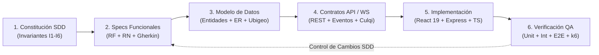

# Paso 4 — Desarrollo Basado en SDD (Spec-Driven Development)

> **Proyecto:** TrabajaYa Perú (`conectaoficios`)  
> **Suite SDD Completa:** [`docs/sdd/README.md`](../sdd/README.md)  
> **Enfoque:** *Spec-Driven Development* (SDD) combinado con *Software Design Document* (IEEE 1016).

---

## 1. Aplicación de la Metodología SDD en TrabajaYa Perú

El **Desarrollo Basado en Especificaciones (SDD)** convierte las especificaciones estructuradas en la **Fuente Única de Verdad (*Single Source of Truth*)** que gobierna el diseño, la codificación, las pruebas y la evolución del sistema. En lugar de improvisar funcionalidades sin contrato previo, cada módulo del programa se define bajo un ciclo estricto de 6 fases:

---

## 2. Artefactos SDD Generados (Trazabilidad Completa del Programa)

La especificación integral de todo el código de `conectaoficios` se encuentra organizada en **7 documentos normativos** dentro de `docs/sdd/`:

| Documento SDD | Propósito dentro del Ciclo SDD | Cobertura en el Programa |
| :--- | :--- | :--- |
| [`docs/sdd/README.md`](../sdd/README.md) | Índice maestro y guía de navegación del repositorio SDD. | Mapa completo de carpetas y de los 9 módulos funcionales. |
| [`docs/sdd/00-CONSTITUCION-SDD.md`](../sdd/00-CONSTITUCION-SDD.md) | **Constitución del Proyecto:** principios arquitectónicos e invariantes no negociables (`I1` a `I6`). | RBAC 2 roles + Admin Único `ADM-001`, fórmulas Escrow/IGV/Garantía 10%, privacidad Ley 29733, identidad en chat y seguridad Culqi. |
| [`docs/sdd/01-ARQUITECTURA-Y-DISENO-SDD.md`](../sdd/01-ARQUITECTURA-Y-DISENO-SDD.md) | **Documento de Diseño Técnico (IEEE 1016):** capas Clean Architecture, Monolito Modular, diagramas y ADRs. | Stack exacto, 26 archivos de `src/components/`, máquina de estados Escrow, secuencias de despacho y Culqi, y 6 ADRs (`ADR-001` a `ADR-006`). |
| [`docs/sdd/02-MODELO-DE-DATOS-Y-DOMINIO.md`](../sdd/02-MODELO-DE-DATOS-Y-DOMINIO.md) | **Especificación de Dominio y Datos:** entidades, taxonomía, geografía y persistencia. | 17 entidades TypeScript, 4 grupos / 14 oficios, 5 bloques del expediente legal, Ubigeo Perú (25/196/1,872), 10 claves `localStorage`, 3 JSON en `.data/` y datos semilla. |
| [`docs/sdd/03-CONTRATOS-API-Y-EVENTOS.md`](../sdd/03-CONTRATOS-API-Y-EVENTOS.md) | **Contratos Formales de Interfaz:** API REST, WebSocket e integraciones externas. | `/api/health`, `/api/payments/culqi/*`, `/api/chat/*`, `/api/notifications/dispatch-order`, `WS /ws/chat`, Culqi v4/v2, SMTP, WhatsApp Cloud API y `.env`. |
| [`docs/sdd/04-ESPECIFICACIONES-FUNCIONALES-MODULOS.md`](../sdd/04-ESPECIFICACIONES-FUNCIONALES-MODULOS.md) | **Especificaciones Ejecutables por Módulo:** RF, RN y criterios de aceptación Gherkin (`Given / When / Then`). | Los **9 módulos funcionales (M1–M9)** de extremo a extremo. |
| [`docs/sdd/05-PLAN-TECNICO-TAREAS-Y-MATRIZ-VERIFICACION.md`](../sdd/05-PLAN-TECNICO-TAREAS-Y-MATRIZ-VERIFICACION.md) | **Plan Técnico, QA y Auditoría de Brechas:** trazabilidad, escenarios E2E y roadmap. | Matriz Spec ↔ Código ↔ QA, 8 brechas técnicas (`GAP-01` a `GAP-08`) y backlog en 4 fases. |

---

## 3. Validación del Ciclo SDD en los Siguientes Pasos

A partir de esta base SDD, los pasos técnicos consecutivos ejecutan y demuestran las especificaciones directamente en código:
* **Paso 5 (Pruebas Unitarias e Integración):** traduce las invariantes (`I1–I6`) y contratos API (`03-CONTRATOS-API-Y-EVENTOS.md`) en suites automatizadas ejecutables con **Vitest + Supertest**.
* **Paso 6 (Pruebas End to End):** automatiza los escenarios Gherkin críticos (`04-ESPECIFICACIONES-FUNCIONALES-MODULOS.md`) en navegador real con **Playwright**.
* **Pasos 8–13 (Escalabilidad, BD, DNS/CDN, Caché, CI/CD, k6):** materializan las remediaciones del plan técnico (`05-PLAN-TECNICO-TAREAS-Y-MATRIZ-VERIFICACION.md`).
