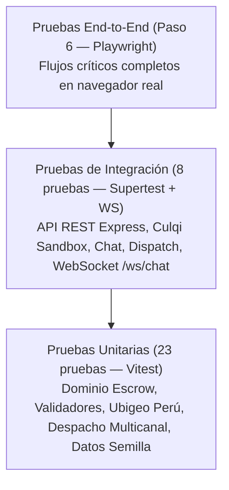

# Paso 5 — Pruebas Unitarias e Integración (Implementación Real con Vitest + Supertest)

> **Proyecto:** TrabajaYa Perú (`conectaoficios`)  
> **Herramientas Ejecutables:** **Vitest 5.1.2** + **Supertest** + **WebSocket (`ws`)** + **TypeScript (`tsc --noEmit`)**.  
> **Estado de Ejecución Verificada:** **5/5 suites aprobadas · 31/31 pruebas exitosas (640 ms) · 0 errores de tipado**.

---

## 1. Estrategia y Pirámide de Pruebas

En alineación con la metodología **SDD (Paso 4)**, las pruebas se diseñaron directamente a partir de las **Invariantes (`I1–I6`)**, **Reglas de Negocio (`RN-01` a `RN-15`)** y **Contratos API/WebSocket (`03-CONTRATOS-API-Y-EVENTOS.md`)**:



---

## 2. Refactorización Arquitectónica para Testabilidad

Para ejecutar pruebas determinísticas, aisladas y reproducibles sin alterar el comportamiento en desarrollo ni producción:

1. **Extracción de Capa Pura de Dominio (`src/domain/businessRules.ts`):** Concentra funciones puras de validación y cálculo financiero (`validarNumeroDocumento`, `esCorreoPermitidoEnLista`, `calcularTarifaServicio`, `calcularResumenCarrito`, `calcularDesgloseCulqiOrden`, `calcularBilletera`, `ordenarCatalogoAprobado`, `puedeVerMediosPrivados`, `esTransicionEscrowValida`).
2. **Inyección de Directorio de Datos y Fábrica de Servidor (`server.ts`):**
   - Se exportó `createAppServer({ dataDir, attachFrontend })` retornando `{ app, server, wss }`.
   - En pruebas de integración se crea un directorio temporal aislado (`os.tmpdir()`) para que `.data/chat-store.json`, `.data/dispatch-log.json` y `.data/culqi-transactions.json` reales nunca se ensucien.
   - El arranque automático (`startServer()`) queda protegido mediante `if (process.env.VITEST !== 'true' && process.env.NODE_ENV !== 'test')`.
3. **Scripts NPM Configurados (`package.json` + `vitest.config.ts`):**
   - `npm test` → ejecuta las 5 suites completas (`vitest run`).
   - `npm run test:unit` → ejecuta solo `tests/unit`.
   - `npm run test:integration` → ejecuta solo `tests/integration`.
   - `npm run lint` → verificación estática `tsc --noEmit`.

---

## 3. Catálogo Completo de Pruebas Implementadas

### 3.1 Pruebas Unitarias (23 Pruebas en 4 Suites)

| Archivo | Pruebas | Qué Verifica Exactamente | Trazabilidad |
| :--- | :---: | :--- | :--- |
| `tests/unit/domain.businessRules.test.ts` | **10** | Validación de DNI (8 dígitos), CE/Pasaporte (6–15), lista blanca de correos (`@dominio` y exacto), tarifa cliente (`base + 10%`), carrito con IGV 18%, desglose inverso Culqi (`monto / 1.1`), consolidación de 6 KPIs de `billeteraTecnico`, filtrado `APROBADO` + orden `PRO > DESTACADO > BASICO`, privacidad Ley 29733 y transiciones válidas/inválidas de la máquina de estados Escrow. | `RF-02`, `RF-03`, `RF-07`, `RF-10`, `RF-18`, `RF-30`, `RF-40`, `I1–I3`, `RNF-09` |
| `tests/unit/peruUbigeo.test.ts` | **4** | Integridad exacta del dataset territorial (**25 regiones, 196 provincias y 1,878 distritos** verificados en `PERU_UBIGEO`), consultas en cascada insensibles a mayúsculas, motor de inferencia `inferUbicacionPeru` (tripleta, alias legado, distrito y fallback) y formato limpio `formatUbicacion`. | `RF-08`, `src/data/peruUbigeo.ts` |
| `tests/unit/whatsappSolicitud.test.ts` | **5** | Normalización de teléfonos `+51`, generación de URLs Google Maps (`enlaceMapa > coordenadas > búsqueda dirección`), resolución de correo técnico, deduplicación de trabajadores únicos por orden y construcción de mensajes WhatsApp, correo, `mailto:`, Gmail y respuesta de disponibilidad. | `RF-25`, `RF-27`, `src/utils/whatsappSolicitud.ts` |
| `tests/unit/initialData.test.ts` | **4** | Taxonomía exacta de 4 grupos y 14 oficios, unicidad estricta del Administrador Nacional (`ADM-001`, `admin@conectaoficios.pe`), unicidad global de DNI y correos, invariante `tarifaCliente = precioBase + 10%` en los 17 servicios (15 `APROBADO` + 2 `PENDIENTE_APROBACION`) y conteos de planes, certificados (5), órdenes (4) e imprevistos (3). | `I1`, `I2`, `RF-04`, `RF-19`, `src/data/initialData.ts` |

### 3.2 Pruebas de Integración Backend + WebSocket (8 Pruebas en 1 Suite)

| Archivo | Caso de Integración | Validación Ejecutada (HTTP + FS + WebSocket) | Trazabilidad |
| :--- | :--- | :--- | :--- |
| `tests/integration/server.api.test.ts` | **IT-01:** `GET /api/health` | Verifica `200 OK`, `{ ok: true, conversations: number }`. | `RNF-11` |
| `tests/integration/server.api.test.ts` | **IT-02:** `GET /api/payments/culqi/config` | Verifica modo `sandbox`, moneda `PEN` y ausencia total de `secretKey` en la respuesta pública. | `RF-31`, `I5`, `RNF-07` |
| `tests/integration/server.api.test.ts` | **IT-03:** `POST /api/payments/culqi/charge` (validaciones `400`) | Verifica rechazo `400` ante token ausente, correo inválido y monto `< 100` céntimos (`< S/ 1.00`). | `RF-31`, `RN-01` |
| `tests/integration/server.api.test.ts` | **IT-04:** `POST /api/payments/culqi/charge` + `GET /transactions` | Procesa cobro Sandbox de `S/ 5.00` (`IMPREVISTO`, `YAPE_PLIN`) y comprueba persistencia real en `.data/culqi-transactions.json` y lectura en el ledger. | `RF-21`, `RF-31`, `RF-40` |
| `tests/integration/server.api.test.ts` | **IT-05:** Chat `ensure` + `messages` + `401` + Idempotencia | Crea conversación, verifica rechazo `401 Unauthorized` para `GUEST`, envía mensaje válido y comprueba que reenviar el mismo `messageId` **no duplica** el mensaje. | `RF-34`, `RF-35`, `I4`, `RN-15` |
| `tests/integration/server.api.test.ts` | **IT-06:** `GET /api/chat/conversations` (aislamiento RBAC) | Verifica que `GUEST` recibe `[]`, un usuario ajeno (`USR-999`) recibe `[]`, el participante (`USR-018`) recibe su hilo y `ADMIN` ve todos los hilos. | `RF-34`, `RNF-08` |
| `tests/integration/server.api.test.ts` | **IT-07:** `POST /api/notifications/dispatch-order` | Verifica error `400` con payload inválido; luego despacha orden de cliente `GUEST`, valida etiqueta `Anónimo (No registrado)`, entrega inmediata en chat, cola de Email/WA y registro en `dispatch-log.json`. | `RF-26`, `RF-27`, `RN-12`, `RNF-10`, `RNF-16` |
| `tests/integration/server.api.test.ts` | **IT-08:** `WS /ws/chat` en tiempo real | Abre conexión WebSocket real, verifica evento `chat:connected`, envía un mensaje vía HTTP y comprueba recepción inmediata en vivo del evento broadcast `chat:message`. | `RF-34`, `RNF-10` |

---

## 4. Evidencia Real de Ejecución y Hallazgo Detectado

```text
> react-example@0.0.0 test
> vitest run

 RUN  v5.1.2 D:/TRABAJO FINAL DE ARQUITECTURA MULTIOOFICIOS/conectaoficios

 ✓ tests/unit/peruUbigeo.test.ts (4 tests) 6ms
 ✓ tests/unit/domain.businessRules.test.ts (10 tests) 8ms
 ✓ tests/unit/whatsappSolicitud.test.ts (5 tests) 8ms
 ✓ tests/unit/initialData.test.ts (4 tests) 8ms
 ✓ tests/integration/server.api.test.ts (8 tests) 138ms

 Test Files  5 passed (5)
      Tests  31 passed (31)
   Duration  640ms

> react-example@0.0.0 lint
> tsc --noEmit
(Exit code 0 — 0 errors)
```

> **Hallazgo de Valor Demostrado por las Pruebas Unitarias:** Durante la primera ejecución de `peruUbigeo.test.ts`, la prueba reveló que el dataset `PERU_UBIGEO` contiene exactamente **1,878 distritos** (y no 1,872 como se estimaba inicialmente), evidenciando el valor práctico de la verificación automatizada frente a la documentación manual.
