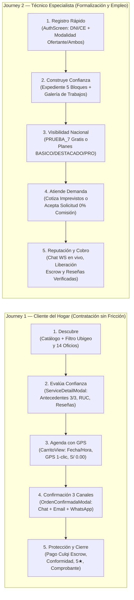

# Paso 7 — Interfaz y Experiencia de Usuario (UI/UX, Design System y Accesibilidad)

> **Proyecto:** TrabajaYa Perú (`conectaoficios`) — *"Tu talento, nuestro compromiso"*  
> **Stack UI:** React 19 + Tailwind CSS v4 (`@tailwindcss/vite`) + Lucide Icons + Motion + Google Fonts (`Plus Jakarta Sans` & `JetBrains Mono`).  
> **Marcos de Evaluación:** Atomic Design, 10 Heurísticas de Usabilidad de Jakob Nielsen y WCAG 2.1 Nivel AA.

---

## 1. Sistema de Diseño (*Design System*) de TrabajaYa Perú

Definido en [`index.html`](../../index.html) y [`src/index.css`](../../src/index.css) y aplicado consistentemente en los 24 componentes activos de `src/components/`:

### 1.1 Tokens de Color e Identidad Semántica

| Token / Clase | Hex / Escala Tailwind | Uso Semántico en la Interfaz |
| :--- | :--- | :--- |
| `--color-primary` / `.bg-navy-900` | `#0d3b66` | Color institucional primario (acciones principales, encabezados de confianza, botones de confirmación). |
| `--color-primary-dark` / `.bg-navy-950` | `#001e3d` | Contenedores estructurales (`Sidebar`, `Header`, banners Hero, headers de modales). |
| `--color-accent` / `.bg-gold-400` / `amber-400` | `#f4d06f` / `#fbbf24` | Acento de marca para rol **Usuario/Perú**, CTAs destacados, estrellas de reputación y badges `PRO`/`Destacado`. |
| `--color-success` / `emerald-600` | `#16a34a` | Acciones de conversión positiva (`Solicitar Visita`, `Enviar Solicitud S/ 0.00`, `Imprevistos`, `Chat Directo`, verificación aprobada y liberación Escrow). |
| `sky-500` / `sky-950` | `#0ea5e9` / `#082f49` | **Diferenciador cromático del rol `ADMIN`**: al entrar como Administrador Único (`ADM-001`), el acento del `Sidebar` y la franja del `Header` cambian de `amber` a `sky` para prevenir errores operativos por confusión de rol. |
| `rose-600` / `rose-50` | `#e11d48` / `#fff1f2` | Alertas de error, rechazo de publicaciones, estado `OBSERVADO_GARANTIA`, cierre de sesión y cuentas suspendidas. |
| `slate-50` a `slate-900` | Escala neutra | Fondo de trabajo limpio (`bg-slate-50`), tarjetas blancas con bordes sutiles (`border-slate-200`) y jerarquía tipográfica legible. |

### 1.2 Tipografía y Formato Numérico
- **Fuente Principal (`Plus Jakarta Sans`, pesos 300–800):** Títulos geométricos de alto impacto (`font-extrabold` / `font-black`), cuerpo legible (`antialiased`) y excelente renderizado de tildes y caracteres del español peruano (`ñ`, `á`, `é`, `í`, `ó`, `ú`, `S/`).
- **Fuente Monoespaciada (`JetBrains Mono`, pesos 400–600):** Códigos de orden (`PED-2026-*`), códigos de autorización (`SOL-PE-*`, `AUT-NBZ-*`, `AUT-CLQ-*`), DNI, RUC, correos electrónicos y cifras alineadas con `tabular-nums` en tablas, badges y pasarela Culqi.

### 1.3 Principios de Diseño Atómico (*Atomic Design*)
- **Átomos:** Botones con área táctil segura (`min-h-[40px]` / `min-h-[44px]`), badges semánticos (`PRO`, `Destacado`, `Verificado`, `Antecedentes 3/3`, `RUC`, `Reglamento`), inputs con estados de foco (`focus:ring-2`), iconos vectoriales uniformes (`lucide-react`).
- **Moléculas:** `PeruUbigeoSelector` (3 selects en cascada + modo personalizado `__CUSTOM__`), chips rápidos de horario (`QUICK_HOURS`), chips de habilidades (`tareasComunes`), notificaciones flotantes `Toast` y tarjetas de KPIs financieros.
- **Organismos:** `Sidebar`, `Header` (con franja de sesión conectada), `ExpedienteCumplimientoSection` (5 bloques colapsables/estructurados), `CulqiCheckoutModal` (Tarjeta + Yape), línea de tiempo Escrow de 5 hitos en `OrdenesView`, y `WhatsAppChatModal` (bandeja de 2 paneles).
- **Plantillas y Páginas:** `AppShell` responsive con marca de agua circular institucional (`opacity-[0.055]`, `pointer-events-none`, `aria-hidden="true"`) y 10 vistas (`ActiveTabType`).

---

## 2. Arquitectura de Información y Diseño Responsive

### 2.1 Estrategia Adaptativa Multi-Dispositivo
| Breakpoint | Layout Aplicado | Comportamiento Validado |
| :--- | :--- | :--- |
| **Móvil (`360px – 639px`)** | `Header` con botón hamburguesa (`44×44px`) + logotipo compacto; `Sidebar` se convierte en drawer deslizable con cierre explícito; grids a 1 columna. | Verificado automáticamente en `E2E-06` (`375×812`): `scrollWidth - innerWidth <= 4px` (cero desbordamiento horizontal). |
| **Tablet (`640px – 1023px`)** | Grids adaptativos de 2 columnas (`sm:grid-cols-2`), formularios de 2 columnas y drawer lateral bajo demanda. | Transición fluida sin recorte de etiquetas ni botones de acción. |
| **Escritorio (`1024px+`, `lg:`)** | `Sidebar` fijo izquierdo (`256px`, `lg:pl-64`) + `Header` sticky contextual con título de sección + contenedor central `max-w-6xl` + grids de 3–4 columnas. | Navegación de 1 clic con badges en vivo siempre visibles. |

### 2.2 Navegación Contextual por Rol
1. **Visitante (`GUEST`):** 4 accesos directos de baja fricción (`Catálogo`, `Imprevistos Hogar`, `Publicar Anuncio`, `Mi Solicitud`) + botón destacado `Iniciar Sesión` (opcional para explorar y solicitar).
2. **Usuario Registrado (`USUARIO`):** añade `Mis Órdenes` (con contador de órdenes por aceptar/calificar) y `Mi Perfil` (acceso directo al expediente y galería).
3. **Administrador Único (`ADMIN`):** reordena la barra hacia gestión nacional (`Consola Admin` con contador unificado de pendientes, `Catálogo`, `Perfiles`, `Imprevistos`, `Órdenes Globales`, `Mi Perfil`).

---

## 3. Mapas de Experiencia de Usuario (*User Journeys*)

---

## 4. Evaluación Heurística — Las 10 Heurísticas de Jakob Nielsen

| # | Heurística de Nielsen | Evaluación | Evidencia Real en el Código (`conectaoficios`) | Mejora Recomendada |
| :-: | :--- | :---: | :--- | :--- |
| **1** | **Visibilidad del estado del sistema** | ✅ Alta | Badges numéricos reactivos en `Sidebar` (carrito, imprevistos, órdenes, moderación, chat), franja de sesión en `Header`, línea de tiempo Escrow de 5 hitos en `OrdenesView`, spinners de envío (`isProcessing`) y `Toast` global. | Añadir indicador visual de estado de conexión WebSocket (`En línea / Reconectando...`) en el header de `WhatsAppChatModal`. |
| **2** | **Correspondencia con el mundo real** | ✅ Alta | Lenguaje natural en español peruano (`es-PE`), moneda `S/`, oficios cotidianos con iconos, turnos (`Mañana`, `Tarde`, `Urgencia`), documentos locales (`DNI`, `RUC`, `Yape`, `SENATI/SENCICO/CAPECO`). | Mantener consistencia de marca única (`TrabajaYa Perú`) eliminando referencias residuales a `ConectaOficios` en textos históricos. |
| **3** | **Control y libertad del usuario** | ✅ Alta | Botón `Volver al Catálogo` en vistas secundarias, edición libre de perfil y publicaciones, cancelación limpia de modales y reversión de `NO_DISPONIBLE` restaurando turnos. | Permitir cancelar una solicitud en estado `EN_CUSTODIA` antes de ser aceptada por el técnico. |
| **4** | **Consistencia y estándares** | ✅ Alta | Sistema de diseño unificado (`navy-950`, `amber-400`, `emerald-600`, `sky-500` para Admin), `PeruUbigeoSelector` reutilizado en 6 pantallas y `ExpedienteCumplimientoSection` compartido entre usuario y admin. | Retirar componentes legados no usados (`AuthModal.tsx`, `PortalSelectorModal.tsx`). |
| **5** | **Prevención de errores** | ✅ Alta | Validación inline en tiempo real en `AuthScreen` (`✓ Permitido / ✕ No permitido`), fecha mínima `today` en `CarritoView`, botón deshabilitado `Sin turnos`, compresión automática de imágenes (`mediaUpload.ts`) y `safeLocalStorageSet`. | Añadir diálogo de confirmación antes de acciones destructivas irreversibles en Consola Admin (ej. eliminar usuario o imprevisto). |
| **6** | **Reconocimiento antes que recuerdo** | ✅ Alta | Lista visible de dominios permitidos en `AuthScreen`, chips de horarios rápidos (`QUICK_HOURS`), chips de tareas sugeridas (`tareasComunes`) y resumen de los 3 canales antes de enviar la solicitud. | Guardar últimas búsquedas o distrito frecuente del usuario en el catálogo. |
| **7** | **Flexibilidad y eficiencia de uso** | ✅ Alta | Búsqueda en vivo sin recargar, captura GPS en 1 clic (`navigator.geolocation`), activación a `AMBOS` en 1 clic desde `ImprevistosView`, chips de respuesta rápida en `WhatsAppChatModal` y botones de autocompletado Sandbox en `CulqiCheckoutModal`. | Añadir atajos de teclado (`/` para buscar en catálogo, `Esc` para cerrar modales). |
| **8** | **Diseño estético y minimalista** | ✅ Media-Alta | Tarjetas limpias, espaciado equilibrado, jerarquía clara de precios y badges agrupados. | Paginar o virtualizar listas cuando el catálogo supere 50 servicios y sintetizar tarjetas densas de `OrdenesView` con acordeones colapsables. |
| **9** | **Ayuda para diagnosticar y recuperarse de errores** | ✅ Alta | Mensajes específicos y accionables con icono `AlertCircle`; en login fallido por correo no registrado ofrece botón directo **`Registrar "<email>" ahora`** prellenando el correo. | Agregar botón "Reintentar" explícito si falla `GET /api/payments/culqi/transactions` o el despacho automático. |
| **10** | **Ayuda y documentación** | ✅ Alta | Bloque explicativo de 3 pasos sobre Escrow al pie de `CatalogoView`, `ArchitectureModal` interactivo, avisos de seguridad en `CallModal` y leyendas claras de `S/ 0.00`. | Añadir centro de preguntas frecuentes (FAQ) colapsable para nuevos técnicos sobre cómo obtener antecedentes PNP/PJ/INPE. |

---

## 5. Auditoría de Accesibilidad (WCAG 2.1 Nivel AA)

| Principio WCAG | Estado Actual en el Programa | Acciones de Fortalecimiento (Backlog UX) |
| :--- | :--- | :--- |
| **Perceptible** | Alto contraste (`white` sobre `navy-950` > 14:1; `slate-800` sobre `white` > 12:1), texto alternativo `alt` en logotipos, `aria-hidden="true"` en marca de agua decorativa. | Asegurar `alt` descriptivo en todas las miniaturas de `fotosTrabajos` e imágenes de `ImprevistosView`. |
| **Operable** | Áreas táctiles móviles `>= 44×44px` (`min-h-[44px]`), botones semánticos `<button type="button">`, `aria-label` en drawer móvil y cierre de modales. | Implementar cierre por tecla `Escape` y trampa de foco (*focus trap*) en los 8 modales globales; agregar enlace `Saltar al contenido principal`. |
| **Comprensible** | Atributo `<html lang="es">`, etiquetas explícitas de campos obligatorios (`*`), mensajes de validación descriptivos y feedback inmediato. | Vincular cada `<label htmlFor="...">` con `id` único en todos los formularios para lectores de pantalla. |
| **Robusto** | HTML5 semántico (`<header>`, `<nav>`, `<main>`, `<footer>`, `<section>`), React 19 con tipado TypeScript estricto. | Añadir `role="dialog"`, `aria-modal="true"` y `aria-live="polite"` en `Toast.tsx` para anuncios automáticos a lectores de pantalla. |
