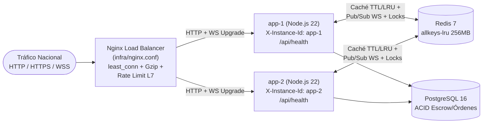

# Paso 8 — Escalabilidad del Frontend y Backend (Implementación Real y Topología Horizontal)

> **Proyecto:** TrabajaYa Perú (`conectaoficios`)  
> **Implementaciones Reales Aplicadas:** React `lazy()` + `Suspense` (`src/App.tsx`), Vite `manualChunks` (`vite.config.ts`), Rate Limiting + Security Headers + `Cache-Control` + Graceful Shutdown (`server.ts`), `Dockerfile` multi-stage, `infra/nginx.conf` Load Balancer y `docker-compose.yml` multi-réplica.

---

## 1. Estrategia de Escalabilidad Frontend

Para atender tráfico concurrente en las **25 regiones del Perú** incluso sobre redes móviles 3G/4G con ancho de banda limitado, se implementaron cuatro tácticas reales:

1. **División de Código por Ruta (`React.lazy` + `Suspense` en [`src/App.tsx`](../../src/App.tsx)):**
   - Solo `CatalogoView` se carga en el bundle inicial para minimizar el *First Contentful Paint (FCP)*.
   - Las 9 vistas restantes (`TecnicoAdminView`, `AdminInspectProfileView`, `PerfilesView`, `PerfilView`, `OrdenesView`, `ImprevistosView`, `PublicarAnuncioView`, `CarritoView`, `AuthScreen`) —y sus dependencias pesadas como `ExpedienteCumplimientoSection` y `CulqiCheckoutModal`— se descargan **únicamente bajo demanda**. Un visitante o cliente jamás descarga los `65.55 kB` de la Consola Admin ni los `30.04 kB` de `AdminInspectProfileView`.
2. **Separación de Chunks Inmutables (`manualChunks` en [`vite.config.ts`](../../vite.config.ts)):**
   - `vendor-react` (`react` + `react-dom`), `vendor-icons` (`lucide-react`), `vendor-motion` (`motion`) y `data-peru-ubigeo` (1,878 distritos) se empaquetan por separado con hash criptográfico. Al desplegar nuevas versiones de negocio, el navegador/CDN reutiliza estos chunks sin re-descargarlos.
3. **Política HTTP de Caché Estática (`server.ts` + `infra/nginx.conf`):**
   - `/assets/*` (hash inmutable): `Cache-Control: public, max-age=31536000, immutable`.
   - `index.html`: `Cache-Control: no-cache, no-store, must-revalidate` para garantizar actualizaciones inmediatas.
4. **Compresión Multimedia en Cliente (`src/utils/mediaUpload.ts`):**
   - Reducción de imágenes en `<canvas>` (`<= 900–1000 px`, JPEG `0.72–0.75`) antes de persistir o transmitir, ahorrando ancho de banda y memoria.

### 1.1 Evidencia Real de Build de Producción (`npm run build` — Vite 8.3.8 en `374 ms`)

| Chunk Generado (`dist/assets/`) | Tamaño Crudo | Tamaño Gzip | Estrategia de Carga |
| :--- | :---: | :---: | :--- |
| `index-*.js` (Core + Catálogo) | `292.57 kB` | `67.36 kB` | Carga inicial crítica |
| `vendor-react-*.js` | `210.91 kB` | `65.85 kB` | Caché inmutable 1 año |
| `index-*.css` (Tailwind v4 purgado) | `98.30 kB` | `15.71 kB` | Caché inmutable 1 año |
| `data-peru-ubigeo-*.js` | `33.34 kB` | `11.95 kB` | Caché inmutable 1 año |
| `vendor-icons-*.js` | `27.46 kB` | `9.71 kB` | Caché inmutable 1 año |
| `TecnicoAdminView-*.js` | `65.55 kB` | `12.71 kB` | **Lazy (solo ADMIN)** |
| `PerfilView-*.js` | `58.81 kB` | `11.86 kB` | **Lazy (solo autenticado)** |
| `OrdenesView-*.js` | `48.90 kB` | `10.75 kB` | **Lazy (solo autenticado)** |
| `ImprevistosView-*.js` | `37.36 kB` | `9.17 kB` | **Lazy bajo demanda** |
| `PublicarAnuncioView-*.js` | `32.08 kB` | `7.85 kB` | **Lazy bajo demanda** |
| `ExpedienteCumplimientoSection-*.js` | `31.42 kB` | `7.54 kB` | **Lazy bajo demanda** |
| `AdminInspectProfileView-*.js` | `30.04 kB` | `6.40 kB` | **Lazy (solo ADMIN)** |
| `CarritoView-*.js` | `26.44 kB` | `6.40 kB` | **Lazy bajo demanda** |
| `AuthScreen-*.js` | `24.15 kB` | `5.81 kB` | **Lazy bajo demanda** |
| `CulqiCheckoutModal-*.js` | `15.21 kB` | `4.60 kB` | **Lazy bajo demanda** |
| `PerfilesView-*.js` | `12.98 kB` | `3.94 kB` | **Lazy (solo ADMIN)** |

> **Ahorro efectivo en carga inicial:** Más de **`382 kB` crudos (~95 kB gzip)** de código secundario y administrativo quedan completamente diferidos fuera del render inicial.

---

## 2. Estrategia de Escalabilidad Backend (`server.ts`, Nginx y Docker)

### 2.1 Topología de Escalado Horizontal

### 2.2 Mejoras Implementadas en el Backend y Contenedores
1. **Endurecimiento y Observabilidad en [`server.ts`](../../server.ts):**
   - `app.disable('x-powered-by')` + cabeceras de seguridad (`X-Content-Type-Options: nosniff`, `X-Frame-Options: SAMEORIGIN`, `Referrer-Policy`).
   - Cabecera `X-Instance-Id` (`process.env.INSTANCE_ID`) para rastrear qué réplica atendió cada petición detrás del balanceador.
   - **Rate Limiter configurable** por ventana (`RATE_LIMIT_MAX_REQ`, default `600 req/min`, cabeceras `X-RateLimit-Limit` / `X-RateLimit-Remaining`, respuesta `429 Too Many Requests`; excluye `/api/health`).
   - **Graceful Shutdown (`SIGTERM` / `SIGINT`):** cierra clientes WebSocket con código `1001` y drena conexiones HTTP activas (timeout 10 s) para despliegues *zero-downtime*.
2. **Balanceador de Carga [`infra/nginx.conf`](../../infra/nginx.conf):**
   - Algoritmo **`least_conn`** sobre `upstream trabajaya_cluster` (`app-1`, `app-2`) con `max_fails=3 fail_timeout=15s` y `keepalive 32`.
   - Soporte dedicado de **WebSocket Upgrade** en `/ws/chat` (`proxy_read_timeout 3600s`).
   - **Compresión Gzip** nivel 5 para JSON, JS, CSS y SVG.
   - **Doble zona de Rate Limiting perimetral:** `30 req/s` (`burst 50`) para `/api/` general y **`5 req/s` (`burst 10`)** específico para `/api/payments/culqi/charge`.
3. **Contenedorización y Orquestación ([`Dockerfile`](../../Dockerfile) + [`docker-compose.yml`](../../docker-compose.yml)):**
   - Imagen **multi-stage** basada en `node:22-alpine`, ejecución con usuario sin privilegios (`trabajaya`) y `HEALTHCHECK` automático cada 30 s contra `/api/health`.
   - Topología reproducible `docker compose up --build` levantando `nginx`, `app-1`, `app-2`, `redis` y `postgres`.

---

## 3. Escalabilidad Horizontal de WebSockets (`/ws/chat`)

En modo de instancia única, `wss.clients.forEach(...)` difunde a los clientes de ese proceso. Al escalar a **N réplicas (`app-1 .. app-N`)**, se aplica el patrón **Redis Pub/Sub Backplane**:
- Cada réplica se suscribe al canal `trabajaya:chat:events` en Redis.
- Cuando `app-1` recibe `POST /api/chat/messages`, persiste el mensaje y publica el evento en Redis.
- `app-1` y `app-2` reciben el evento desde Redis y lo entregan únicamente a los sockets locales pertenecientes a esa conversación.

---

## 4. Plan de Auto-Scaling (Vertical vs. Horizontal)

| Nivel de Tráfico | Usuarios Concurrentes | Infraestructura Recomendada | Disparador de Auto-Scaling |
| :--- | :---: | :--- | :--- |
| **Nivel 1 (Lanzamiento)** | `1 – 200` | 1–2 instancias Node.js (`0.5 vCPU / 512 MB`) + PostgreSQL Single + Redis básico | CPU `> 65%` por 2 min |
| **Nivel 2 (Crecimiento Nacional)** | `200 – 2,000` | 3–6 instancias stateless detrás de LB + Redis Cluster + PostgreSQL + 1 Read Replica | CPU `> 65%` o latencia `p95 > 250 ms` |
| **Nivel 3 (Alta Demanda / Campañas)** | `2,000 – 10,000+` | Auto-scaling Kubernetes/Cloud Run (`min 4 / max 20` pods) + Cloudflare CDN + PgBouncer + Réplicas de lectura | Conexiones WS `> 1,500/pod` o req/s `> 300/pod` |
