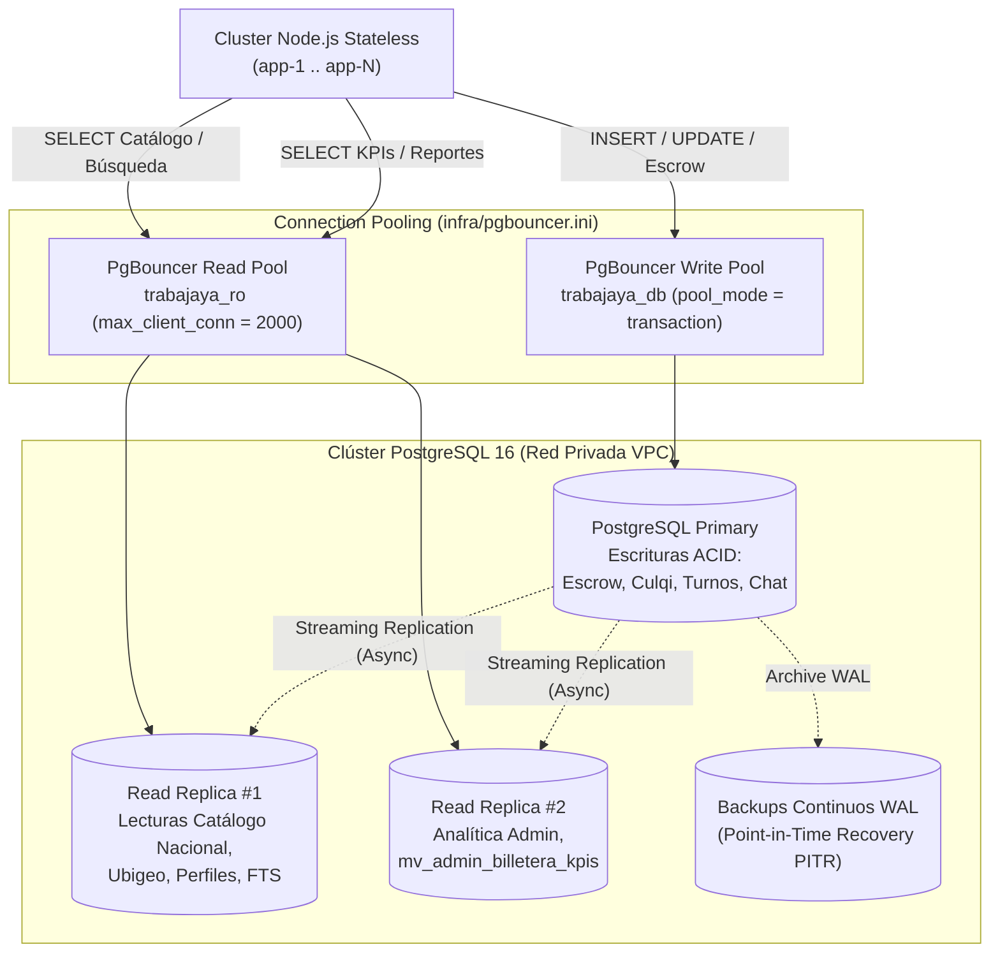

# Paso 9 — Escalabilidad de Base de Datos (PostgreSQL 16, Índices, Particionamiento y Réplicas)

> **Proyecto:** TrabajaYa Perú (`conectaoficios`)  
> **Artefactos SQL/Infra Reales Creados:** [`database/01_schema.sql`](../../database/01_schema.sql), [`database/02_indexes_and_scalability.sql`](../../database/02_indexes_and_scalability.sql), [`database/03_seed_data.sql`](../../database/03_seed_data.sql) e [`infra/pgbouncer.ini`](../../infra/pgbouncer.ini).

---

## 1. Evolución de la Persistencia: Prototipo vs. Producción Escalable

| Dimensión | Fase Prototipo Actual | Fase Producción Escalable (PostgreSQL 16) |
| :--- | :--- | :--- |
| **Motor de Datos** | `localStorage` (10 claves `conecta_*_pe_v2`) + archivos `.data/*.json` en servidor. | **PostgreSQL 16** (Primary + Read Replicas) + **PgBouncer** + **Redis 7**. |
| **Integridad Financiera** | Cálculos en memoria cliente/servidor. | **Transacciones ACID**, columnas generadas (`garantia_monto`, `tarifa_cliente`, `amount_soles`) y `CHECK` constraints estrictos. |
| **Invariante Admin Único** | Sanitización en hidratación de `ConectaContext.tsx`. | **Índice único parcial en SQL:** `CREATE UNIQUE INDEX uq_single_admin_only ON users(permiso) WHERE permiso = 'ADMIN'`. |
| **Concurrencia de Turnos** | Resta directa en estado React. | **`sp_reservar_turno_atomico`** con `SELECT ... FOR UPDATE` (bloqueo pesimista a nivel de fila) + candado distribuido Redis. |
| **Archivos Pesados** | DataURL comprimido / `ObjectURL`. | **Object Storage (S3/GCS)** guardando solo claves (`*_key`) en `compliance_dossiers` y URLs CDN en `work_photos`. |

---

## 2. Topología Escalable de Datos (CQRS Read/Write Split + PgBouncer)

---

## 3. Estrategias de Optimización y Escalabilidad Implementadas en SQL

### 3.1 Indexación Estratégica (`database/02_indexes_and_scalability.sql`)
1. **Índice Compuesto Parcial del Catálogo (`idx_services_catalogo_aprobado`):**
   - Cubre `(oficio, region, provincia, distrito, sello_verificado_pro DESC, destacado DESC, calificacion DESC) WHERE estado_publicacion = 'APROBADO'`.
   - Permite resolver el filtro combinado más frecuente (oficio + Ubigeo + orden `PRO > DESTACADO > BASICO`) en un solo *Index Scan* (`< 15 ms` con `> 100,000` servicios).
2. **Búsqueda Textual en Español (`idx_services_fts_es`):**
   - Índice **GIN** con `to_tsvector('spanish', titulo || descripcion || tecnico_nombre)` y extensión `pg_trgm`, evitando *Sequential Scans* con `LIKE '%texto%'`.
3. **Índices Parciales de Colas Operativas:**
   - `idx_services_moderacion_pendiente` (`WHERE estado_publicacion = 'PENDIENTE_APROBACION'`),
   - `idx_imprevistos_abiertos_ubigeo` (`WHERE estado = 'ABIERTO'`),
   - `idx_orders_activas_escrow` (`WHERE estado <> 'CONFORMIDAD_Y_LIBERADO'`).
   - Al indexar solo filas activas (un pequeño porcentaje del histórico total), los índices permanecen compactos en memoria RAM (`shared_buffers`).

### 3.2 Particionamiento Declarativo (`PARTITION BY RANGE`)
- Tablas de auditoría y eventos de alto crecimiento (`audit_events_partitioned` — y aplicable a `chat_messages` / `dispatch_logs` al superar 10M de filas) se particionan **por mes (`created_at`)**.
- **Beneficios:** *Partition Pruning* automático en consultas recientes, `VACUUM` rápido por partición y archivado en frío mediante `DETACH PARTITION` sin bloqueos de tabla.

### 3.3 Vista Materializada para Analítica Financiera (`mv_admin_billetera_kpis`)
- Precalcula los 6 indicadores de `billeteraTecnico` (`fondos_liberados`, `fondos_en_custodia`, `fondo_garantia`, `total_contratos`, `ingresos_publicaciones`, `ingresos_imprevistos`).
- Con el índice único `uq_mv_admin_billetera_kpis`, se refresca sin bloquear lecturas mediante `REFRESH MATERIALIZED VIEW CONCURRENTLY mv_admin_billetera_kpis` cada 1–5 minutos o tras cada liberación Escrow.

### 3.4 Control de Concurrencia en Reservas (`sp_reservar_turno_atomico`)
- Usa `SELECT turnos_libres ... FOR UPDATE` dentro de una transacción ACID para impedir que dos clientes reserven simultáneamente el último turno libre de un técnico.

### 3.5 Connection Pooling (`infra/pgbouncer.ini`)
- PostgreSQL penaliza abrir miles de conexiones nativas por memoria por proceso. **PgBouncer** en `pool_mode = transaction` multiplexa hasta **2,000 conexiones de clientes Node.js** sobre **40 conexiones reales** al motor PostgreSQL.

---

## 4. Plan de Crecimiento y Sharding Geográfico (Horizonte Nacional)

| Etapa | Volumen Estimado | Arquitectura de Base de Datos |
| :--- | :--- | :--- |
| **Etapa 1** | `< 50K` usuarios · `< 200K` órdenes | 1 PostgreSQL Primary + PgBouncer + índices parciales + Redis caché. |
| **Etapa 2** | `50K – 500K` usuarios · `2M` órdenes | Primary + 2 Read Replicas (CQRS) + particionamiento mensual de chat/auditoría/órdenes. |
| **Etapa 3** | `> 500K` usuarios · cobertura masiva | Sharding lógico con **Citus / PostgreSQL** por **Macro-Región del Perú** (`Lima-Callao`, `Norte`, `Centro-Oriente`, `Sur`) manteniendo replicación de tablas catálogo (`publication_plans`, `allowed_emails`). |

---

## 5. Estrategia de Respaldo y Recuperación ante Desastres (RPO / RTO)

- **Backups diarios automáticos** (`pg_basebackup`) + archivado continuo de **WAL** hacia almacenamiento cifrado en región distinta.
- **RPO (*Recovery Point Objective*):** `< 5 minutos` (mediante PITR — *Point-in-Time Recovery*).
- **RTO (*Recovery Time Objective*):** `< 15 minutos` (promoción automática de Read Replica a Primary vía Patroni / Cloud SQL HA).
