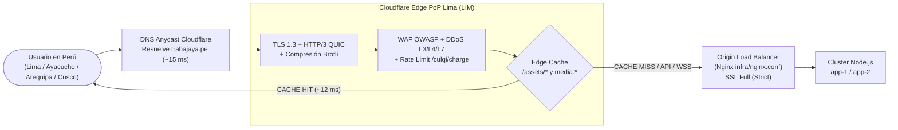

# Paso 10 — Configuración de Dominio, Subdominios, DNS y CDN

> **Proyecto:** TrabajaYa Perú (`conectaoficios`)  
> **Dominio Propuesto:** `trabajaya.pe` (NIC Perú — `.pe`)  
> **Proveedor DNS + CDN + WAF:** **Cloudflare** (con nodo Edge local **PoP Lima — `LIM`** para baja latencia en las 25 regiones del Perú).  
> **Archivo de Zona DNS:** [`infra/dns-zone-trabajaya.pe.txt`](../../infra/dns-zone-trabajaya.pe.txt).

---

## 1. Arquitectura de Dominio y Subdominios

| Dominio / Subdominio | Propósito Funcional | Modo CDN | Política de Caché |
| :--- | :--- | :---: | :--- |
| **`trabajaya.pe`** *(Apex)* | SPA principal React 19 (`index.html` + chunks `dist/assets/*`). | Proxied (Naranja) | `/assets/*`: `1 año (immutable)` · `/index.html`: `Bypass` |
| **`www.trabajaya.pe`** | Alias de marca; redirección permanente **HTTP 301** hacia `https://trabajaya.pe` para consolidar SEO y cookies. | Proxied (Naranja) | Redirect Rule en Edge |
| **`api.trabajaya.pe`** | Endpoints REST (`/api/health`, `/api/payments/culqi/*`, `/api/chat/*`, `/api/notifications/dispatch-order`) y **WebSocket `/ws/chat`**. | Proxied (Naranja) + WS ON | Bypass en Edge (caché gestionada en backend — Paso 11) |
| **`media.trabajaya.pe`** | Bucket público de imágenes (`fotosTrabajos`, imágenes optimizadas de servicios). | Proxied (Naranja) | `Cache Everything` (Edge TTL 30 días + WebP/AVIF) |
| **`staging.trabajaya.pe`** | Ambiente de preproducción/QA desplegado por CI/CD antes de producción. | Proxied + Zero Trust | Restringido por Cloudflare Access |

---

## 2. Flujo de Resolución DNS, CDN y Seguridad Perimetral



---

## 3. Configuración Completa de Registros DNS (`infra/dns-zone-trabajaya.pe.txt`)

| Tipo | Nombre | Destino / Valor | TTL | Proxy | Justificación Arquitectónica |
| :---: | :--- | :--- | :---: | :---: | :--- |
| `A` | `@` | `203.0.113.10` | `300s` | 🟠 Sí | Apunta el dominio raíz al Load Balancer IPv4 ocultando la IP real del origen. |
| `AAAA` | `@` | `2001:db8:1::10` | `300s` | 🟠 Sí | Soporte nativo IPv6 para operadores móviles peruanos (Claro, Movistar, Entel, Bitel). |
| `CNAME` | `www` | `trabajaya.pe` | `300s` | 🟠 Sí | Normalización hacia dominio canónico mediante Redirect Rule 301. |
| `CNAME` | `api` | `trabajaya.pe` | `300s` | 🟠 Sí | Punto de entrada dedicado para API REST y túnel `wss://api.trabajaya.pe/ws/chat`. |
| `CNAME` | `media` | `cdn-bucket.r2.dev` | `300s` | 🟠 Sí | Descarga el 100% del tráfico de imágenes del servidor Node.js hacia Edge CDN. |
| `A` | `staging` | `203.0.113.20` | `300s` | 🟠 Sí | Validación previa a producción protegida con autenticación Zero Trust. |
| `MX` | `@` | `aspmx.l.google.com` (`10`) | `3600s` | ⚪ No | Recepción corporativa de correos (`admin@trabajaya.pe`, soporte). |
| `TXT` | `@` | `v=spf1 include:_spf.google.com ~all` | `3600s` | ⚪ No | **SPF:** autoriza el servidor SMTP usado por `nodemailer` en `server.ts` para enviar solicitudes de órdenes sin caer en SPAM. |
| `TXT` | `google._domainkey` | `v=DKIM1; k=rsa; p=...` | `3600s` | ⚪ No | **DKIM:** firma criptográfica de correos automáticos de despacho. |
| `TXT` | `_dmarc` | `v=DMARC1; p=quarantine; rua=...` | `3600s` | ⚪ No | **DMARC:** protege el dominio contra suplantación (*phishing*) a clientes y técnicos. |
| `CAA` | `@` | `0 issue "letsencrypt.org"` / `"pki.goog"` | `3600s` | ⚪ No | Restringe qué autoridades pueden emitir certificados SSL para `trabajaya.pe`. |

---

## 4. Configuración de SSL/TLS, Rendimiento CDN y Reglas WAF

### 4.1 Seguridad de Transporte (SSL/TLS)
- **Modo SSL/TLS:** **`Full (Strict)`** — cifra extremo a extremo (Navegador ↔ Cloudflare con TLS 1.3; Cloudflare ↔ Nginx Origin con certificado **Cloudflare Origin CA** válido por 15 años).
- **Always Use HTTPS:** Activado (redirección automática HTTP 80 → HTTPS 443).
- **HSTS:** `Strict-Transport-Security: max-age=31536000; includeSubDomains; preload`.
- **Protocolos Modernos:** **HTTP/2**, **HTTP/3 (QUIC)**, **0-RTT** y **WebSockets** activados en el panel de Red.

### 4.2 Reglas de Caché CDN (*Cache Rules*)
1. **Regla 1 — Chunks Inmutables de Vite (`/assets/*`):**
   - Condición: `http.request.uri.path starts_with "/assets/"`.
   - Acción: *Eligible for cache*, Edge TTL `1 year`, Browser TTL respetar origen (`max-age=31536000, immutable`), compresión **Brotli (`br`)** automática.
2. **Regla 2 — Punto de Entrada SPA (`/` y `/index.html`):**
   - Acción: *Bypass Cache* para asegurar que cada despliegue CI/CD entregue los nuevos hashes de `vite build` inmediatamente.
3. **Regla 3 — API Dinámica y WebSocket (`/api/*` y `/ws/chat`):**
   - Acción: *Bypass Cache* en Edge (las respuestas estables como `/api/payments/culqi/config` se aceleran desde la caché de aplicación implementada en el Paso 11).

### 4.3 Protección WAF (Web Application Firewall)
- **OWASP Managed Ruleset:** bloqueo automático de inyecciones SQL, XSS y escaneos automatizados.
- **Regla Custom Anti-Carding (Culqi):** limitar `POST /api/payments/culqi/charge` a máximo **10 peticiones por minuto por IP** (acción `Managed Challenge` / `Block`), protegiendo el comercio contra pruebas fraudulentas de tarjetas.
- **Protección de Despacho:** limitar `POST /api/notifications/dispatch-order` para evitar abuso de cuota SMTP y WhatsApp Cloud API.

---

## 5. Comandos de Verificación en Despliegue

```bash
# 1. Verificar resolución DNS (A, CNAME, SPF, DMARC, CAA)
dig +short trabajaya.pe A
dig +short trabajaya.pe TXT
dig +short _dmarc.trabajaya.pe TXT
dig +short trabajaya.pe CAA

# 2. Verificar TLS 1.3, HSTS, Brotli y Cache HIT en assets estáticos
curl -I https://trabajaya.pe/assets/vendor-react-*.js
# Esperado: HTTP/2 200 | cf-cache-status: HIT | content-encoding: br | cache-control: public, max-age=31536000, immutable

# 3. Verificar Bypass en API y Healthcheck
curl -I https://api.trabajaya.pe/api/health
# Esperado: HTTP/2 200 | cf-cache-status: DYNAMIC | x-instance-id: app-1
```
