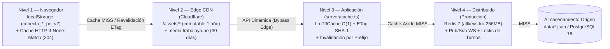

# Paso 11 — Implementación de Caché (Multi-Nivel: Navegador, CDN, LRU/TTL en Backend y Redis)

> **Proyecto:** TrabajaYa Perú (`conectaoficios`)  
> **Implementación Real en Código:** [`server/cache.ts`](../../server/cache.ts), [`server.ts`](../../server.ts), [`tests/unit/cache.test.ts`](../../tests/unit/cache.test.ts) y [`tests/integration/server.api.test.ts`](../../tests/integration/server.api.test.ts).  
> **Verificación:** **36/36 pruebas aprobadas** (`cache.test.ts` + prueba de integración HTTP `X-Cache`, `ETag`/`304` e invalidación).

---

## 1. Arquitectura de Caché Multi-Nivel (4 Capas)

---

## 2. Diseño e Implementación del Motor de Caché (`server/cache.ts`)

Se implementó el puerto **`CacheStore`** siguiendo Clean Architecture para desacoplar los endpoints de `server.ts` del motor subyacente:

- **Clase `LruTtlCache` (O(1) con `Map` nativo de JavaScript):**
  - **Política LRU (*Least Recently Used*):** cada lectura (`get`) reubica la clave al final del `Map`; cuando `store.size >= maxEntries` (`CACHE_MAX_ENTRIES`, default `500`), expulsa la clave menos usada (`store.keys().next().value`) e incrementa `evictions`.
  - **Expiración por TTL:** verifica `Date.now() >= entry.expiresAt` eliminando entradas vencidas de forma perezosa y contabilizando `misses`.
  - **Generación de `ETag` débil (RFC 9110):** calcula `W/"<sha1-16hex>"` del payload serializado para habilitar ahorro de ancho de banda mediante **`304 Not Modified`**.
  - **Invalidación Selectiva y por Prefijo:** `del(key)` e `invalidateByPrefix(prefix)` mantienen consistencia fuerte tras escrituras.
  - **Observabilidad:** expone `stats()` con `{ size, maxEntries, hits, misses, sets, invalidations, evictions, hitRatio }`.

---

## 3. Estrategia Cache-Aside, TTL e Invalidación por Endpoint (`server.ts`)

| Endpoint | Clave de Caché | TTL | Cabeceras HTTP | Eventos de Invalidación |
| :--- | :--- | :---: | :--- | :--- |
| `GET /api/payments/culqi/config` | `culqi:config` | `60 s` | `X-Cache: HIT\|MISS`, `Cache-Control: public, max-age=60`, `ETag` (`304`) | Expiración TTL (configuración casi estática). |
| `GET /api/payments/culqi/transactions` | `culqi:transactions` | `30 s` | `X-Cache: HIT\|MISS`, `Cache-Control: private, max-age=30`, `ETag` (`304`) | **`cache.del('culqi:transactions')`** en `POST /api/payments/culqi/charge` (live y sandbox). |
| `GET /api/chat/conversations` | `chat:conv:{role}:{userId}:{dni}:{tel}` | `15 s` | `X-Cache: HIT\|MISS`, `Cache-Control: private, max-age=15`, `ETag` (`304`) | **`cache.invalidateByPrefix('chat:conv:')`** en `POST /ensure`, `POST /messages`, `POST /dispatch-order` y WS `chat:send`. |
| `GET /api/cache/stats` | *(sin caché)* | `0 s` | `Cache-Control: no-store` | Métricas en vivo para monitoreo y sustentación. |
| `GET /assets/*` (producción) | Hash de Vite | `365 días` | `Cache-Control: public, max-age=31536000, immutable` | Cambio automático de hash en `npm run build`. |
| `GET /index.html` (producción) | *(sin caché)* | `0 s` | `Cache-Control: no-cache, no-store, must-revalidate` | Siempre entrega la versión vigente de la SPA. |

---

## 4. Transición a Redis Distribuido en Clúster Multi-Réplica

En `docker-compose.yml` ya está aprovisionado **Redis 7** (`--maxmemory 256mb --maxmemory-policy allkeys-lru`). Para escalar a `N` réplicas (`app-1 .. app-N`), el adaptador `RedisCacheStore` implementa el mismo puerto `CacheStore`:
- **Catálogo Nacional:** `catalog:approved:{oficio}:{region}:{provincia}:{distrito}` (TTL `60 s`, invalidado al ejecutar `admitirPublicacion` / `rechazarPublicacion` / `editarMiPublicacion`).
- **Candados Distribuidos de Turnos:** `SET lock:service:{id} {token} NX PX 5000` antes de ejecutar `sp_reservar_turno_atomico` en PostgreSQL.
- **Backplane WebSocket:** canal Pub/Sub `trabajaya:chat:events` sincronizando eventos `chat:message` entre todas las réplicas.

---

## 5. Evidencia Real de Verificación Automatizada

Ejecución verificada con `npm test` (Vitest + Supertest):
- `tests/unit/cache.test.ts` (**4/4 aprobadas**): valida `MISS → HIT`, formato `ETag`, cálculo exacto de `hitRatio`, expiración por TTL (`vi.useFakeTimers()`), expulsión LRU al llenar capacidad e invalidación selectiva por prefijo.
- `tests/integration/server.api.test.ts` (**9/9 aprobadas**): valida `X-Cache: HIT` en `/api/payments/culqi/config`, respuesta **`304 Not Modified`** al enviar `If-None-Match`, invalidación inmediata (`HIT → POST /charge → MISS`) en `/api/payments/culqi/transactions` y métricas reales en `GET /api/cache/stats`.
