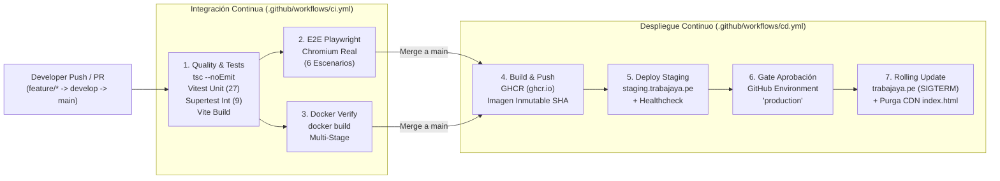

# Paso 12 — Integración Continua y Despliegue Continuo (CI/CD con GitHub Actions)

> **Proyecto:** TrabajaYa Perú (`conectaoficios`)  
> **Pipelines Reales Implementados:** [`.github/workflows/ci.yml`](../../.github/workflows/ci.yml) y [`.github/workflows/cd.yml`](../../.github/workflows/cd.yml).

---

## 1. Flujo Completo del Pipeline CI/CD

---

## 2. Estrategia de Ramas y Protección (*Branching Strategy*)

| Rama | Regla de Protección | Disparador Automático |
| :--- | :--- | :--- |
| `feature/*`, `fix/*` | Trabajo diario trazado a tareas SDD (`docs/sdd/05-*`). | Pull Request hacia `develop` ejecuta `ci.yml`. |
| `develop` | Requiere `quality-and-tests`, `e2e-playwright` y `docker-verify` en verde. | Integración de features aprobadas. |
| `main` | Prohibido push directo; requiere PR aprobado + CI 100% verde. | Dispara `cd.yml` → GHCR → Staging → Gate manual → Producción. |
| `v*.*.*` *(Tags)* | Etiquetas SemVer de release (`v1.0.0`). | Genera imagen versionada y release trazable. |

---

## 3. Gestión Segura de Secretos (GitHub Environments)

Ninguna credencial reside en el repositorio (`.gitignore` excluye `.env` y `.env.local`). Los secretos se inyectan por ambiente (`staging` vs. `production`):

| Secreto / Variable | Ambiente | Uso |
| :--- | :---: | :--- |
| `CULQI_PUBLIC_KEY` / `CULQI_SECRET_KEY` | Staging (`pk_test_*`) / Prod (`pk_live_*`) | Pasarela Culqi v4/v2 en `server.ts`. |
| `DATABASE_URL` / `REDIS_URL` | Staging / Producción | Conexión cifrada a PostgreSQL (PgBouncer) y Redis. |
| `SMTP_USER` / `SMTP_PASS` / `WHATSAPP_ACCESS_TOKEN` | Producción | Despacho automático en 3 canales (`POST /api/notifications/dispatch-order`). |
| `DEPLOY_WEBHOOK_STAGING` / `DEPLOY_WEBHOOK_PROD` | Staging / Producción | Gatillo de despliegue del contenedor inmutable. |
| `CLOUDFLARE_ZONE_ID` / `CLOUDFLARE_API_TOKEN` | Producción | Purga selectiva de `index.html` tras cada release manteniendo los `/assets/*` cacheados. |

---

## 4. Estrategia de Despliegue *Zero-Downtime* y Rollback

1. **Rolling Update + Graceful Shutdown:** Al desplegar una nueva imagen, el orquestador levanta primero la nueva réplica, valida `GET /api/health` (`200 OK`) y recién envía `SIGTERM` a la réplica anterior. El manejador implementado en `server.ts` cierra los sockets `/ws/chat` con código `1001` (provocando la reconexión automática del cliente en `2500ms`) y drena las solicitudes HTTP activas antes de finalizar.
2. **Rollback en < 60 segundos:** Dado que cada build genera una imagen inmutable `ghcr.io/<org>/conectaoficios:sha-<commit>`, revertir un fallo consiste en redesplegar la etiqueta SHA anterior sin recompilar código.
